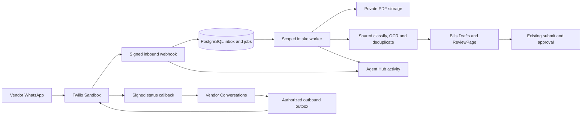

# WhatsApp Agent technical design

**Status:** Proposed · **Scope:** New WhatsApp channel, shared vendor bill workflow

See the [product requirements](whatsapp-agent-prd.md) for release scope and acceptance. Proposed paths, schema and SLOs below are implementation targets.

## Integration points

| Existing code | Change |
|---|---|
| [Vendor Bill Agent router](../../../backend_ocr/app/routers/agent.py) | Extract shared classification, OCR, invoice comparison and draft persistence behind a channel-neutral service. Keep email scan and its public API compatible |
| [Email connection and vendor inbox](../../../backend_ocr/app/routers/email_connection.py) | Reuse authorization patterns and vendor conversation actions. Add a Twilio adapter and channel-aware conversation queries |
| [Agent client](../../../frontend/src/api/agent.ts) and [Agent Hub](../../../frontend/src/pages/AgentHubPage.tsx) | Add channel selector and WhatsApp connection, watch list, activity, retry and counters. Replace scan-specific copy on the WhatsApp view |
| [Bills](../../../frontend/src/pages/BillsPage.tsx) and [app routing](../../../frontend/src/App.tsx) | Add source badge and channel metadata to the shared draft handoff. Preserve the PDF preview and review form |
| [Service registry](../../../backend_ocr/app/security/services.py) and [licensing rules](../../../backend_ocr/app/security/licensing.py) | Add default-off `whatsapp_agent` entitlement alongside `agent_hub`. Add route map coverage and enforce tenant/brand capabilities on reads and writes |

## Application flow

### Webhook and routing

1. Receive Twilio form POST at `/api/webhooks/twilio/whatsapp/{connection_key}/inbound`. Use the opaque key solely to look up a single tenant/brand connection and its token reference. Verify `X-Twilio-Signature` with the Twilio SDK, using the exact configured public URL and all form values. Preserve multi-valued fields and avoid reconstructing the URL from untrusted proxy headers.
2. Verify configured Account SID, destination WhatsApp address and active connection. Normalize the inbound WhatsApp sender to E.164. A Sandbox webhook and Twilio account/sender pairing belong to one workspace scope. Give each parallel pilot its own isolated provider configuration or test serially. Never choose tenant or brand from sender text, an invoice or a client-supplied identifier.
3. In one transaction insert the normalized inbound event and an eligible durable work item. Deduplicate by connection and Message SID. Respond with empty TwiML only after the database commit. Return a transient error on persistence failure and monitor provider failures. Validate retry behavior with the actual configured Twilio webhook policy and test recovery using retained provider message records where available.
4. Apply license, runtime pause, watch flag and contact scope again before fetching media or using OCR. Quarantine ambiguous matches. Keep minimal event metadata for unwatched numbers and avoid retrieving their media. Acknowledge authenticated paused traffic with a visible disposition and retain only configured pilot evidence.

Use `AccountSid`, `MessageSid`, `From`, `To`, `Body`, `NumMedia` and indexed media parameters. Treat all fields as provider data even after verification. [Twilio signature validation](https://www.twilio.com/docs/usage/webhooks/webhooks-security) · [Messaging webhook request fields](https://www.twilio.com/docs/messaging/guides/webhook-request)

### Media, workers and invoice decisions

- Claim jobs with database row locks and expiring leases. Use a lease token to fence final writes, bounded retries with backoff for transient failures, and a terminal state for persistent failures. Refresh invokes a rate-limited drain of eligible work in the selected scope. It never scans a personal WhatsApp inbox.
- Fetch media server-side using provider credentials and documented Twilio media endpoints. Validate allowed hosts and redirect destinations, never forward credentials to a different origin, enforce streaming size/time limits and inspect file signatures. Use the existing supported PDF limits and private storage patterns. Discard generated temp files and prevent documents from becoming public URLs. [Twilio Media resource](https://www.twilio.com/docs/messaging/api/media-resource)
- Use the same bill classification and OCR payload contract as email. PDFs with an empty caption go through document-based classification. Apply confidence and completeness gates. Classifier failure becomes a retryable or reviewable outcome, with no default assumption that a missing result is a bill.
- Use a conversation key based on connection and scoped contact for timeline display. WhatsApp conversations can contain many invoices. Scope candidate invoices by tenant, brand and vendor, then prioritize explicit references, secure attachment hashes, normalized invoice identity and material invoice differences. Exact document replays are duplicate evidence. Ambiguous corrections go to review. Never infer replacement from contact history alone.
- Cross-channel comparison must consider both pending drafts and posted invoices. Serialize shared draft decisions under a scoped invoice identity or document fingerprint. Recheck candidates inside the transaction after acquiring the lock so simultaneous email and WhatsApp arrivals cannot both create an effective draft. Material corrections remain reviewable with an explicit prior reference.
- Persist job result, event and draft provenance atomically where they share PostgreSQL. Use deterministic private object keys and reconcile orphaned objects when object writes succeed before database failures. Link bill ingest to a draft idempotency key so a lost response or repeated submission resolves to the same bill.

## Proposed storage and API

Each resource carries tenant and brand where applicable. Foreign-key ownership and server-side query filters must agree. Use an explicit brand scope on pilot connections.

| Record | Invariants |
|---|---|
| `whatsapp_connections` | Opaque public connection key, tenant/brand, account and sender binding, encrypted secret reference, active state, inbound and outbound switches. Enforce one active binding for each provider account/sender tuple |
| `whatsapp_contact_watches` | Scoped vendor/contact, E.164 identity, watch flag, consent and verification metadata. Reject or quarantine conflicting active mappings |
| `whatsapp_messages` | Unique connection + Message SID when known. Direction, conversation, receipt time, outcome, provider status and minimal content. Outbound also has a unique scoped client operation key |
| `whatsapp_media_jobs` | Unique inbound message + media index, retry state, lease token and stable content hash. Private object reference, failure code and draft link |
| `agent_draft_bills` | Add source channel and normalized provenance, retaining current email fields and defaulting legacy rows to email. Enforce one draft per accepted source item and one submitted bill per draft |
| `whatsapp_status_events` | Correlate callbacks to the scoped outbound operation and provider SID. Deduplicate replayed updates and keep status history independently of the current projection |

Use additive migrations and deploy readers tolerant of missing channel fields before enabling writes. Keep existing email routes and clients functional during rollout.

| Contract | Purpose |
|---|---|
| `GET /api/agent/whatsapp/status`, `GET /api/agent/whatsapp/events` | Scoped health and paginated activity |
| `PUT /api/agent/whatsapp/connection`, `DELETE /api/agent/whatsapp/connection` | Privileged connection provisioning and disablement. Return masked settings |
| `PATCH /api/agent/whatsapp/settings`, `POST /api/agent/whatsapp/refresh` | Pause/resume and request a bounded queue drain |
| `PATCH /api/vendors/{vendor}/contacts/{contact}/whatsapp-watch` | Verify ownership and manage channel watch state |
| Existing `/api/agent/drafts` family | Unified draft list, detail, file, submission and discard with channel provenance and existing access semantics |
| `/api/vendors/{vendor}/whatsapp/conversations` | List/detail, summary, follow-up state, attachment preview/save, manual draft and authorized reply operations |
| `POST /api/webhooks/twilio/whatsapp/{connection_key}/status` | Validate callback and record an idempotent outbound update |

## Outbound messaging and data controls

Bind each reply to a verified contact, authorized vendor and active sender. Store explicit opt-in and honor opt-out in the final worker check before send. Use the latest qualifying inbound timestamp to determine whether free-form messaging is allowed. Outside the customer service window, require an eligible approved template. In Sandbox restrict recipients and templates to the configured pilot capabilities. Never promise custom outbound sends until confirmed on the trial account. [Twilio Sandbox](https://www.twilio.com/docs/whatsapp/sandbox)

Use a durable outbox and create the message through Twilio after authorization. Track accepted, delivered, read when reported, failed and unknown separately. Deduplicate callbacks and prevent out-of-order callbacks from regressing terminal status. A provider timeout after an attempt can mean the send succeeded. Mark it unknown, correlate later callbacks or provider records, and require reconciliation before retrying. [Twilio delivery status](https://www.twilio.com/docs/messaging/guides/track-outbound-message-status)

Store tokens through the existing secret-management pattern. Keep identifiers, message content and OCR payload out of routine logs. Limit preview and download to scoped users. Apply workspace retention and deletion rules to inbox data, originals, duplicates, backups and provider-side copies where supported. Treat chat and OCR text as untrusted model inputs. Keep classification and summary output schema-bound and prevent it from triggering money movement or record changes.

## Build, verify and operate

1. **Foundation.** Add the default-off license, migrations, provider adapter and verified webhook. Use signed fixtures and synthetic files. Validate reverse-proxy URL behavior and account/sender mismatches.
2. **Inbound vertical slice.** Reuse OCR and drafts, then add Agent Hub and Vendor Contacts controls. Test concurrent webhook delivery, expired claims, repeated Submit, malformed/oversize media, partial storage failures, and cross-channel duplicates/corrections.
3. **Communications parity.** Add vendor timeline, media actions, draft from evidence, summaries, thread state, reply outbox and callbacks. Verify unauthorized file access, consent, expiry, unknown send outcomes and out-of-order delivery events.
4. **Sandbox UAT.** Activate the Sandbox, record remaining trial units, configure public HTTPS inbound/status URLs, and have a test contact join. Run end-to-end cases in Chromium through Agent Hub and Bills. Use mocks for failure, concurrency and load tests. Run an isolation scenario with two tenants and two brands, including selected-brand switches and license revocation.
5. **Pilot release.** Target P95 webhook acknowledgement under two seconds and P95 accepted-to-draft under two minutes on a representative test set. Monitor oldest queued job, retries, inbound rejection reasons, latency, duplicate decisions, outbound unknown status and trial quota. Alert on queue backlog and missing expected test events. Pause inbound processing and outbound independently for rollback. Retain authorized drafts and audit records.
6. **Production gate.** Prove dedicated sender registration, consent/template operations, ownership and routing, retention and spending controls before enabling real traffic. A change from Sandbox to production creates a new connection and leaves prior test history isolated.
