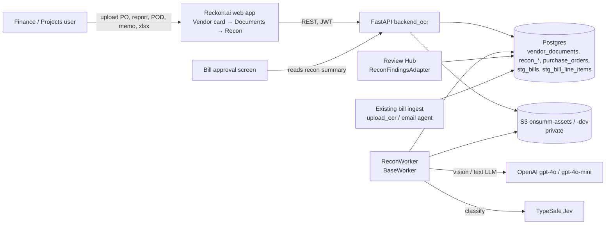
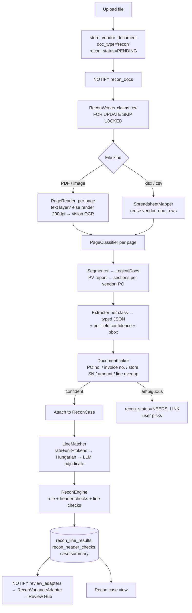
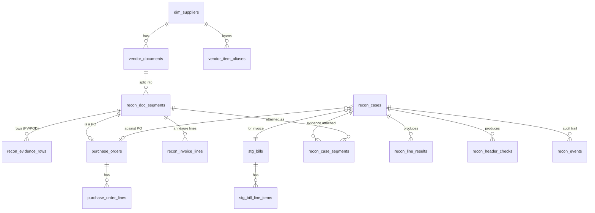

# 01 · High-Level Design: Bata Recon

## 1. Problem and goal

**Problem.** Bata's finance team pays capex vendors (store fit-out, AC/AHU, furniture, signage,
lights) against three kinds of paper:

- a **PO**: an estimate, pre-tax;
- a **tax invoice**: the claim;
- **on-ground evidence**: an auditor's physical-verification report, or a POD.

Today a person reads all three side by side, often with handwritten quantities, and decides what
to pay.

**Goal.** A user drops any of these documents into a vendor's **Documents → Recon** section. The
system then:

1. works out what each document is, even across several pages and several vendors in one file;
2. reads it, including scans and handwriting;
3. links it to the right invoice and PO;
4. maps line items whose names differ across documents;
5. applies Bata's billing rule;
6. shows every difference line by line, with money at risk.

**Non-goals for v1:**

- auto-correcting or rejecting bills;
- creating POs in the ERP;
- routing report sections to *other* vendors' cards (that is Phase 5);
- bank reconciliation.

## 2. Context

## 3. Components

| # | Component | Kind | New / reused | Responsibility |
|---|---|---|---|---|
| C1 | `VendorDocuments.tsx` → **Recon section** | React | extend | Upload zone, case list, case view |
| C2 | `routers/recon.py` | FastAPI router | **new** | Upload, list, case read, link/unlink, override match, acknowledge, re-run, export |
| C3 | `store_vendor_document()` | function | reuse | Saves to S3, inserts the `vendor_documents` row |
| C4 | `recon/worker.py` **ReconWorker** | `BaseWorker` | **new** | Claims `recon_status='PENDING'` docs and runs the pipeline |
| C5 | `recon/pages.py` **PageReader** | lib | **new** (wraps `ocr_engine`) | Text-layer probe, per-page render, per-page OCR |
| C6 | `recon/classify.py` **PageClassifier** | lib | **new** (reuses Jev + OpenAI clients) | Per-page doc class |
| C7 | `recon/segment.py` **Segmenter** | lib | **new** | Pages → logical documents → report sections |
| C8 | `recon/extract/*` **Extractors** | lib | **new** | Typed JSON per class |
| C9 | `recon/link.py` **DocumentLinker** | lib | **new** | Document → PO / invoice / case |
| C10 | `recon/match.py` **LineMatcher** | lib | **new** (uses rapidfuzz) | PO ↔ invoice ↔ evidence line mapping |
| C11 | `recon/rules.py` + `recon/engine.py` **ReconEngine** | pure lib | **new** | Billing rule, header and line checks, roll-up |
| C12 | `recon/repo.py` **ReconRepository** | DB | **new** | All SQL for recon tables |
| C13 | `review/adapters/recon_variance.py` **ReconVarianceAdapter** | `FindingAdapter` | **new** | Turns 🔴/🟠 results into Review Hub findings |
| C14 | `migrations.py` `_ensure_recon_tables` | DDL | **new** | Tables and columns |

## 4. Pipeline (one uploaded file)

**Recompute triggers.** A case is recomputed, from extraction outputs and never by re-reading
files, whenever:

- a document is attached to or detached from it;
- a match is overridden;
- an evidence cell is corrected;
- the bill is edited.

## 5. Data model (overview)

The full DDL is in [03_LLD_BACKEND.md §2](03_LLD_BACKEND.md#2-database).

**Why the `recon_doc_segments` layer exists.** One file is not one document:

- An invoice PDF holds a tax invoice **plus** an annexure.
- A PV report holds a narrative, plus 6 vendor/PO sheets, plus signed field sheets.

A segment is "one logical document inside a file". Cases link to segments, not files.

## 6. Where the invoice comes from

The invoice already exists as a **bill**, ingested by the existing upload/email pipeline into
`stg_bills` / `stg_bill_line_items`. Recon needs to handle three situations:

| Situation | Handling |
|---|---|
| Bill exists with real line items (Bosch) | Use `stg_bill_line_items` as the invoice lines |
| Bill exists but only has header lines ("Gst Local Sales", 2 lump sums), with the annexure on later pages | Recon extracts the **annexure** from the bill's own file into `recon_invoice_lines`, then ties Σ annexure = bill taxable |
| User uploads the invoice into Recon, and no bill exists | Create a segment of class `tax_invoice`. The case is **orphaned** until the bill is ingested. Show "Add as bill" (calls the existing bill upload). Matching on invoice no. + GSTIN attaches it later |

## 7. Key quality mechanisms

| Risk | Mechanism |
|---|---|
| Handwritten audit qty misread | PO-prompted read, two independent reads, a consistency check against the invoice, cell crop shown, low confidence → `needs_review` |
| Wrong line match | Deterministic scores first, then a one-to-one assignment. The LLM only sees leftovers and its answer passes a numeric guardrail. A human confirms and the confirmed pair becomes an alias |
| Wrong document link | Exact references first. Auto-link only when score ≥ 0.85 **and** margin ≥ 0.15. Otherwise the user picks |
| Silent wrong totals | Totals are always recomputed, never read (Excel `####`, footing errors) |
| Re-processing cost | Extraction is cached per segment (`extracted_json` + `extractor_version`). The engine recomputes from the cache |
| Cost and latency | Text layer first. Vision only for scanned pages. `gpt-4o-mini` for classify/memo/POD, `gpt-4o` for tables and handwriting |

## 8. Non-functional requirements

| | Target |
|---|---|
| Upload → case ready (text-layer PDFs) | < 30 s |
| Upload → case ready (10-page scanned report) | < 3 min (async; the UI shows progress per stage) |
| Memory | One page rendered at a time; ≤ 200 dpi; max 60 pages per recon file (configurable `RECON_MAX_PAGES`) |
| Matching correctness on golden set | 100% of the 4 sample sets ([07_TEST_PLAN.md](07_TEST_PLAN.md)) |
| Handwritten cell accuracy | ≥ 98% auto-accepted correct; the remainder routed to review |
| Isolation | Every query is tenant-scoped; supplier ownership is checked on every route |
| Audit | Every override, acknowledgement and correction is written to `recon_events` |
| Licensing | Gated by `require_service("recon")`. A new licence key; the Bata tenant gets it |

## 9. Rollout

1. A behind-licence feature on `uat2` and the dev DB. Load the 4 sample folders as a demo tenant.
2. Run with Bata on real data, read-only (L1).
3. Phase 5: route store-level report sections to other vendors' cards; accept Excel exports from
   Bata's ERP.
