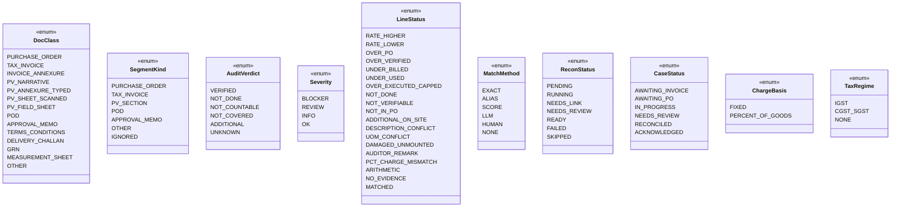
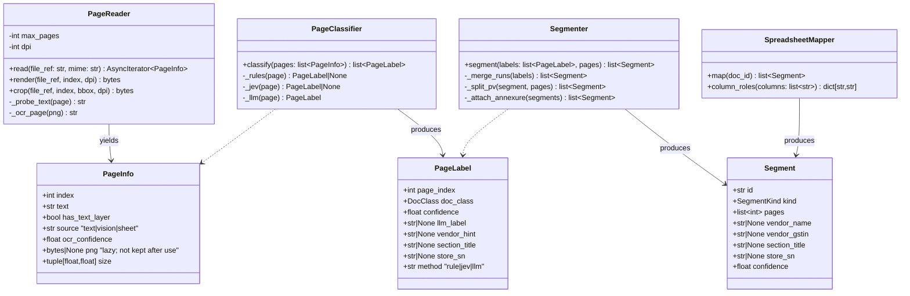
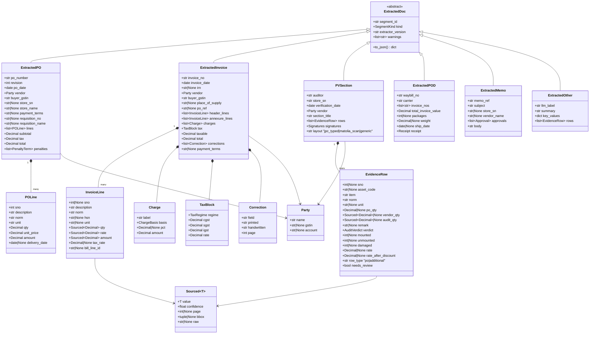
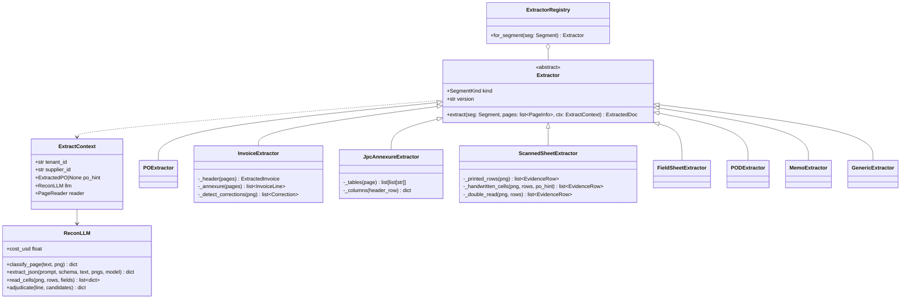
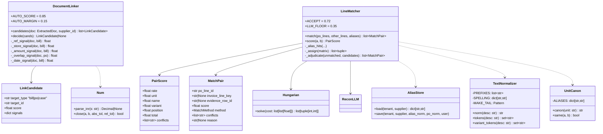
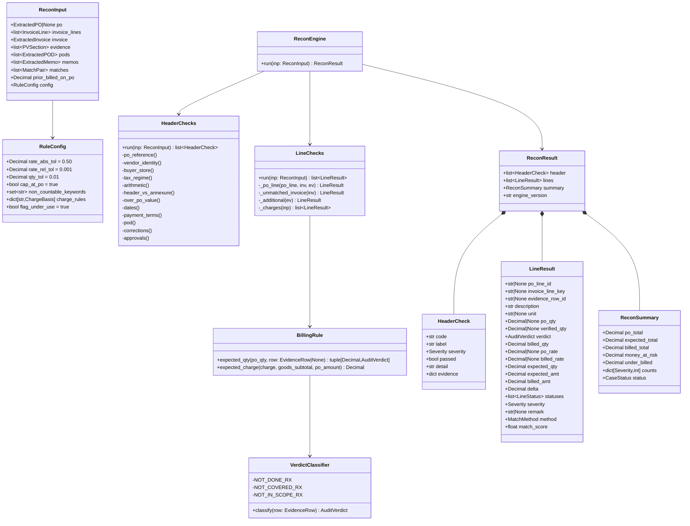
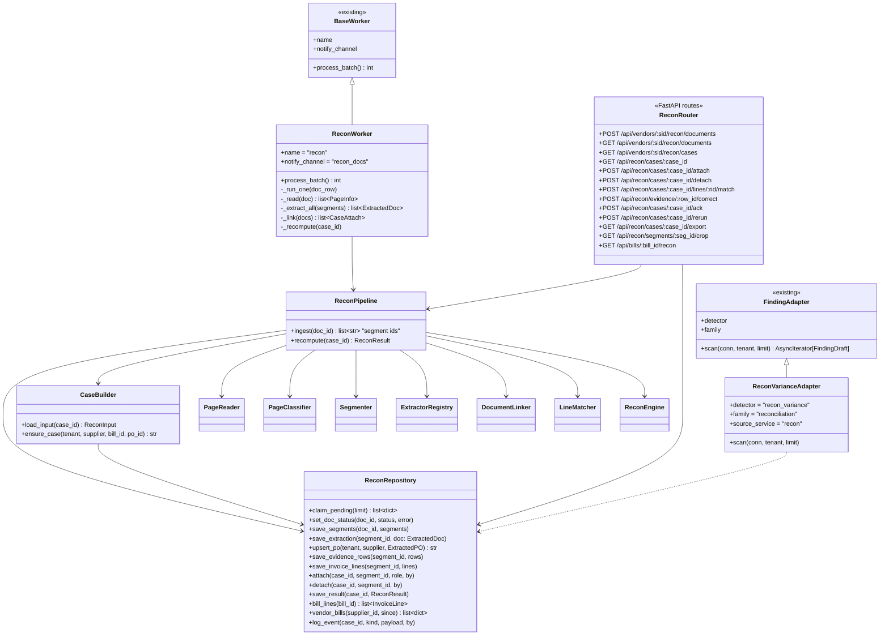
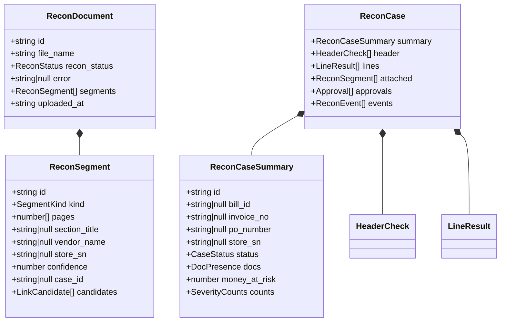
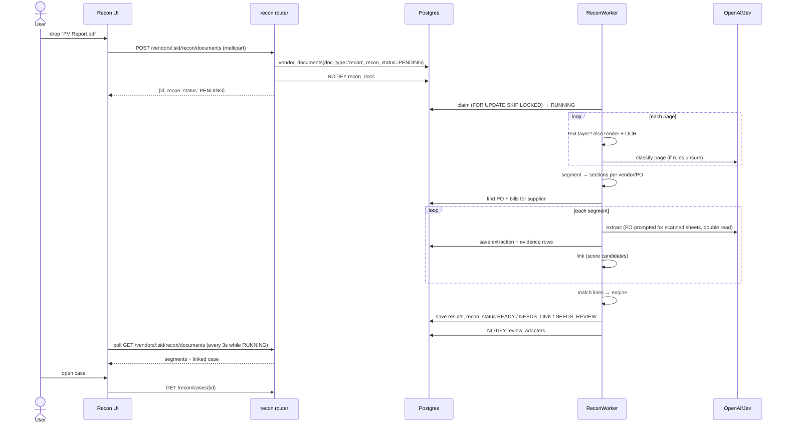

# 02 · Class Diagrams

All backend classes live under `backend_ocr/app/recon/` unless noted otherwise. Value types are
`@dataclass(frozen=True, slots=True)`. Money and quantities use `Decimal`, never `float`.

## 1. Enums

### Vocabulary codes for these enums (2026-11-16)

These enums stay the code's internal names. Their vocabulary codes (`docs/RECON_VOCABULARY.md`) come from **one** mapping in `recon/vocab.py`:

| Enum | Mapping in `recon/vocab.py` | Vocabulary kind |
|---|---|---|
| `DocClass` | `DOC_CLASS_ROLE` | `doc_role` |
| `SegmentKind` | `SEGMENT_KIND_ROLE`, `SEGMENT_KIND_LEG`, `SEGMENT_KIND_GRANULARITY` | `doc_role`, `recon_leg`, `receipt_granularity` |
| `AuditVerdict` | `VERDICT_STATUS` | `verification_status` |
| `LineStatus` | the codes themselves | `recon_line_status` |
| `Severity` | `SEVERITY_OUTCOME` | `recon_outcome` |
| `MatchMethod` | `MATCH_METHOD` | `match_method` |

`TERMS_CONDITIONS`, `OTHER` and `IGNORED` are page or part types with no document role.

## 2. Reading layer: pages, classification, segmentation

## 3. Extraction layer: typed documents

## 4. Normalisation, linking, matching

## 5. Rules and engine (pure, no I/O)

## 6. Orchestration, persistence, API, Review Hub

## 7. Frontend types (TypeScript)

The component tree is in [04_LLD_FRONTEND.md](04_LLD_FRONTEND.md).

## 8. Sequence: one file end to end

