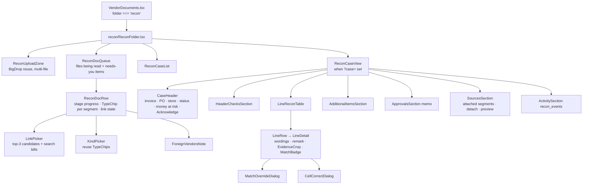

# 04 · Low-Level Design: Frontend

## 1. Placement

The Vendor card's **Documents** panel (`frontend/src/components/vendor/VendorDocuments.tsx`) has
a folder nav: `recent | bills | contracts | t:<label>`. Recon is added there:

- `DocFolder` gains `'recon'`, i.e. `'recent' | 'bills' | 'contracts' | 'recon' | `t:${string}``.
- The folder appears in the nav **only when the tenant has the `recon` service**. Check it the
  same way other licensed UI is gated: `hasService('recon')` from the licence context.
- **Deep link:** `/vendors/:sid?tab=documents&folder=recon&case=:caseId`. Review Hub findings and
  the bill approval screen use it.
- **Bill detail and approval:** a compact `ReconBadge` showing
  `Recon · 1 blocker · ₹1,850 under-billed → open`. It reads `GET /api/bills/{id}/recon`.

**Classification guard in `UploadDialog`.** `guessType()` treats `\bpo[-_ ]` as a contract today.
When the user is inside the Recon folder, `UploadDialog` is bypassed: everything dropped there is
`doc_type='recon'`. Outside Recon, if the existing classifier says
`purchase_order | pv_report | pod`, offer "File under Recon" as the first option.

## 2. Component tree



**Files:**

```
frontend/src/api/recon.ts
frontend/src/components/vendor/recon/
  ReconFolder.tsx  ReconUploadZone.tsx  ReconDocQueue.tsx  ReconDocRow.tsx  LinkPicker.tsx
  ReconCaseList.tsx  ReconCaseView.tsx  HeaderChecksSection.tsx  LineReconTable.tsx  LineDetail.tsx
  MatchOverrideDialog.tsx  CellCorrectDialog.tsx  EvidenceCrop.tsx  ReconBadge.tsx
  reconFormat.ts         # status → label/colour/severity, money fmt (Indian grouping)
  recon.css
  *.test.tsx
```

## 3. API client (`frontend/src/api/recon.ts`)

```ts
export type ReconStatus = 'PENDING'|'RUNNING'|'NEEDS_LINK'|'NEEDS_REVIEW'|'READY'|'FAILED'
export type SegmentKind = 'PURCHASE_ORDER'|'TAX_INVOICE'|'PV_SECTION'|'POD'|'APPROVAL_MEMO'|'OTHER'|'IGNORED'
export type SegmentStatus = 'PENDING'|'EXTRACTED'|'NEEDS_REVIEW'|'LINKED'|'UNLINKED'|'FOREIGN'|'IGNORED'|'FAILED'
export type Severity = 'BLOCKER'|'REVIEW'|'INFO'|'OK'
export type CaseStatus = 'AWAITING_INVOICE'|'AWAITING_PO'|'IN_PROGRESS'|'NEEDS_REVIEW'|'RECONCILED'|'ACKNOWLEDGED'
export type LineStatus = 'RATE_HIGHER'|'RATE_LOWER'|'OVER_PO'|'OVER_VERIFIED'|'UNDER_BILLED'|'UNDER_USED'
  |'OVER_EXECUTED_CAPPED'|'NOT_DONE'|'NOT_VERIFIABLE'|'NOT_IN_PO'|'ADDITIONAL_ON_SITE'|'DESCRIPTION_CONFLICT'
  |'UOM_CONFLICT'|'DAMAGED_UNMOUNTED'|'AUDITOR_REMARK'|'PCT_CHARGE_MISMATCH'|'ARITHMETIC'|'NO_EVIDENCE'|'MATCHED'

export interface LinkCandidate { target_type: 'bill'|'case'|'po'; target_id: string; label: string; score: number; signals: Record<string, number> }
export interface ReconSegment { id: string; kind: SegmentKind; llm_label: string|null; pages: number[]; status: SegmentStatus
  section_title: string|null; vendor_name: string|null; store_sn: string|null; confidence: number
  case_id: string|null; candidates: LinkCandidate[]; needs_review_cells: number; warnings: string[] }
export interface ReconDocument { id: string; file_name: string; recon_status: ReconStatus; recon_stage: string|null
  progress: { page: number; pages: number }|null; error: string|null; uploaded_at: string; duplicate_of: string|null; segments: ReconSegment[] }
export interface HeaderCheck { code: string; label: string; severity: Severity; passed: boolean; detail: string }
export interface LineResult { id: string; ord: number; description: string; invoice_text: string|null; evidence_text: string|null
  unit: string|null; po_qty: string|null; verified_qty: string|null; billed_qty: string; expected_qty: string
  po_rate: string|null; billed_rate: string|null; expected_amt: string; billed_amt: string; delta: string
  verdict: string|null; statuses: LineStatus[]; severity: Severity
  match: { method: 'EXACT'|'ALIAS'|'SCORE'|'LLM'|'HUMAN'|'NONE'; score: number; conflicts: string[] }
  remark: string|null; evidence_crop: { segment_id: string; page: number; bbox: number[] }|null
  evidence_row_id: string|null; needs_review_cell: boolean; reviewed: { by: string; note: string }|null; kind: 'po'|'not_in_po'|'additional'|'charge' }
export interface ReconCaseSummary { id: string; bill_id: string|null; invoice_no: string|null; po_number: string|null; store_sn: string|null
  status: CaseStatus; docs: { po: boolean; invoice: boolean; evidence: number; pod: boolean; memo: boolean }
  po_total: string|null; billed_total: string|null; expected_total: string|null; money_at_risk: string; under_billed: string
  counts: Record<Severity, number>; computed_at: string|null }
export interface ReconCase { summary: ReconCaseSummary; header: HeaderCheck[]; lines: LineResult[]; attached: ReconSegment[]
  approvals: { approver: string; status: string; date: string; remark: string }[]; events: { kind: string; actor: string|null; at: string; payload: unknown }[] }

export const uploadReconDocuments = (sid: string, files: File[], brandId?: string|null) => …   // POST multipart
export const fetchReconDocuments = (sid: string) => …                                         // GET
export const fetchReconCases = (sid: string) => …
export const fetchReconCase = (caseId: string) => …
export const setSegmentKind = (segId: string, kind: SegmentKind) => …
export const linkSegment = (segId: string, target: { bill_id?: string; case_id?: string; po_id?: string }) => …
export const ignoreSegment = (segId: string, reason: string) => …
export const detachSegment = (caseId: string, segId: string) => …
export const overrideMatch = (caseId: string, otherKey: string, poLineId: string|null) => …
export const reviewLine = (resultId: string, note: string) => …
export const correctEvidence = (rowId: string, patch: Partial<{ audit_qty: string; vendor_qty: string; verdict: string; remark: string }>) => …
export const acknowledgeCase = (caseId: string, note: string, force?: boolean) => …
export const rerunCase = (caseId: string, reextract?: boolean) => …
export const reconExportUrl = (caseId: string) => `/api/recon/cases/${caseId}/export?format=xlsx`
export const evidenceCropUrl = (segId: string, page: number, bbox: number[]) => …   // returns 5-min signed URL via redirect
export const fetchBillRecon = (billId: string) => …
```

Money and quantities stay **strings** end to end and are formatted for display only. This avoids
float drift; `Decimal` is used on the server.

**Vocabulary (2026-11-16).** Every `CaseDocument` carries `vocab?: DocVocab`: `doc_role`, `recon_leg`, `receipt_granularity`, `pv_format` and `evidence_layer`, all codes from `docs/RECON_VOCABULARY.md`. Table columns with a quantity or rate carry `code?`, such as `QTY_CLAIMED`. No screen reads them yet; they're there for filters and the next client's labels.

## 4. State and polling

- `ReconFolder` holds `docs`, `cases` and `selectedCaseId`, synced with the `?case=` param.
- **Polling:** while any doc is `PENDING` or `RUNNING`, call `fetchReconDocuments` every 3 s.
  Stop when none remain, or after 10 minutes (then show "Still reading. Check back shortly").
  When a doc becomes READY, refresh `cases`.
- Mutations (`overrideMatch`, `correctEvidence`, `linkSegment`, …) return the updated `ReconCase`
  where the API allows it. Replace local state from the response; never patch optimistically on
  numbers.
- An unsaved override or correction dialog keeps its draft in `sessionStorage`, wrapped in
  try/catch.

## 5. Screens

### 5.1 Recon folder (no case selected)

```
┌ Recon ─────────────────────────────────────────────────────────────── [Add documents] ┐
│ Match invoices to their PO and the on-ground report, line by line.                    │
├───────────────────────────────────────────────────────────────────────────────────────┤
│ ⤓ Drop POs, invoices, audit reports, PODs, memos or spreadsheets here                 │
├ Reading (2) ──────────────────────────────────────────────────────────────────────────┤
│ 1_New Town Yelanka 1859 S.pdf      Reading handwriting · page 4 of 11  ▓▓▓▓░░░░        │
│ POD- SI15224.png                   Done · POD → 26GJ/KMW/SI15224 ✓                     │
├ Needs you (3) ────────────────────────────────────────────────────────────────────────┤
│ PV Report 8255.pdf · AHU section       Which invoice?  [AMP/26-27/070 · 88%] [Other ▾] │
│ PV Report 8255.pdf · Civil section     Other vendor (Manoviraj Enterprises) · Ignore   │
│ Report 9621 · FURNITURE PO             4 handwritten numbers to check → Open case      │
├ Cases ────────────────────────────────────────────────────────────────────────────────┤
│ Invoice          PO              Store  Docs              Status        At risk  Flags  │
│ IS-HO-26-27-120  PPO00024378-1   1859   PO✓ Rep✓ Memo✓    Reconciled    ₹0       0·3·21 │
│ AMP/26-27/070    PPO00024046-1   8255   PO✓ Rep✓ Memo✓    Needs review  ₹0       0·2·19 │
│ 26GJ/KMW/SI15224 PPO00030541-1   9648   PO✓ POD✓ Memo✓    Needs review  ₹0       0·1·2  │
└───────────────────────────────────────────────────────────────────────────────────────┘
```

- **Flags** shows blocker · review · info counts, as coloured chips.
- **At risk** uses the money format with Indian grouping.
- A case with `under_billed > 0` shows that amount too: "₹1,850 under-billed".

### 5.2 Case view

The layout is approver-first: fixed, labelled sections. Nothing is collapsed except row detail.

```
← Cases   AMP/26-27/070 · PPO00024046-1 · Bhumi World Thane (8255)           [Export] [Re-run] [Acknowledge]
PO ₹7,54,596.00   Expected ₹6,36,740.50   Billed ₹6,34,890.50   Under-billed ₹1,850.00   At risk ₹0.00
─ Checks ─────────────────────────────────────────────────────────────────────────────────────────────
✓ PO reference   ✓ Vendor GSTIN   ✓ IGST correct (07 → 27)   ✓ Header = annexure   ⚠ HSN typo 993463 (2 lines)
─ Lines ──────────── [All 44] [Flagged 6] [Blockers 0] [Under-used 13] [Not in PO 0] [Additional 5] ────
#  Item (PO)                         Unit  PO    Verified Billed  PO rate  Billed rate  Expected   Billed     Δ        Status
3  24 Gauge GI Ducting               sqm   70    30.8     30.8    900      900          27,720.00  27,720.00  0        Under-used
9  Butterfly Valve                   nos   3     4        3       4,200    4,200        12,600.00  12,600.00  0        Capped at PO
36 MCP Hooter                        nos   2     1        0       1,850    —            1,850.00   0.00       −1,850   Under-billed
…
 ▸ row detail: PO "Supply and Installation MCP Hooter" · Invoice — (not billed) · Audit "verified 1" · [crop image]
─ Additional items found on site ─────────────────────────────────────────────────────────────────────
─ Approvals (MEMO/…) ── Satish Dadge ✓ 06-11 "Machine installed" · Sumit Joshi ✓ · Anil Kumar Malhotra ✓
─ Sources ── PO.pdf p1–9 · Invoice.pdf p1–3 · PV Report.pdf p7–17, 28–36 [detach] [preview]
─ Activity ──
```

**Line table columns** (fixed order): #, Item, Unit, PO qty, Verified, Billed, PO rate,
Billed rate, Expected ₹, Billed ₹, Δ ₹, Status.

**Cell styling:**

- `Verified` with `needs_review_cell` gets an amber outline and a "check" icon. Clicking it opens
  `CellCorrectDialog`, which shows the crop.
- `Δ` < 0 (under-billed) is grey; `Δ` > 0 on a flagged line is red.
- `Status` shows the **primary** chip, which is the highest severity. The others are listed in the
  row detail.
- `MatchBadge` (in the row detail): `Exact | Learned | Matched 91% | AI | You`.

**Row detail:**

- the three wordings side by side (PO / Invoice / Report);
- conflicts highlighted: `Type D ≠ Type E`, `600 ≠ 1200`;
- the auditor remark in full;
- the evidence crop as an image from a signed URL;
- the actions: "Change match", "Correct reading", "Mark reviewed".

**Acknowledge:**

- **disabled** while unreviewed BLOCKER lines or unchecked handwritten cells remain;
- the tooltip says how many remain;
- admins and approvers can use "Acknowledge anyway" with a required note.

### 5.3 Dialogs

- **LinkPicker:** the top 3 candidates with their signals ("same store 1859 · PO no. found ·
  amount ±0"), plus a search over this vendor's bills by number or amount. Options: "None of
  these: keep unlinked", and "Belongs to another vendor → Ignore".
- **MatchOverrideDialog:** choose a PO line (searchable, with rate and unit shown), or "Not in this
  PO". A note says "We'll remember this for future invoices from <vendor>."
- **CellCorrectDialog:** the crop at a large size, both machine readings ("Read A: 1665 · Read B:
  1685"), and number input plus verdict select. Saving recomputes and logs the event.
- **KindPicker:** the TypeChips list of SegmentKind, plus "Other: name it".

## 6. Consistency rules (from the house style)

- **One style per action.** "Acknowledge" uses the same class and icon as the approval "Approve"
  secondary button. "Export" matches the existing bill export button. "Re-run" matches the
  "Re-read" action on contracts. Grep the label and copy the class and icon.
- Don't repeat what a title, badge or count already says. For example, the case header doesn't
  restate "Reconciliation" under the Recon folder title.
- Indian number grouping everywhere. Quantities show up to 3 decimals, with trailing zeros
  trimmed.
- Every number taken from a scan has a way back to its source (the crop).

## 7. Accessibility and responsiveness

- The line table scrolls horizontally inside its own container. The first column (Item) is
  sticky. At widths under 768 px, rows render as cards that show only Item, Billed, Expected, Δ
  and Status, and expand to the rest.
- Status chips carry text, not only colour.
- Dialogs trap focus, close on `Esc`, and are labelled by their titles.

## 8. Tests (vitest + testing-library)

| Test | Checks |
|---|---|
| `ReconFolder.test.tsx` | Polling starts and stops; Needs-you grouping; licence gating hides the folder |
| `LineReconTable.test.tsx` | Filters; primary-status selection; Δ colouring; sticky item; card mode |
| `CellCorrectDialog.test.tsx` | Both readings shown; save calls `correctEvidence` and replaces the case |
| `LinkPicker.test.tsx` | Candidates rendered with signals; ignore path |
| `reconFormat.test.ts` | Severity ordering; money and qty formatting |
| `VendorDocuments.test.tsx` (extend) | The Recon folder appears and routes |
