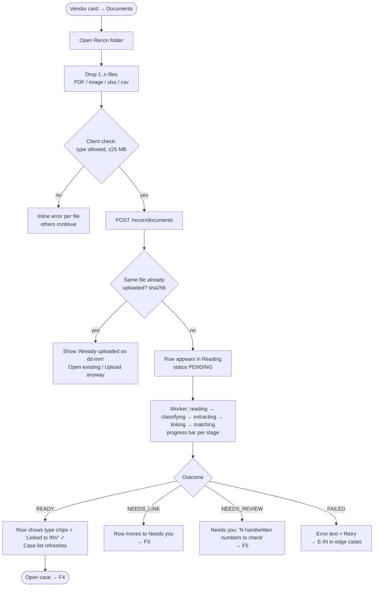
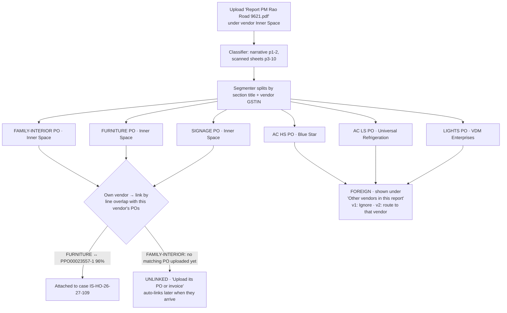
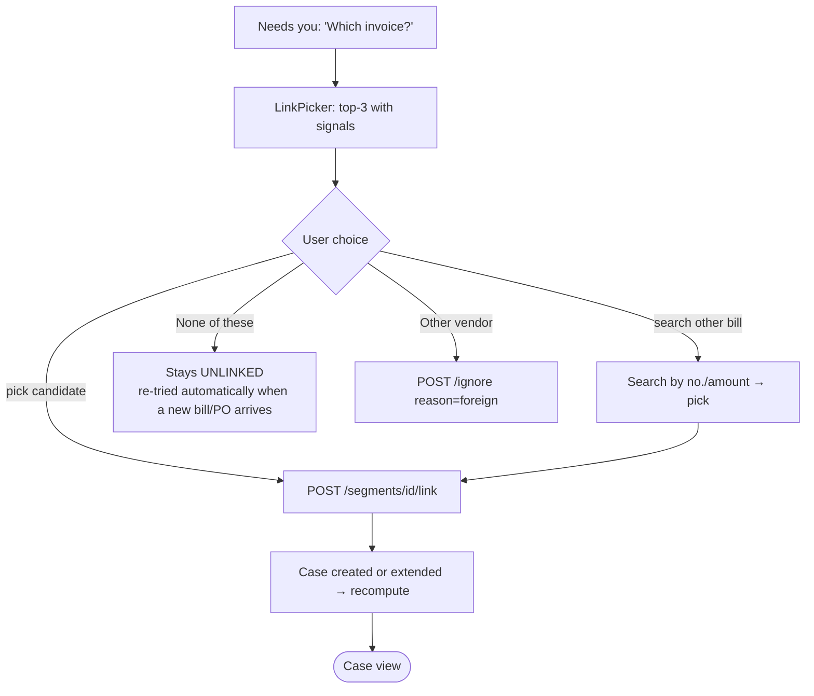
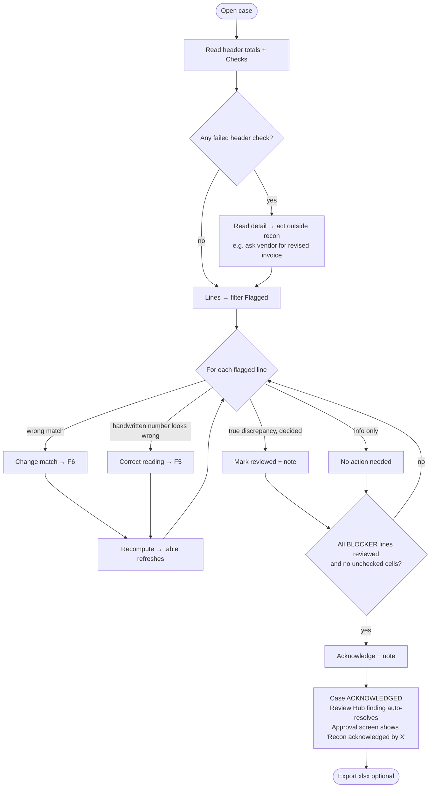
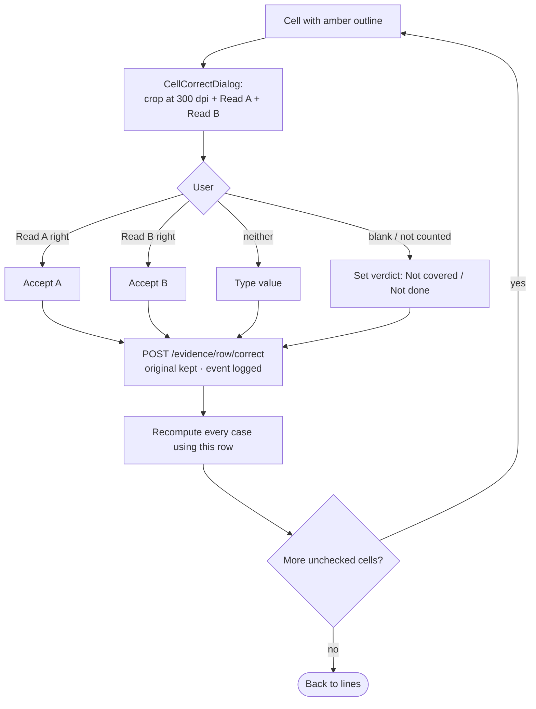
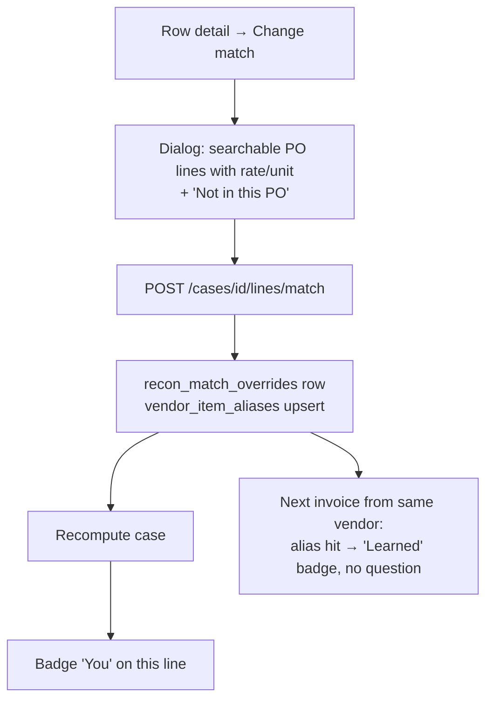
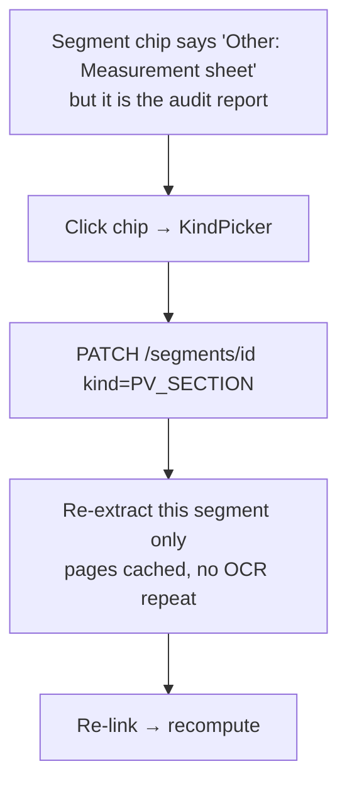
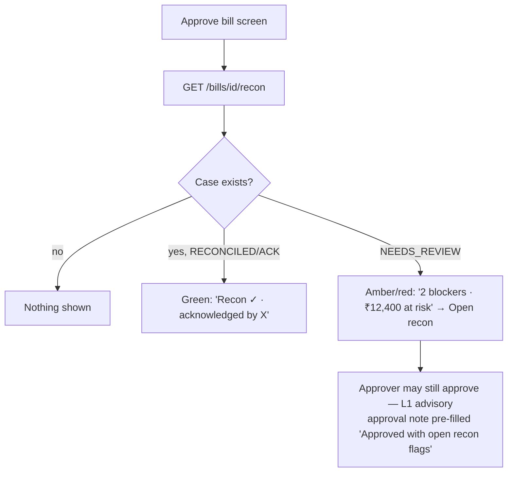
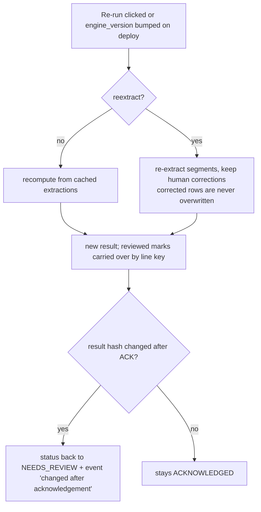
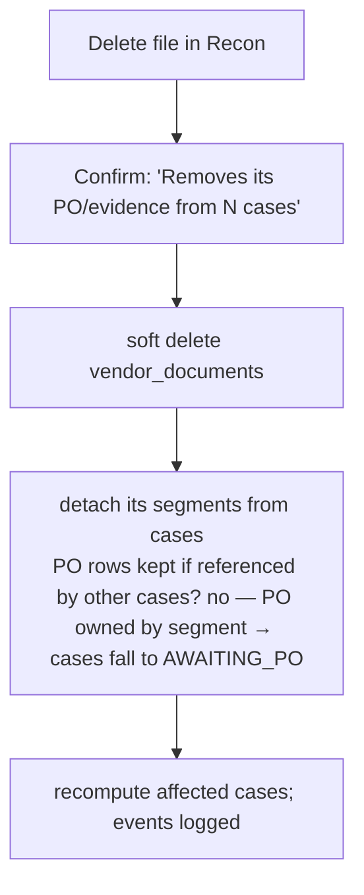

# 05 · User Flows

**Actors:**

| Actor | What they do |
|---|---|
| **Finance user** (`finance`, `admin`) | Uploads documents, resolves links, reviews lines, acknowledges |
| **Approver** (`approver`) | Sees the recon summary on the approval screen; can acknowledge with a note |
| **System** | ReconWorker, Review Hub |

## F1. Upload documents into Recon (happy path)



## F2. Bata store-level report (several vendors in one file)



## F3. Resolve an ambiguous link



## F4. Review a case (main approver journey)



## F5. Check handwritten numbers



## F6. Correct a line match (and teach the system)



## F7. Wrong document type



## F8. Invoice arrives after the evidence (out-of-order uploads)

```mermaid
sequenceDiagram
    actor U as User
    participant R as Recon
    participant B as Bill ingest
    U->>R: upload PO + PV report (no bill yet)
    R->>R: PO stored; report section UNLINKED (store 1859, overlaps PO 96%)
    Note over R: case not created — no bill. Doc row: "Waiting for the invoice"
    B->>B: invoice IS-HO-26-27-120 ingested (email/upload)
    B-->>R: NOTIFY recon_docs (new bill for supplier)
    R->>R: relink sweep: bill.po_ref = PPO00024378 → create case, attach PO + section
    R->>R: recompute → READY
    R-->>U: case appears in list (and Review Hub if flagged)
```

**Implementation note.** The bill-ingest path (`domain/ingest.py`, after it inserts `stg_bills`)
runs `pg_notify('recon_docs', json{kind:'bill', supplier_id, bill_id})`. It does this only when
the tenant has the `recon` service and the supplier has recon segments in `UNLINKED` status.
ReconWorker handles `kind:'bill'` messages with `relink_supplier(supplier_id)`.

## F9. Approver on the bill approval screen



## F10. Re-run and versioning



## F11. Delete a document


