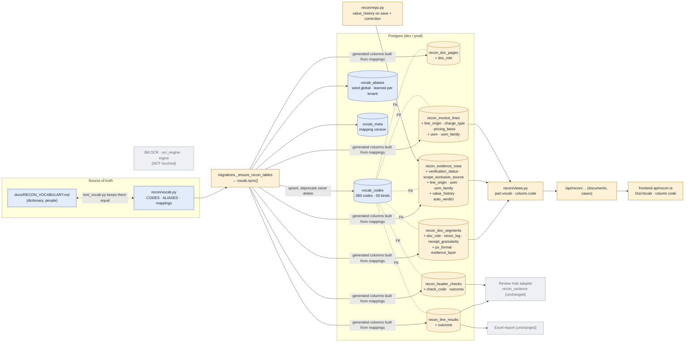

# Recon vocabulary adoption: impact

**Date:** 2026-11-16 · **Decision:** Recon adopts Vibhanshu's vocabulary (`docs/RECON_VOCABULARY.md`) as the single source of truth for its codes. Storage stays on the live Recon tables; no graph database (see `infra_brainstorm/ANALYSIS.md`). Bills are untouched.

## 1. Impact diagram

Blue = new · amber = changed · grey = checked, no change needed.

## 2. What changed, where

| Area | File | Change | Risk |
|---|---|---|---|
| Dictionary | `docs/RECON_VOCABULARY.md` | Vibhanshu's v1-draft adopted. Fixed the wrong example GSTIN (`…1ZJ` → `29AABCB1043Q1ZI`) and the dead "§8.4" link. Added `date_role`, `evidence_layer`, `value_change_kind`, `recon_outcome`, `recon_line_status`, `recon_check_code`, `match_method`, `SPREADSHEET_TABLE`, `NO_TAX`, and the "Memorandum" alias. §21 explains how Recon uses it. | None (docs) |
| Registry | `backend_ocr/app/recon/vocab.py` (new) | 383 codes in 50 kinds, 138 seed aliases ("Kit" → `SET` added after the dev data showed it). The only mapping from internal enums to codes. SQL for the generated columns. `sync()`. | Low |
| DB: new tables | `vocab_codes`, `vocab_aliases`, `vocab_meta` | Created by `sync()`. Learned aliases must carry a tenant (CHECK constraint). | Low |
| DB: new columns | 6 recon tables (diagram) | 19 **generated** code columns, each with an FK to `vocab_codes`. Plus `recon_evidence_rows.value_history` (JSONB) and `recon_evidence_rows.auto_verdict`. The verdict was never saved before (screens computed it on view), so the vocabulary status needs the classifier's reading stored. | Low: every write lists its columns, and generated values follow the row |
| Migration | `backend_ocr/app/migrations.py` | `_ensure_recon_tables` runs `vocab.sync()` after the recon DDL. | Low: idempotent |
| Save path | `backend_ocr/app/recon/repo.py` | `value_history` on extraction (handwritten `~~old~~ new` / `[old] new`) and on every reviewer correction (`REVIEWER_CORRECTION`, who, when). | Low |
| API | `backend_ocr/app/recon/views.py` | Every part has `vocab: {doc_role, recon_leg, receipt_granularity, pv_format, evidence_layer}`; quantity and rate columns have `code`. Additive. | None |
| Frontend types | `frontend/src/api/recon.ts` | `DocVocab`, `column.code?`. Optional fields; no screen change. | None |
| Tests | `tests/recon/test_vocab.py` (new); the three DB fixtures | Registry ↔ document, every internal code mapped, every engine check registered, generated values and FKs. All Recon DB tests now run with the vocabulary applied. | — |

**Checked, no change needed:**
- **Review Hub `recon_variance` adapter:** it reads severity, which maps one-to-one to `recon_outcome`.
- **Excel export:** finance users read labels, not codes.
- **`routers/recon.py`:** it reads row ids, pages and boxes only.
- **Bill OCR / `ocr_engine` / `ingest_invoice`:** not touched, as decided.

## 3. Applied to the dev database (2026-11-16)

On `onsumm_db` at 3.110.208.167 (the self-hosted dev DB; **not** prod RDS):
- 383 codes and 138 aliases seeded; 19 generated columns built; mapping version `m3`.
- All 234 existing evidence rows classified.

| Meaning | Rows |
|---|---|
| `VERIFIED` | 175 |
| `NOT_EXECUTED` | 34 |
| `NOT_IN_SCOPE`, of which `CLIENT_INSTRUCTION` ("as per Bata instructions") 6 and `AUDITOR_SCOPE` 18 | 24 |
| `NOT_VERIFIABLE` | 0 |
| Unknown | 1 |

Units mapped on every row but 2 blanks. Every header check and line result has an outcome.

**Divergence found and handled.** Recon's classifier files "As per Bata Instruction not in scope" as *not countable* or *additional* for billing. The vocabulary (§17) says the line is `NOT_IN_SCOPE` on the client's instruction, so the vocabulary column follows the auditor's words and billing is unchanged. **Product decision pending:** should billing treat those rows as out of scope too?

**Until dev runs this code,** rows the old dev server writes get `auto_verdict` empty, so `verification_status` is empty. The next migration run backfills them.

## 4. Rollout on a database

1. Pull the branch and run `python3 scripts/run_api_migrations.py`. This runs the recon DDL, then `vocab.sync()`.
2. On the first run, `sync()` creates the vocabulary tables, seeds 383 codes and 136 aliases, adds the 19 generated columns and their FKs, and backfills every existing row automatically, because generated columns compute on add.
3. Later runs change nothing unless `vocab.py` changes.
   - A new code is inserted.
   - A removed code is marked `deprecated`.
   - A bumped `MAPPING_VERSION` rebuilds the generated columns.

**Cost on dev:** the recon tables hold about 400 rows today; adding the generated columns rewrites them in well under a second.

**Rolling back:** set `MAPPING_VERSION` back, or drop the generated columns. Nothing else reads them yet, and the existing columns are unchanged.

## 5. Not done yet (next steps, in order)

1. **Column-heading aliases feeding the readers.** Resolve a sheet's headings through `vocab_aliases`, so "Contractor Claim" → `QTY_CLAIMED` for a new client, as a row and not a prompt change.
2. **Learned aliases from reviewer corrections,** tenant-scoped only.
3. **Assurance exclusions and payable conditions** extracted from PV disclaimers and PO text (§10–§11), lowering confidence on payment.
4. **POD and e-way checks** (`recon_check_code` tier X).
5. **`link_method` codes,** once Recon records *how* a part was linked, not only by whom.
