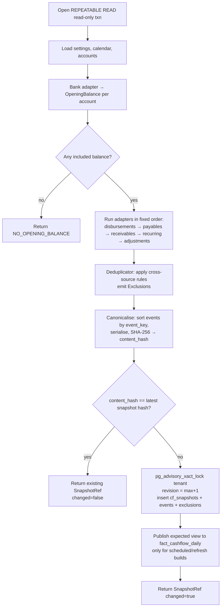
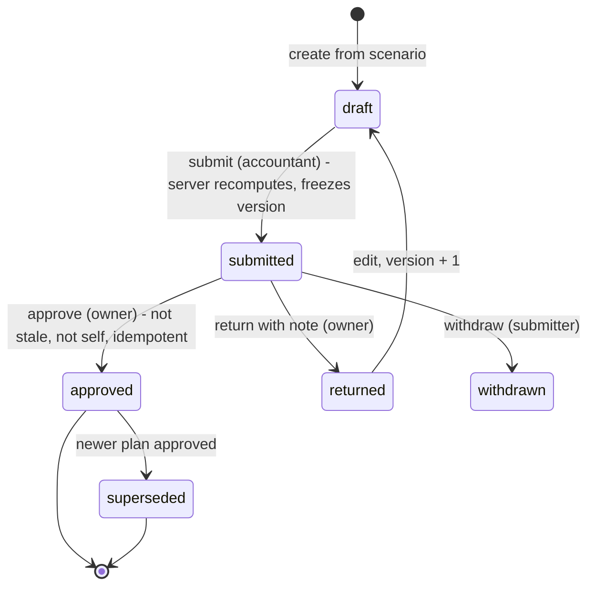

# Cash Flow Forecast — Technical Design

| | |
|---|---|
| **Status** | Draft for build · v1.0 · 21 Nov 2026 |
| **Audience** | Backend, frontend and QA engineers building the module; reviewers |
| **Reads with** | [PRD](01_PRD.md) (what and why) · [HLD](03_HLD.md) (system shape) · [LLD](04_LLD.md) (classes, DDL, API contracts) |

This document explains **how** the forecast is computed, which existing Reckon.ai tables feed it, the rules that keep numbers right (no double counting, correct dates, correct amounts), and the engineering choices behind storage, performance, security, testing and rollout.

---

## 1. Design principles

1. **Deterministic core, thin edges.** All money arithmetic happens in a pure engine (`project(snapshot, view, overrides) → ForecastResult`) with no I/O. Adapters read data; routers authorise; the UI renders. This makes golden tests exact and scenario previews instant.
2. **Integer paise everywhere.** Source tables use `NUMERIC(18,4)` or `NUMERIC(18,2)`. Every amount is converted once, at the adapter boundary, with `ROUND_HALF_UP` to an `int` of paise. JSON carries `*_paise` integers. Only the UI formats rupees.
3. **Every event has provenance.** Each cash event carries `source_type`, `source_id`, a stable `event_key`, a `date_basis` string and a confidence. Each skipped record becomes an `Exclusion` with a reason code. Nothing disappears silently.
4. **Snapshots are immutable and revisioned.** A forecast is always “revision N as of T”. Scenarios and plans pin a revision. A refresh that finds identical inputs returns the existing revision.
5. **Read-only towards the books.** The module never updates `fact_invoices`, `ar_invoices`, `fact_disbursements` or any operational table. Its only writes are its own `cf_*` tables and an optional publish to `fact_cashflow_daily`.
6. **Decisions are separate from execution.** An approved plan changes *forecast inputs* (planned payment dates), never payments.

## 2. Codebase placement

Follows the existing layout (`backend_ocr/app/receivables/` is the closest precedent: own package, own DDL module, own router).

```
backend_ocr/app/cashflow/
├── __init__.py
├── types.py              # enums + frozen dataclasses (CashEvent, Snapshot, ForecastResult …)
├── money.py              # to_paise(), format helpers for logs/tests
├── calendar.py           # BusinessCalendar (banking days, roll rules)
├── collection_model.py   # PaymentProfile, CollectionModel (median / p80 / conditional)
├── sources/
│   ├── base.py           # SourceAdapter protocol, SourceContext, SourceResult
│   ├── bank.py           # opening balances (stg_bank_statements + cf_bank_balances)
│   ├── payables.py       # fact_invoices AP + stg_bills + payment_schedules + planned dates
│   ├── disbursements.py  # fact_disbursements (in flight / succeeded after balance)
│   ├── receivables.py    # ar_invoices + ar_payments + history for profiles + promises
│   ├── recurring.py      # cf_recurring_items expansion
│   ├── adjustments.py    # cf_adjustments
│   └── fixture.py        # loads docs/cashflow-forecast/dummy-data/seed/*.json
├── snapshot.py           # SnapshotBuilder, Deduplicator, content hash
├── engine.py             # ForecastEngine (pure)
├── scenario.py           # Override types, OverrideValidator, apply()
├── plans.py              # PlanService (submit / decide / stale check / adopt)
├── repo.py               # CashForecastRepo (all SQL for cf_* tables)
├── schema.py             # DDL tuple, applied by migrations._ensure_cash_forecast_tables
├── publish.py            # fact_cashflow_daily publisher
├── accuracy.py           # P1 backtest
└── jobs.py               # daily refresh + alert job (worker)

backend_ocr/app/routers/cash_forecast.py   # FastAPI router, prefix /api/finance-desk/cash-forecast

frontend/src/pages/cashforecast/
├── CashForecastPage.tsx  # route component
├── api.ts, types.ts      # typed client mirroring Pydantic models
├── hooks/ useForecast.ts, useScenario.ts, usePlans.ts
├── components/ KpiStrip, ForecastChart, DayLedgerTable, DayDrawer, ExclusionsDrawer,
│               DriversPanel, ScenarioPanel, PlanPanel, InputsDrawer, FreshnessStrip
└── cash-forecast.css

tests/test_cash_forecast_engine.py         # golden parity with expected_forecast.json
tests/test_cash_forecast_rules.py          # calendar, collection model, dedupe, overrides
tests/test_cash_forecast_api.py            # auth, tenancy, plans, idempotency
frontend/src/pages/cashforecast/*.test.tsx
```

Registration mirrors `inventory_router` in [main.py](../../backend_ocr/app/main.py): `app.include_router(cash_forecast_router, dependencies=[Depends(require_service("cash_forecast"))])`. Route `PATHS.cashForecast = '/finance-desk/cash-forecast'` in [paths.ts](../../frontend/src/routes/paths.ts); sidebar entry under **Insights** in [Sidebar.tsx](../../frontend/src/components/Sidebar.tsx).

## 3. Source integration

All reads use `get_conn()`/`put_conn()` from `app.config`, `RealDictCursor`, parameterised SQL and `tenant_id = %s` from `require_tenant()` — never from the request body. Each adapter runs inside **one** `REPEATABLE READ, READ ONLY` transaction opened by the snapshot builder, so all sources see the same database state.

### 3.1 Opening balance

```sql
-- latest statement balance per included account at or before the as-of time
SELECT DISTINCT ON (s.bank_account_id)
       s.bank_account_id, s.running_balance, s.transaction_date, s.source_updated_at
FROM stg_bank_statements s
JOIN dim_bank_accounts a ON (a.tenant_id, a.bank_account_id) = (s.tenant_id, s.bank_account_id)
WHERE s.tenant_id = %s AND a.is_active AND a.currency_code = 'INR'
  AND s.running_balance IS NOT NULL
ORDER BY s.bank_account_id, s.transaction_date DESC, s.source_updated_at DESC;
```

Merged with `cf_bank_balances` (manual entries): per account the record with the **latest `as_of`** wins. `cf_account_settings.include_in_forecast` (default true for `CURRENT`/`SAVINGS`, false for `OVERDRAFT`) selects accounts. Overdraft accounts contribute **headroom** (`od_limit − drawn`) shown beside the forecast, never to the balance.

`snapshot.as_of` = the **earliest** included balance timestamp (conservative: the forecast cannot be fresher than its stalest account). Horizon start = `as_of` local date + 1. Freshness: `fresh` (≤ 1 banking day), `stale` (2–3), `expired` (> 3, blocks plan submission). Missing any included account → coverage `partial`; no balances at all → forecast `unavailable` (422 `NO_OPENING_BALANCE`).

### 3.2 Payables

```sql
SELECT fi.invoice_id, fi.stg_bill_id, fi.supplier_id, s.name AS supplier_name,
       fi.invoice_number AS bill_number, fi.due_date, fi.status, fi.payment_status,
       fi.currency_code, fi.total_amount, fi.amount_paid, fi.outstanding_amount,
       sb.validation_flag, sb.tds_amount, sb.net_payable, fi.updated_at
FROM fact_invoices fi
JOIN stg_bills sb       ON (sb.tenant_id, sb.stg_bill_id) = (fi.tenant_id, fi.stg_bill_id)
JOIN dim_suppliers s    ON (s.tenant_id, s.supplier_id)   = (fi.tenant_id, fi.supplier_id)
WHERE fi.tenant_id = %s AND fi.invoice_type = 'AP' AND fi.soft_status = 'active'
  AND coalesce(fi.payment_status, 'unpaid') <> 'paid'
  AND fi.status NOT IN ('DRAFT');
```

Plus `payment_schedules` (`cycle_type='PAYABLE'`, status in `PENDING|PARTIAL|OVERDUE`), `cf_planned_dates` (active), `cf_payment_windows`.

**Amount rule.** Cash out = `outstanding − (tds_amount if amount_paid = 0 else 0)`. Rationale: Reckon.ai stores TDS on the bill and `net_payable = total − tds`; TDS is withheld at the first payment and deposited separately on the 7th of the next month (modelled by the *TDS deposit* recurring item). For instalments, cash out = `scheduled_amount − paid_amount` (instalments are created net).

**Date precedence.** `cf_planned_dates` (approved plan) → payment-schedule instalment → `due_date` → if missing, an `UNDATED` exclusion that is surfaced as an input task (“add a due date”). Overdue (date < start) → first banking day ≥ start, basis `overdue_catch_up`. Roll: next banking day.

**Confidence.** `APPROVED` → `committed`; approval-pending states → `pipeline` (counted in expected/downside, not in no-collections).

### 3.3 Disbursements (dedupe of AP)

```sql
SELECT disbursement_id, invoice_id, supplier_id, amount, status, created_at, updated_at
FROM fact_disbursements
WHERE tenant_id = %s
  AND (status IN ('PENDING', 'PENDING_OTP', 'PROCESSING')
       OR (status = 'SUCCESS' AND updated_at > %s));      -- %s = earliest balance timestamp − 3 days
```

| Disbursement | Effect |
|---|---|
| In flight | One `confirmed` outflow on the first banking day (event key `disbursement:{id}`); the bill gets exclusion `PAYOUT_IN_FLIGHT` |
| `SUCCESS`, bill still not `paid` | Bill excluded `PAID_VIA_DISBURSEMENT` (money already left; it is in the balance). The 3-day look-back covers statement lag. |
| `FAILED` | Ignored; bill forecast normally |

### 3.4 Receivables

Open book:

```sql
SELECT i.id, i.customer_id, c.name, i.invoice_number, i.due_date, i.status, i.currency,
       i.taxable_amount, i.total_amount, i.tds_amount, i.outstanding, c.tds_rate_hint, i.updated_at
FROM ar_invoices i JOIN ar_customers c ON c.id = i.customer_id AND c.tenant_id = i.tenant_id
WHERE i.tenant_id = %s AND i.status IN ('open', 'partially_paid', 'disputed') AND i.outstanding > 0;
```

History for profiles (12 months; one row per paid invoice):

```sql
SELECT i.customer_id, i.due_date, i.paid_at::date AS paid_on
FROM ar_invoices i
WHERE i.tenant_id = %s AND i.status = 'paid' AND i.paid_at IS NOT NULL AND i.due_date IS NOT NULL
  AND i.paid_at >= now() - interval '12 months';
```

Unapplied receipts (dedupe):

```sql
SELECT id, amount, received_on, suggestion
FROM ar_payments
WHERE tenant_id = %s AND status IN ('unmatched', 'needs_review')
  AND (suggestion->>'confidence')::numeric >= 0.90;
```

An open invoice referenced by such a suggestion is excluded `SETTLED_PENDING_APPLICATION` — the receipt is already in the bank balance. Lower-confidence unapplied receipts are **not** used for dedupe (risk of hiding a real receivable); they appear in the Exclusions drawer as an informational “unapplied receipts ₹X” line with a link to cash application.

**Amount rule.** `outstanding − expected_tds`, where `expected_tds = round(taxable × tds_rate_hint / 100)` only if the invoice has no TDS recorded yet. Partial payments are handled by `outstanding` (a generated column in `ar_invoices`).

### 3.5 Recurring items and adjustments

`cf_recurring_items` expand over the horizon by frequency (`weekly` with weekday anchor, `monthly` with day-of-month or `last_banking_day`, `quarterly` with month list) then roll by `business_day_rule`. Event key `recurring:{id}:{nominal_due_date}` — keyed on the *nominal* date so a holiday roll doesn't create a new identity. `cf_adjustments` are single dated items (`adjustment:{id}`).

Statutory templates seeded on first run (editable, amounts blank until set): GSTR-3B on 20th, TDS deposit on 7th, PF/ESI on 15th, advance tax on 15 Jun/Sep/Dec/Mar, payroll on last banking day. A template with no amount is listed under **Coverage → needs setup** and does not count.

## 4. Snapshot build



- **Adapter order matters** only for dedupe signals: disbursements run first so payables can consult the in-flight / succeeded sets; receivables load unapplied-receipt suggestions before scheduling.
- **Content hash** covers opening balances, all events (key, amount, date per view, confidence, basis) and exclusions; it deliberately excludes timestamps of the build itself. Identical inputs ⇒ identical hash ⇒ no new revision. This keeps scenario/plan pins stable across no-op refreshes.
- **Per-view dates.** One `CashEvent` holds a `dates: dict[View, date | None]`; `None` means “not in this view”. AR events carry different expected/downside dates; AP events share one date across views; pipeline AP has `no_collections=None`. This is cheaper and clearer than duplicating events per view (the reference generator duplicates for readability only).
- **Write path.** Snapshot + events + exclusions are written in one transaction (separate from the read-only source transaction) using `execute_values` batches of 1,000.

## 5. Forecast engine

Pure function; no DB, no clock (the snapshot carries `start` and `horizon_days`).

```
project(snapshot, view, overrides=[]) -> ForecastResult
  events  = [e for e in snapshot.events if e.dates[view] is not None]
  events  = apply_overrides(events, overrides, snapshot, view)     # validated earlier
  buckets = {d: Bucket() for d in horizon}
  for e in events:
      d = e.effective_date(view)
      if d > horizon_end: beyond[e.direction] += e.amount; continue
      buckets[d].add(e)                                            # inflow or outflow
  balance = snapshot.opening_total
  for d in horizon:                                                # ascending
      b = buckets[d]; b.opening = balance
      b.closing = balance + b.inflow - b.outflow
      b.below_reserve = b.closing < reserve                        # strictly less
      balance = b.closing
  metrics = min_closing (earliest on tie), first_breach, first_negative,
            days_below_reserve, totals by category, beyond-horizon totals,
            runway_days (no_collections view: days until first_negative)
```

Notes:

- **Intraday order is not modelled.** A day's closing is opening + inflows − outflows. The UI states this (“daily totals; timing within a day is not modelled”).
- **Reserve comparison is strict** (`<`). Closing exactly at reserve is not a breach (tested).
- **Delta vs baseline.** `preview` returns both baseline and scenario `ForecastResult` plus a `Delta` (per-day closing difference, min/breach changes) so the chart can draw two lines without a second request.
- **Complexity.** O(E + D) per view; ~5,000 events × 3 views runs in well under 50 ms in CPython.

## 6. Collection model

Implemented in `collection_model.py`; rules restated from the PRD with engineering notes.

| Step | Detail |
|---|---|
| Samples | `delay = paid_on − due_date` for paid invoices in the last 12 months. One sample per invoice (partial payments: date of the payment that fully settled it). |
| Percentiles | Nearest-rank, integers. `median` = p50 rounded half-even via `statistics.median` then `round`. Stable, explainable, no interpolation surprises. |
| Customer vs tenant | Customer profile when `n ≥ min_customer_history` (3); else tenant profile. Basis string records which, and `n`. |
| Not yet due | expected `due + median`, downside `due + p80`, both clamped to ≥ start. |
| Overdue by `o` | Conditional pool `{x − o : x > o}` from customer, then tenant, needing ≥ 3 members; expected = start + median(pool), downside = start + p80(pool). |
| No comparable history | expected = start + 5 banking days; downside = expected + 14 days. Basis `no comparable history`. |
| Promise to pay | Replaces the expected date (and amount if partial); downside unchanged. Expired promise (date < start, invoice still open) → ignored and listed as “broken promise” in the day drawer of the original date (P1 alert). |
| Downside exclusion | Overdue > `downside_exclude_overdue_after_days` (60) → no downside date. |

Fixture check values (from `expected_forecast.json → customer_profiles`): Sahyadri {median 21, p80 26, n 10}; Trinetra {0, 3, 14}; Konkan {8, 33, 11} (erratic: wide p80).

**Why not ML in P0:** the pilot has no backtest data yet; a transparent rule wins trust and gives a baseline. `ai_payment_predictions` (existing table) can later supply `predicted_pay_date` as an alternative date provider behind the same interface — the `date_basis` would read “model v… (confidence …)”.

## 7. Scenarios and validation

Overrides are typed (discriminated union on `op`). Validation runs server-side on every preview and again on submit/approve against the current snapshot.

| Code | When |
|---|---|
| `EVENT_NOT_FOUND` | Override references an event key absent from the snapshot |
| `FIXED_OBLIGATION` | Shift of statutory / payroll / debt / in-flight payout |
| `OUTSIDE_PAYMENT_WINDOW` | Bill moved later than `cf_payment_windows.latest_date`, or later than due with no window |
| `BEFORE_HORIZON` | Any date < start |
| `NON_BANKING_DAY` | Target date is not a banking day (UI snaps; API refuses) |
| `INFLOW_ONLY` | `exclude_event` on an outflow |
| `EXCEEDS_OD_HEADROOM` | Financing `add_item` larger than headroom |
| `DUPLICATE_TARGET` | Two overrides for the same event key (last-wins is ambiguous; refuse) |
| `LIMIT_EXCEEDED` | > 200 overrides per scenario |

Application order is the list order; each override sees the result of the previous ones. `delay_customer` and `haircut_customer` expand to per-event effects at apply time (so new invoices for that customer in a later snapshot are also affected when the scenario is rebased — documented behaviour).

**Rebase.** When a scenario pinned to revision N is opened on revision M > N, overrides are re-validated on M. Outcomes per override: `ok`, `target_gone` (bill paid/removed — dropped with notice), `now_invalid` (e.g., window shortened). Scenario status becomes `needs_review` if any override is not `ok`.

## 8. Plans



**Stale check at decision time.**

1. Build (or reuse) the current snapshot `M`.
2. If `M.revision == plan.revision` → not stale.
3. Else re-validate overrides on `M` and recompute `{min_closing, min_date, first_breach, closing}` for the plan's view. If any override is not `ok` **or** any metric differs from the submitted metrics → `409 PLAN_STALE` with a diff payload; otherwise approve and record `validated_on_revision = M`.

**Concurrency.** `SELECT … FROM cf_plans WHERE id=%s AND tenant_id=%s FOR UPDATE`, check `state='submitted'` and `version = expected_version`, insert decision, update state — one transaction. Idempotency: unique `(tenant_id, idempotency_key)` on `cf_plan_decisions`; same key + same payload hash → return stored response (200); same key + different payload → `409 IDEMPOTENCY_CONFLICT`.

**Adoption.** On approve, for each `shift_event` override whose kind is *decision*: upsert `cf_planned_dates(tenant, source_type, source_id, planned_date, plan_id, active=true)` and deactivate older rows for the same source. `add_item` decisions with `committed` confidence become `cf_adjustments` rows tagged with `plan_id`. Assumptions are not adopted. A superseding approval deactivates the previous plan's planned dates that the new plan doesn't restate.

## 9. Storage choices

- **Own tables, `cf_` prefix** (DDL in [LLD §6](04_LLD.md#6-database-schema)). Same rationale as receivables keeping `ar_*` separate: `fact_*` tables are read by many queries and should not learn forecast semantics.
- **Snapshot events stored, not recomputed,** so a plan's numbers are reproducible years later even after sources change. Retention: keep snapshots referenced by any plan forever; prune unreferenced snapshots older than 90 days (daily job), keeping one per day for accuracy tracking.
- **Volume estimate:** 5,000 events × 1 snapshot/day + ad-hoc refreshes (≈ 3/day) ≈ 20k rows/day/tenant → ~1.8 M rows per 90 days for a large tenant. Indexed by `(tenant_id, snapshot_id)`; partitioning not needed for pilot.
- **`fact_cashflow_daily` publish.** After a scheduled or user refresh produces a new revision, upsert the expected view's 30 days: `opening_balance`, `closing_balance`, `inflows_forecast`, `outflows_forecast`, `ar_outstanding`, `ap_outstanding`; `inflows_actual`/`outflows_actual` left untouched (owned by whichever job fills actuals). Requires a unique key `(tenant_id, cashflow_date, currency_code)` — the migration verifies no duplicates exist before creating `uq_fact_cashflow_daily_tenant_date` (if duplicates exist it logs and skips publishing for that tenant). Copilot's existing `cash_forecast` source then shows real numbers with no change.

## 10. API behaviour

Full contracts in [LLD §7](04_LLD.md#7-api-contracts). Cross-cutting rules:

- **Auth.** Every handler calls `require_tenant()` and a role check via a local helper `_require(capability)` mapping `view → {admin, finance_controller, accountant, auditor}`, `edit → {admin, finance_controller, accountant}`, `approve → {admin, finance_controller}`, `settings → {admin, finance_controller}`. Router is mounted behind `require_service("cash_forecast")`.
- **Errors.** `{"code": "...", "message": "...", "request_id": "...", "details": {...}}`. 401/403 per existing conventions; 404 for foreign IDs (never 403 — don't confirm existence across tenants); 409 stale/idempotency/state; 422 validation; 429 when a tenant exceeds 30 refreshes/minute.
- **Caching.** `GET /forecast` for a persisted snapshot is cacheable (`ETag = content_hash:view`); in-process LRU of 256 `(tenant, snapshot_id, view)` results. Previews are not cached (cheap and user-specific).
- **Bounds.** Horizon 7–91 days; overrides ≤ 200; note ≤ 2,000 chars; amounts ≤ 10¹⁴ paise.

## 11. Jobs

Runs in the existing worker process ([main.py](../../main.py)) on a schedule, per tenant with the entitlement:

| Job | When | Does |
|---|---|---|
| `cf_daily_refresh` | 07:00 IST | Build snapshot (no-op if unchanged); publish to `fact_cashflow_daily`; evaluate alerts |
| `cf_alerts` | after refresh | If expected view's first breach is within 7 days and differs from the last alerted breach date → in-app notification (+ email P1). Dedup key `(tenant, breach_date, revision bucket)` |
| `cf_accuracy` (P1) | 07:30 IST | For each past day with an actual statement closing, compare against forecasts made 1–30 days earlier; persist per-horizon errors |
| `cf_prune` | 02:00 IST | Delete unreferenced snapshots > 90 days, keeping the 07:00 snapshot of each day |

Jobs take a per-tenant advisory lock and are safe to rerun.

## 12. Security and privacy

| Threat | Control |
|---|---|
| Cross-tenant read | Tenant from token only; every query filters `tenant_id`; composite FKs `(tenant_id, snapshot_id)` etc.; foreign IDs → 404 |
| Privilege escalation via plan | Server-side role check; self-approval blocked unless tenant setting; approver identity from token |
| Replay / double approval | Idempotency key + row lock + version check |
| Sensitive data exposure | Responses include account masks only (`XXXXXX4821`); no beneficiary account numbers; logs carry IDs and counts, never names/amounts |
| Tampered overrides | Overrides re-validated on submit and approve against the snapshot, not trusted from client state |
| Impersonation | Platform-impersonated sessions: read-only (all mutating routes 403) |
| Formula injection in CSV export | Prefix cells starting with `= + - @` with `'` |

## 13. Observability

Metrics (Prometheus-style names, emitted via existing observability helpers): `cf_snapshot_build_seconds{result}`, `cf_snapshot_events_total{source}`, `cf_exclusions_total{reason}`, `cf_preview_seconds`, `cf_override_refused_total{code}`, `cf_plan_transitions_total{to}`, `cf_publish_rows_total`, `cf_alerts_sent_total`. Structured logs with `tenant_id`, `snapshot_id`, `revision`, `request_id`. Alert on build p95 > 3 s or failure rate > 2% over 15 min.

## 14. Testing strategy

| Layer | What | How |
|---|---|---|
| Golden parity | Engine reproduces `expected_forecast.json` exactly: all 3 views' daily rows, metrics, exclusions, scenario results | `FixtureAdapter` → `SnapshotBuilder` → `ForecastEngine`; compare dicts |
| Rules | Calendar rolls (2nd/4th Saturday, holiday, month end), percentile edge cases (n=1..3), conditional delay, promise precedence, TDS amount rules, dedupe (in-flight, succeeded, unapplied ≥ 0.90 vs 0.89), reserve `<` vs `=` | Table-driven pytest |
| Overrides | Every refusal code; window boundary (latest date allowed, +1 refused); rebase outcomes | pytest |
| Plans | submit → approve; return → resubmit v2; stale (inputs changed, metrics differ) vs revalidated (revision changed, metrics same); self-approval; idempotent replay; conflicting key; concurrent approvals (two threads, one wins) | pytest with DB (existing test DB fixtures) |
| API/auth | Each role × route matrix; cross-tenant IDs → 404; impersonation read-only | FastAPI TestClient |
| Hash stability | Same inputs twice → same revision; changing one amount → new revision | pytest |
| Frontend | KPI text from fixture JSON; chart table equivalence; drawer sums; refusal messages; keyboard flow | Vitest + Testing Library |
| Performance | 5,000-document synthetic tenant: build < 1.5 s, preview < 300 ms p95 | `scripts/` benchmark, CI-optional |

## 15. Rollout and migration

1. Ship DDL via `migrations._ensure_cash_forecast_tables()` (idempotent, `IF NOT EXISTS`), registered in `scripts/run_api_migrations.py` like receivables.
2. Add `cash_forecast` to `service_catalog`; enable for internal tenants only.
3. Seed statutory templates lazily on first page load (`POST /setup/seed-templates`, idempotent).
4. Shadow week: daily snapshots run; accountant compares to their spreadsheet; collect discrepancies as rule bugs.
5. Enable plans; then alerts; then `fact_cashflow_daily` publish (Copilot picks it up automatically).
6. Rollback: disable entitlement (UI and API vanish); `cf_*` tables are additive and can stay. Publishing to `fact_cashflow_daily` can be switched off independently (`cf_settings.publish_daily = false`).

## 16. Known limitations (documented in-product)

- Intraday timing not modelled; cheques and clearing float not modelled (statement value date is used when available).
- Bank charges, interest credits and small card spends are not forecast unless entered as recurring items.
- GST/TDS amounts are user-entered estimates in P0; P2 can derive GST payable from sales/purchase registers.
- Collection model assumes the last 12 months are representative; seasonal businesses should use promises and scenarios.
