# Cash Flow Forecast — High-Level Design

| | |
|---|---|
| **Status** | Draft for build · v1.0 · 21 Nov 2026 |
| **Scope** | System context, containers, components, data flow, key interactions, deployment, decisions |
| **Reads with** | [PRD](01_PRD.md) · [Technical design](02_TECHNICAL_DESIGN.md) · [LLD](04_LLD.md) |

Diagrams are Mermaid; they render in GitHub and in VS Code's Markdown preview. Colour key used throughout:

| Colour | Meaning |
|---|---|
| Blue | Existing Reckon.ai component or table (read only for this module) |
| Green | New component introduced by Cash Flow Forecast |
| Amber | External system or person |
| Grey | Storage owned by this module |

---

## 1. System context

Who uses the module and what it touches.

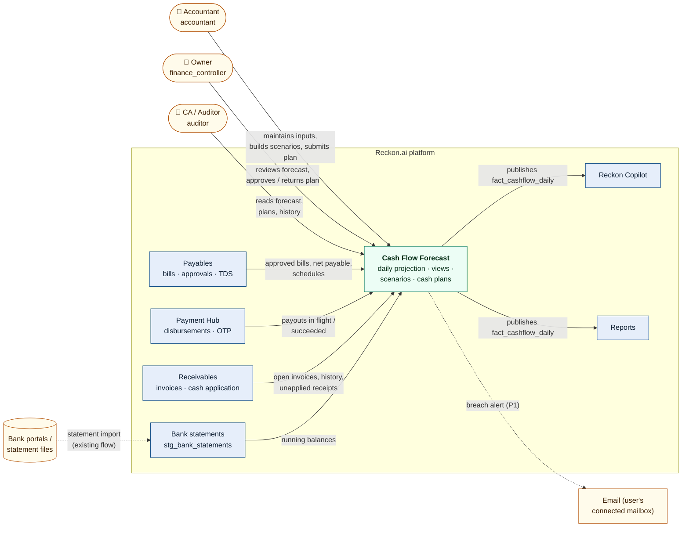

**Boundary rules**

- The module **reads** payables, payouts, receivables and statements. It **never writes** to them.
- It **writes** only its own `cf_*` tables and (optionally) the forecast columns of `fact_cashflow_daily`.
- It **never** initiates payments, sweeps, drawdowns or collection messages. Payment Hub keeps sole authority over money movement.

## 2. Containers

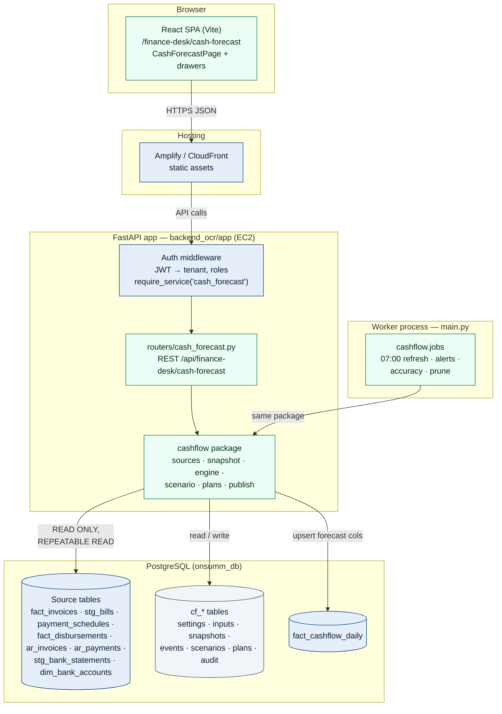

No new deployable is introduced: the router runs inside the existing FastAPI process and the jobs inside the existing worker. This matches how inventory, Copilot and receivables were added.

## 3. Components (backend)

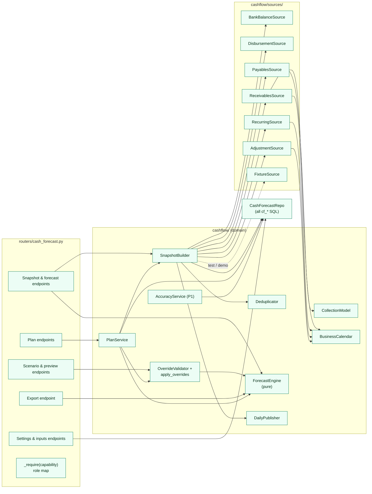

| Component | Responsibility | Depends on | Must not |
|---|---|---|---|
| Sources | Read one domain, convert to `CashEvent`/`Exclusion`/`OpeningBalance`, paise, local dates | DB cursor, calendar, collection model | Write anything; know about views beyond per-view dates |
| SnapshotBuilder | Orchestrate sources in one read txn, dedupe, hash, persist new revision | Sources, Deduplicator, Repo | Compute balances |
| Deduplicator | Cross-source “count once” rules | Source results | Touch DB |
| CollectionModel | Customer profiles, expected/downside dates with basis | History rows | Know about bills |
| BusinessCalendar | Banking-day tests and roll rules | Tenant holidays | — |
| ForecastEngine | Daily buckets, metrics, deltas | Snapshot, overrides | I/O, clock |
| OverrideValidator | Typed checks and refusal codes | Snapshot, windows, calendar | Persist |
| PlanService | Lifecycle, stale check, idempotency, adoption | Builder, Engine, Validator, Repo | Move money |
| DailyPublisher | Upsert forecast columns of `fact_cashflow_daily` | Engine result, DB | Touch actual columns |
| Repo | All `cf_*` SQL, tenant-scoped | DB | Business rules |

## 4. Data flow

From source rows to a number on screen.

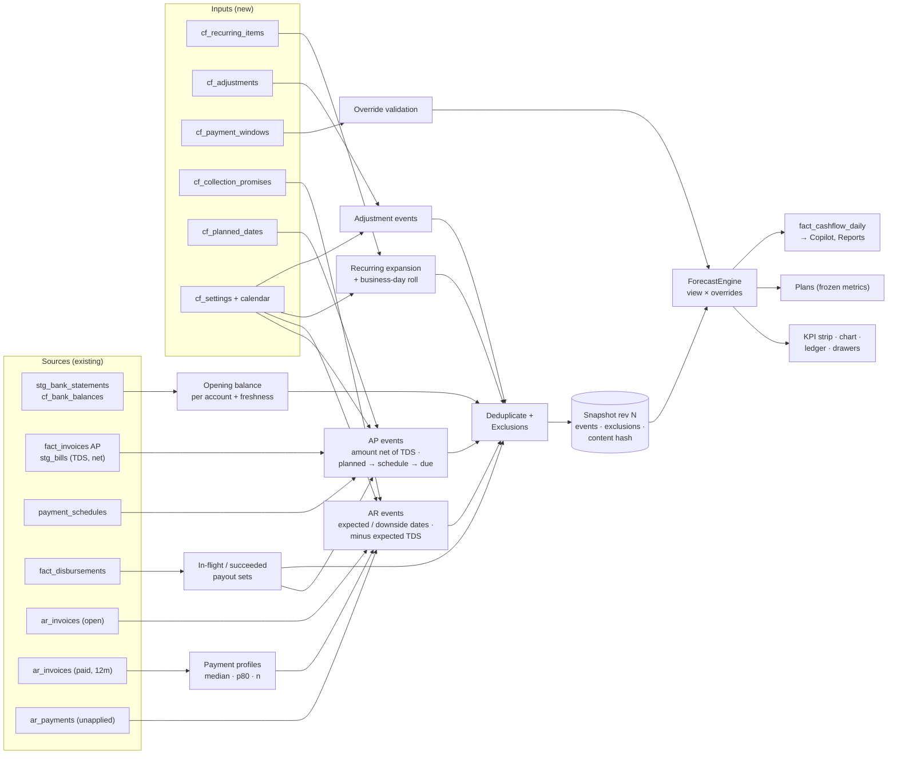

## 5. Key interactions

### 5.1 Open the page

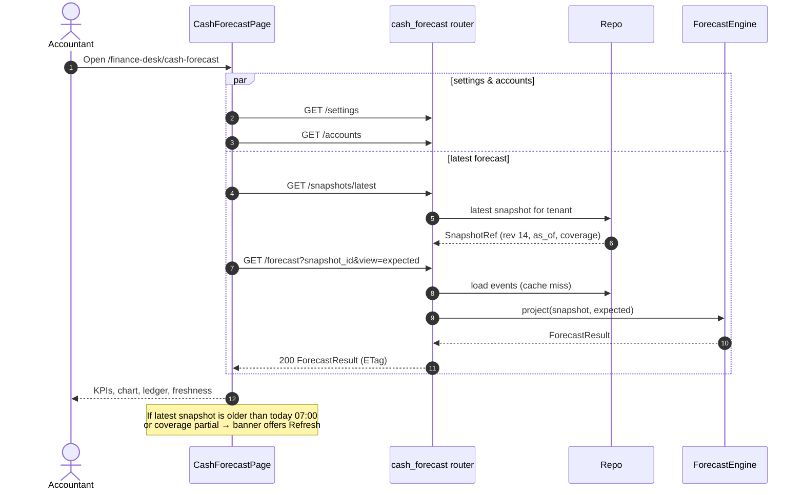

### 5.2 Refresh (build snapshot)

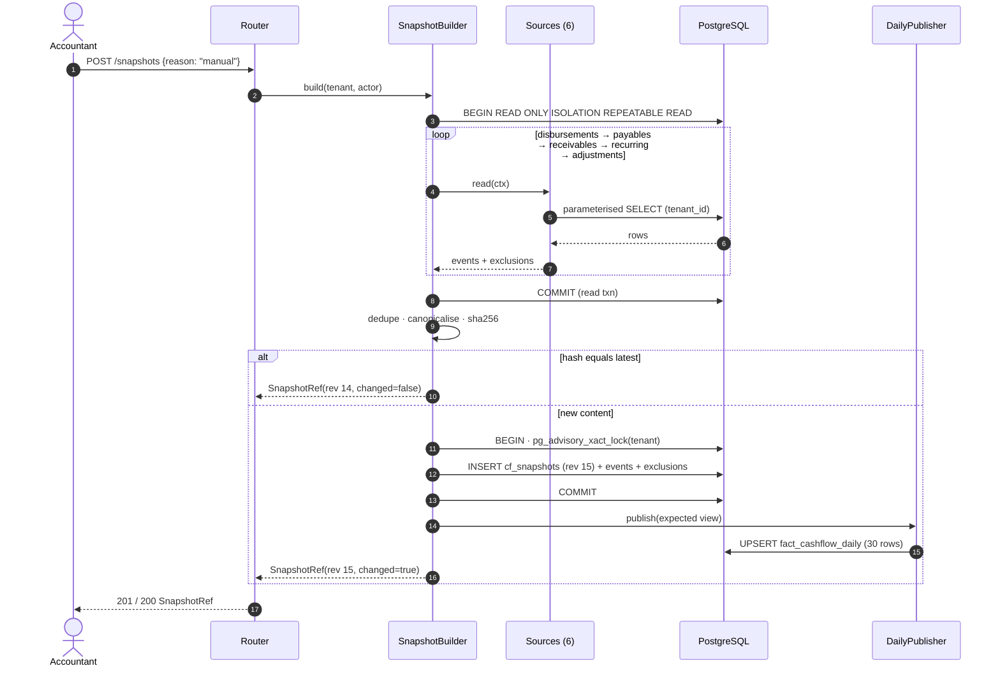

### 5.3 Scenario preview

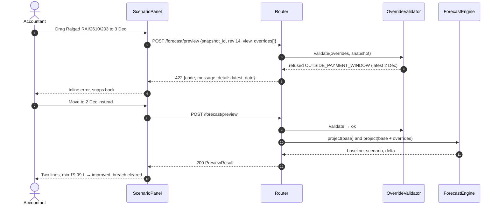

### 5.4 Submit and approve a plan

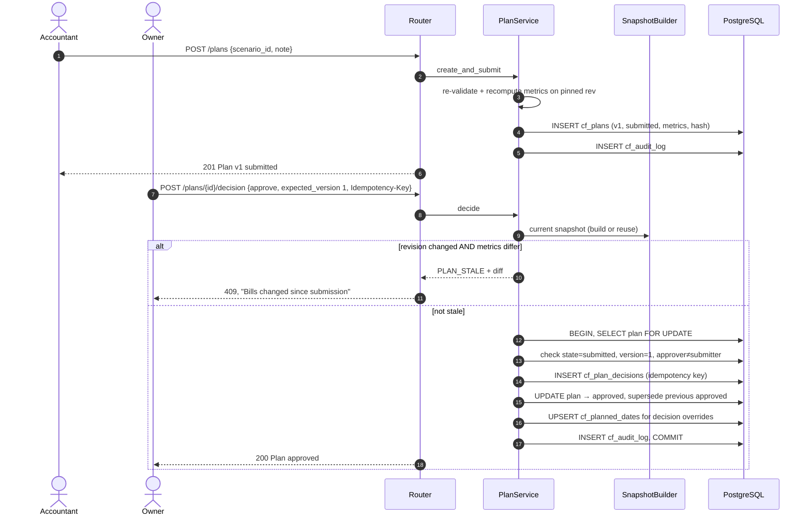

### 5.5 Daily job and alert

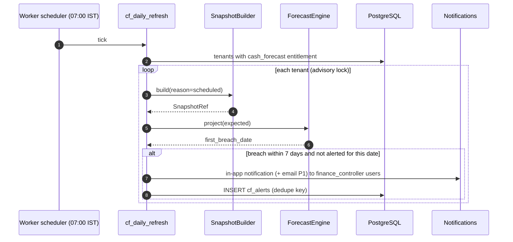

## 6. Deployment view

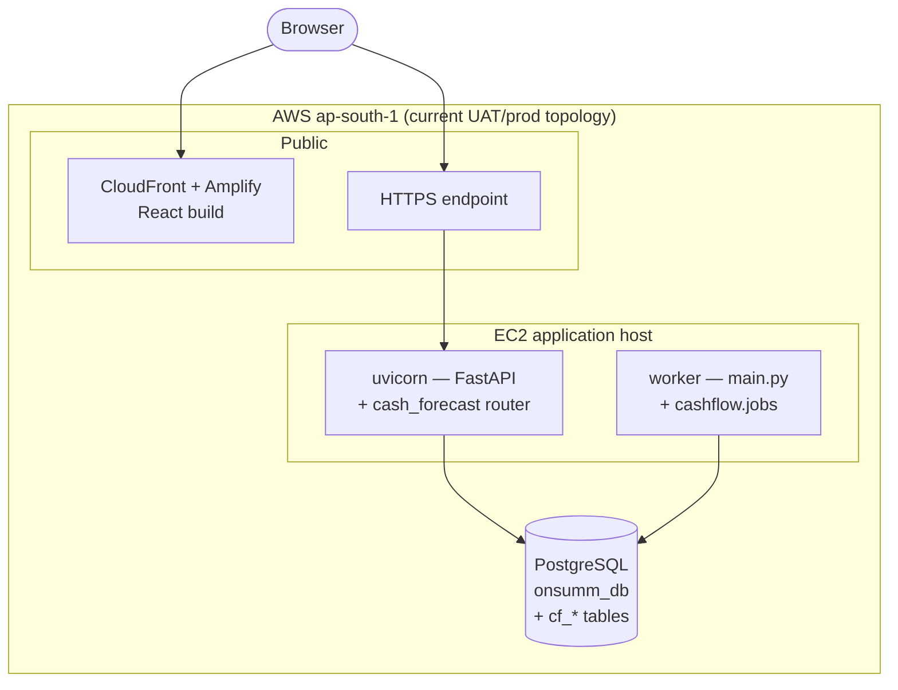

No infrastructure change is required. Resource impact: one snapshot build per tenant per morning plus ad-hoc refreshes; CPU-light pure Python; DB load dominated by five indexed reads per build. Scale-out path (if needed later): move `cashflow.jobs` to its own worker task; keep the API in-process.

## 7. Data lifecycle

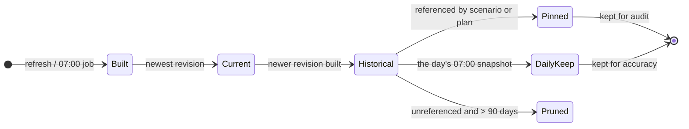

## 8. Cross-cutting concerns

| Concern | Approach |
|---|---|
| **Tenancy** | Tenant from JWT; every SQL filters `tenant_id`; composite FKs; foreign IDs return 404 |
| **Authorisation** | Role → capability map in router (`view`, `edit`, `approve`, `settings`); entitlement `cash_forecast` at mount |
| **Consistency** | One `REPEATABLE READ` read transaction per build; immutable snapshots; plans pinned to revision with stale check |
| **Idempotency** | Content-hash snapshots; idempotency keys on decisions; upserts for planned dates and publish |
| **Money** | Integer paise; single conversion point; sums verified in tests |
| **Time** | Business dates in tenant timezone (Asia/Kolkata); timestamps UTC in DB; engine has no clock |
| **Performance** | Pure engine; per-snapshot LRU; previews never hit the DB except snapshot load (cached) |
| **Auditability** | `cf_audit_log` for every mutation; plans store metrics + override list + content hash |
| **Failure isolation** | Source failure → coverage `partial`, named source, approval blocked; model-free design means no LLM dependency |
| **Accessibility** | Chart has a ledger table equivalent; status text + icon, not colour alone |

## 9. Failure modes

| Failure | Detection | Behaviour |
|---|---|---|
| No bank balance for any included account | Bank source returns empty | Forecast `unavailable`; UI shows “Add today's balance” form |
| One account stale (> 3 banking days) | Freshness check | Forecast shown with warning; plan submit/approve blocked (`BALANCE_EXPIRED`) |
| A source query fails | Exception in adapter | Snapshot coverage `partial` with `failed_sources`; persisted so users see it; approve blocked |
| Payroll/GST templates missing amounts | Coverage check | Banner “Payroll not configured — forecast may be optimistic” |
| Concurrent refreshes | Advisory lock + hash | One revision created; the other returns it |
| Concurrent approvals | Row lock + version | One decision; the other gets 409 `PLAN_STATE` |
| Publish unique key missing | Migration check | Publishing disabled for tenant, logged; forecast unaffected |

## 10. Architecture decisions

| # | Decision | Alternatives considered | Why |
|---|---|---|---|
| ADR-1 | Run inside existing FastAPI + worker | Separate service | Matches inventory/receivables precedent; no new infra; low load |
| ADR-2 | Own `cf_*` tables; publish to `fact_cashflow_daily` | Write forecasts straight into `fact_cashflow_daily` only | Need immutable snapshots, events and plans for audit; `fact_cashflow_daily` has no per-event detail |
| ADR-3 | Persist snapshot events | Recompute from sources on demand | Plans must stay reproducible after sources change |
| ADR-4 | Content-hash revisions | Time-based revisions | No-op refreshes don't invalidate scenarios; cheap equality |
| ADR-5 | Statistical collection model (median/p80, conditional) | ML model, `ai_payment_predictions` | Explainable, no training data needed, backtestable; ML can plug in later behind the same interface |
| ADR-6 | Daily granularity, 30-day default, 91-day max | Weekly only | Payroll/GST/EMI are date-specific; weekly rollup derived from daily |
| ADR-7 | Decisions vs assumptions in overrides | Treat all overrides alike | Only decisions should change tomorrow's baseline; assumptions are opinions |
| ADR-8 | No LLM in the forecast path | LLM-generated narratives | Numbers must be exact; Copilot can narrate using the published data/tool (P1) |
| ADR-9 | Strict reserve comparison (`<`) | `≤` | Matches owner language (“don't go below”) and finance-desk precedent |
