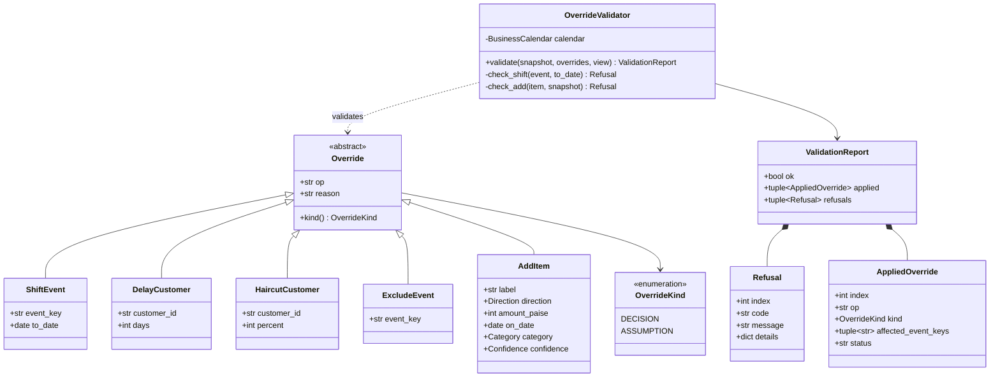
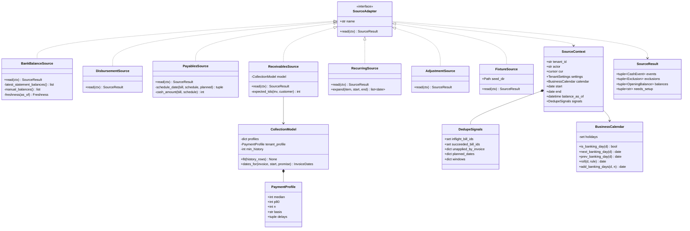
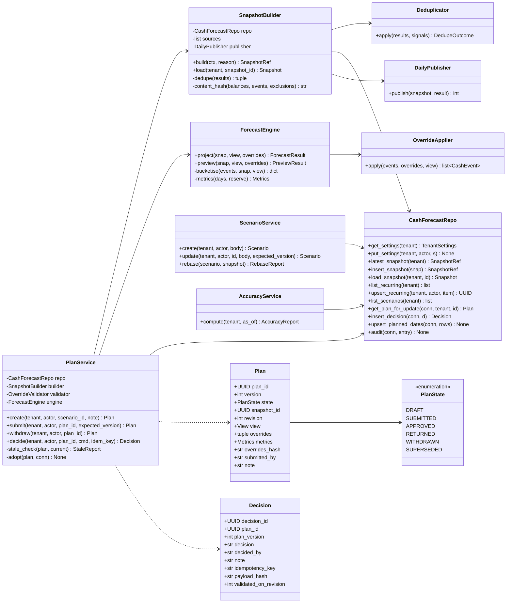
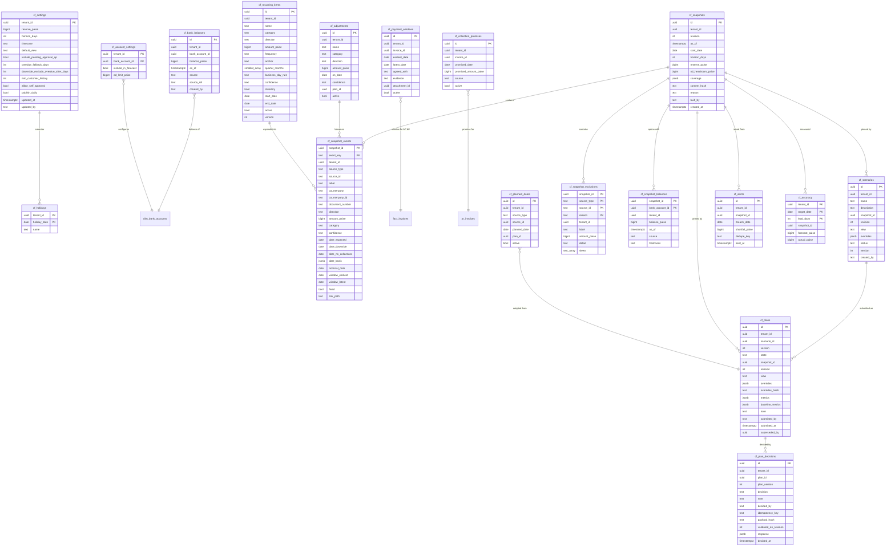
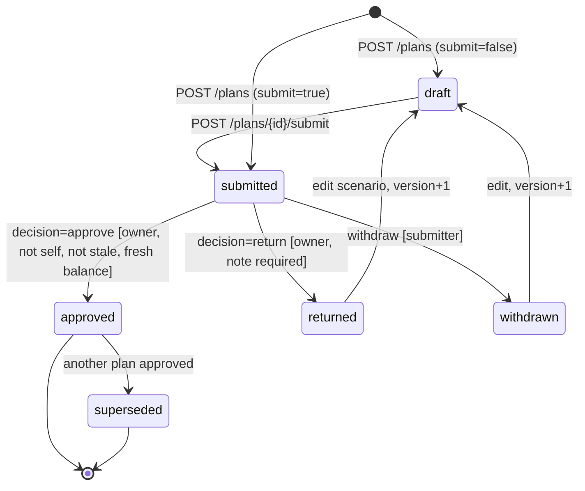
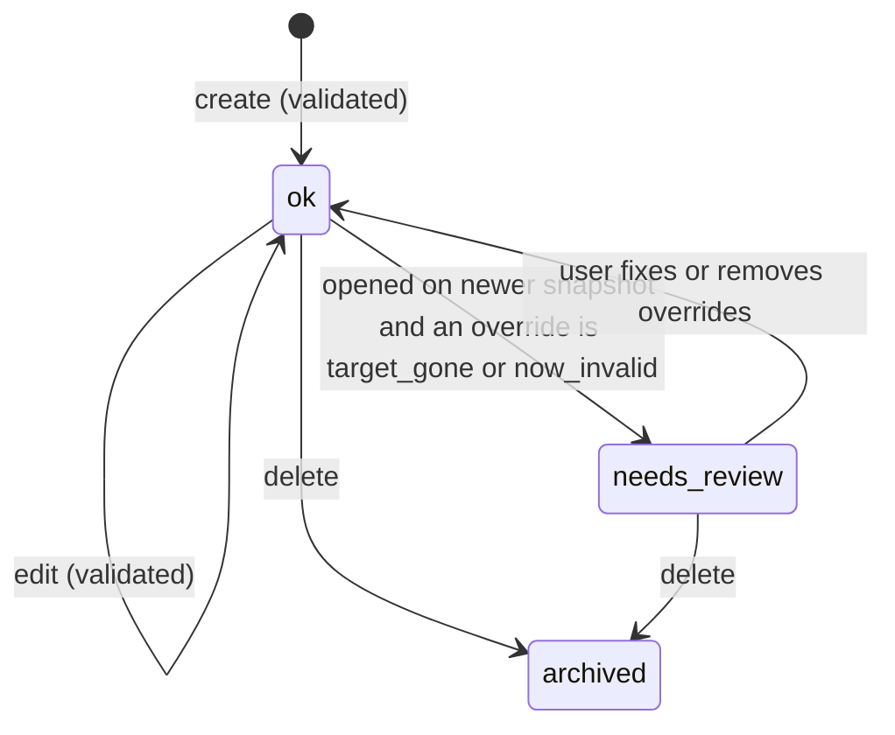
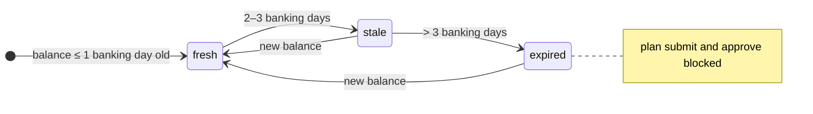
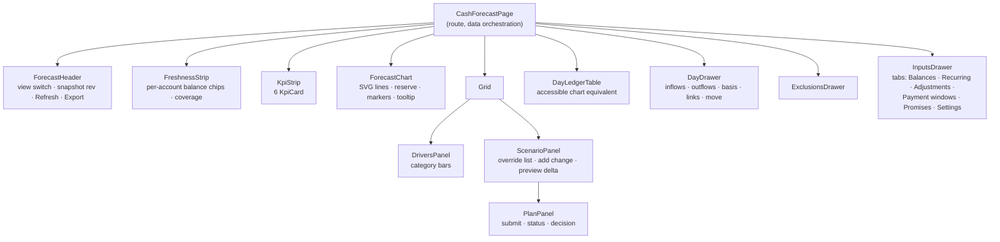
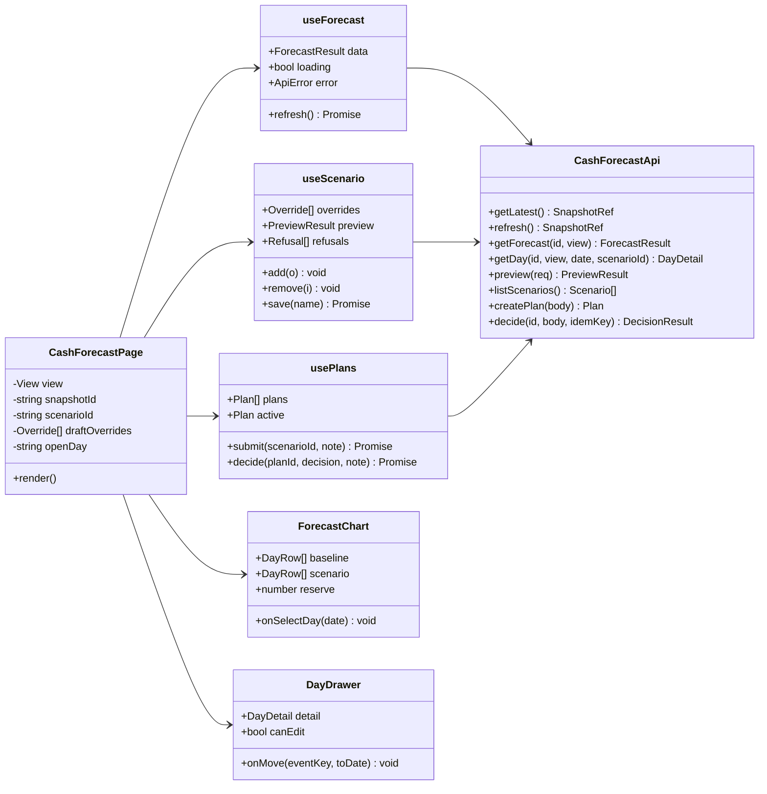

# Cash Flow Forecast — Low-Level Design

| | |
|---|---|
| **Status** | Draft for build · v1.0 · 21 Nov 2026 |
| **Audience** | Engineers implementing the module |
| **Reads with** | [Technical design](02_TECHNICAL_DESIGN.md) (rationale) · [HLD](03_HLD.md) (system shape) · [UI spec](06_UI_SPEC.md) (screens) |
| **Golden data** | [`dummy-data/seed/expected_forecast.json`](dummy-data/README.md). The engine must reproduce it exactly. |

---

## 1. Conventions

| Topic | Rule |
|---|---|
| Money | `int` paise in Python, `BIGINT` in SQL, `*_paise` in JSON. Converted from `NUMERIC` with `Decimal(x).scaleb(2).quantize(Decimal(1), ROUND_HALF_UP)`. Inflows and outflows are **positive** amounts with a `direction`. Signed values appear only in balances and deltas. |
| Dates | `datetime.date` in the tenant timezone (`Asia/Kolkata` default). ISO `YYYY-MM-DD` in JSON. Timestamps are `timestamptz` (UTC) in the DB and ISO-8601 with offset in JSON. |
| IDs | UUID v4 for rows. `event_key` is a stable string: `bill:{invoice_id}`, `schedule:{schedule_id}`, `disbursement:{id}`, `ar:{invoice_id}`, `recurring:{item_id}:{nominal_date}`, `adjustment:{id}`, `scenario:{scenario_id}:{n}` for added items. |
| Immutability | Domain dataclasses are `@dataclass(frozen=True, slots=True)`. Collections are tuples. |
| Views | `View = Literal["expected", "downside", "no_collections"]` |
| Naming | New tables use the `cf_` prefix. Python package `app.cashflow`. Router `app.routers.cash_forecast`. |

## 2. Package layout (as built)

```
backend_ocr/app/cashflow/
  types.py             # CashEvent, ViewDates, Snapshot, DayRow, Metrics, to_paise/pct_of, jsonable
  calendar.py          # BusinessCalendar (banking days, roll rules)
  collection_model.py  # CollectionModel, PaymentProfile (median / p80 / conditional delay)
  rules.py             # Settings, SourceData, assemble(): rows → Snapshot (events, exclusions, hash). Pure.
  sources.py           # load_books_live (SQL) · load_books_fixture (seed JSON) · load_inputs (cf_*) · fixture switch
  engine.py            # project(), delta(). Pure.
  scenario.py          # Override models (Pydantic), validate(), apply(), kind()
  repo.py              # cf_* SQL: snapshots (+ LRU cache), settings, plans, audit
  service.py           # use cases: build, latest, forecast, preview, day detail, scenarios, plans, publish
  schema.py            # DDL + guarded fact_cashflow_daily publish key
  demo.py              # seed_inputs(): load the synthetic tenant's inputs into cf_*
backend_ocr/app/routers/cash_forecast.py      # 39 routes under /api/finance-desk/cash-forecast
scripts/seed_cash_forecast_demo.py           # demo tenant setup
tests/test_cash_forecast_engine.py           # golden parity (fixture path)
tests/test_cash_forecast_rules.py            # rules, overrides, auth matrix
tests/test_cash_forecast_db.py               # live SQL path + persistence + plans (needs CF_TEST_DB_URL)
frontend/src/pages/cashforecast/…
```

The design's separate `sources/*.py` adapters became one `sources.py` with two halves: **books** (live SQL or seed JSON, same normalised rows) and **inputs** (always cf_*). Both feed the single pure `rules.assemble()`, so the golden test on the fixture exercises the production rules.

## 3. Domain model

### 3.1 Class diagram — domain types (`types.py`)

```mermaid
classDiagram
    direction LR

    class View {
        <<enumeration>>
        EXPECTED
        DOWNSIDE
        NO_COLLECTIONS
    }
    class Direction {
        <<enumeration>>
        IN
        OUT
    }
    class Confidence {
        <<enumeration>>
        CONFIRMED
        COMMITTED
        PIPELINE
        EXPECTED
        ESTIMATED
    }
    class SourceType {
        <<enumeration>>
        BILL
        SCHEDULE
        DISBURSEMENT
        AR_INVOICE
        RECURRING
        ADJUSTMENT
        SCENARIO_ITEM
    }
    class Category {
        <<enumeration>>
        CUSTOMER
        SUPPLIER
        PAYROLL
        STATUTORY
        RENT
        DEBT
        UTILITIES
        OPERATIONS
        INSURANCE
        CAPEX
        REFUND
        FINANCING
        OTHER
    }
    class ExclusionReason {
        <<enumeration>>
        PAYOUT_IN_FLIGHT
        PAID_VIA_DISBURSEMENT
        SUSPECTED_DUPLICATE
        REJECTED
        VOID
        NON_INR
        UNDATED
        DISPUTED
        SETTLED_PENDING_APPLICATION
        AGED_OVER_60_DAYS_DOWNSIDE
        TEMPLATE_WITHOUT_AMOUNT
    }

    class OpeningBalance {
        +UUID bank_account_id
        +str account_name
        +str account_mask
        +int balance_paise
        +datetime as_of
        +str source
        +str source_ref
        +Freshness freshness
    }
    class Freshness {
        <<enumeration>>
        FRESH
        STALE
        EXPIRED
    }

    class CashEvent {
        +str event_key
        +SourceType source_type
        +str source_id
        +str label
        +str counterparty
        +str document_number
        +Direction direction
        +int amount_paise
        +Category category
        +Confidence confidence
        +ViewDates dates
        +ViewBasis date_basis
        +date nominal_date
        +PaymentWindow window
        +bool fixed
        +str link_path
        +effective_date(view) date
        +in_view(view) bool
    }
    class ViewDates {
        +date expected
        +date downside
        +date no_collections
    }
    class PaymentWindow {
        +date earliest
        +date latest
        +str agreed_with
        +str evidence
    }
    class Exclusion {
        +SourceType source_type
        +str source_id
        +str label
        +int amount_paise
        +ExclusionReason reason
        +str detail
        +tuple views
        +str link_path
    }

    class Snapshot {
        +UUID snapshot_id
        +UUID tenant_id
        +int revision
        +datetime as_of
        +date start
        +int horizon_days
        +int reserve_paise
        +int od_headroom_paise
        +tuple~OpeningBalance~ balances
        +tuple~CashEvent~ events
        +tuple~Exclusion~ exclusions
        +Coverage coverage
        +str content_hash
        +opening_total() int
        +horizon() list~date~
        +end() date
    }
    class Coverage {
        +str state
        +tuple failed_sources
        +tuple needs_setup
        +int event_count
    }

    class DayBucket {
        +date date
        +bool banking_day
        +int opening_paise
        +int inflow_paise
        +int outflow_paise
        +int closing_paise
        +bool below_reserve
        +tuple~str~ event_keys
    }
    class ForecastResult {
        +UUID snapshot_id
        +int revision
        +View view
        +int opening_paise
        +int reserve_paise
        +tuple~DayBucket~ days
        +Metrics metrics
        +dict category_totals
    }
    class Metrics {
        +int minimum_closing_paise
        +date minimum_date
        +date first_reserve_breach_date
        +date first_negative_date
        +int days_below_reserve
        +int total_inflow_paise
        +int total_outflow_paise
        +int closing_paise
        +int beyond_horizon_inflow_paise
        +int beyond_horizon_outflow_paise
        +int runway_days
    }
    class Delta {
        +int minimum_change_paise
        +date baseline_first_breach
        +date scenario_first_breach
        +tuple~int~ closing_diff_paise
    }
    class PreviewResult {
        +ForecastResult baseline
        +ForecastResult scenario
        +Delta delta
        +tuple~AppliedOverride~ applied
    }

    Snapshot "1" *-- "many" OpeningBalance
    Snapshot "1" *-- "many" CashEvent
    Snapshot "1" *-- "many" Exclusion
    Snapshot "1" *-- "1" Coverage
    CashEvent *-- ViewDates
    CashEvent o-- PaymentWindow
    CashEvent --> Direction
    CashEvent --> Confidence
    CashEvent --> SourceType
    CashEvent --> Category
    Exclusion --> ExclusionReason
    OpeningBalance --> Freshness
    ForecastResult "1" *-- "many" DayBucket
    ForecastResult *-- Metrics
    ForecastResult --> View
    PreviewResult *-- ForecastResult
    PreviewResult *-- Delta
```



### 3.2 Class diagram — scenario overrides (`scenario.py`)



`kind()` rules: `ShiftEvent` is a decision when the target is a bill, schedule, recurring item or adjustment, and an assumption when the target is an AR invoice. `DelayCustomer`, `HaircutCustomer` and `ExcludeEvent` are always assumptions. `AddItem` is a decision if `confidence == COMMITTED`, otherwise an assumption.

### 3.3 Python signatures (abridged)

```python
# types.py
@dataclass(frozen=True, slots=True)
class ViewDates:
    expected: date | None
    downside: date | None
    no_collections: date | None
    def get(self, view: View) -> date | None: return getattr(self, view)

@dataclass(frozen=True, slots=True)
class CashEvent:
    event_key: str
    source_type: SourceType
    source_id: str
    label: str
    direction: Direction
    amount_paise: int                 # > 0
    category: Category
    confidence: Confidence
    dates: ViewDates
    date_basis: Mapping[View, str]    # human-readable basis per view
    nominal_date: date | None         # due date before roll / model
    counterparty: str | None = None
    document_number: str | None = None
    counterparty_id: str | None = None   # customer_id / supplier_id (for DelayCustomer)
    window: PaymentWindow | None = None
    fixed: bool = False               # statutory, payroll, debt, in-flight payout
    link_path: str | None = None      # server-built UI path, e.g. /bills/{id}

    def in_view(self, view: View) -> bool: return self.dates.get(view) is not None
    def effective_date(self, view: View) -> date: ...

# engine.py
class ForecastEngine:
    def project(self, snap: Snapshot, view: View, overrides: Sequence[Override] = ()) -> ForecastResult: ...
    def preview(self, snap: Snapshot, view: View, overrides: Sequence[Override]) -> PreviewResult: ...

# snapshot.py
class SnapshotBuilder:
    def __init__(self, repo: CashForecastRepo, sources: Sequence[SourceAdapter],
                 calendar_factory: Callable[[TenantSettings], BusinessCalendar],
                 publisher: DailyPublisher | None = None) -> None: ...
    def build(self, ctx: SourceContext, reason: BuildReason) -> SnapshotRef: ...
    def load(self, tenant_id: str, snapshot_id: UUID) -> Snapshot: ...
```

## 4. Services and sources

### 4.1 Class diagram — sources (`sources/`)



`FixtureSource` implements all six domains from the JSON seed. Tests and the demo tenant use it in place of the live sources, through the same `SnapshotBuilder`.

### 4.2 Class diagram — application services



## 5. Algorithms

The reference implementation of §5.2–5.7 is the second half of [`generate_dummy_data.py`](dummy-data/generate_dummy_data.py). Production code must produce identical results on the seed.

### 5.1 Business calendar

```python
def is_banking_day(d):
    if d.weekday() == 6: return False                               # Sunday
    if d.weekday() == 5 and ((d.day - 1) // 7 + 1) in (2, 4): return False   # 2nd/4th Saturday
    return d not in holidays

def roll(d, rule):  # rule ∈ {"next_banking_day", "previous_banking_day", "none"}
    step = 1 if rule == "next_banking_day" else -1
    while rule != "none" and not is_banking_day(d): d += timedelta(days=step)
    return d
```

Defaults: suppliers, receipts, rent, EMI and adjustments use `next_banking_day`. Statutory dues and payroll use `previous_banking_day`. Fixture checks: 28 Nov (4th Saturday) is non-banking. 24 Nov is a holiday. GSTR-3B nominal Sunday 20 Dec is paid on 19 Dec.

### 5.2 Opening balance and horizon

```
balances = latest per included account of (statement running_balance, cf_bank_balances) by as_of
if not balances: raise NoOpeningBalance
as_of = min(b.as_of for b in balances)          # conservative
start = local_date(as_of) + 1 day
end = start + horizon_days - 1
freshness(b) = FRESH if banking_days_between(b.as_of, today) <= 1
               STALE if <= 3 else EXPIRED
```

### 5.3 Payables scheduling

```
for bill in open AP bills (INR, active, not paid):
    if bill.status in {REJECTED, VOID, CANCELLED}: exclude(REJECTED|VOID); continue
    if bill.id in signals.inflight_bill_ids: exclude(PAYOUT_IN_FLIGHT); continue
    if bill.id in signals.succeeded_bill_ids: exclude(PAID_VIA_DISBURSEMENT); continue
    if bill.validation_flag == DUPLICATE: exclude(SUSPECTED_DUPLICATE); continue
    if bill.currency != INR: exclude(NON_INR); continue
    schedules = open PAYABLE instalments for bill
    for each unit u in (schedules or [bill]):                 # one event per instalment
        amount = u.scheduled - u.paid  if schedule
                 else bill.outstanding - (bill.tds if bill.amount_paid == 0 else 0)
        nominal, basis = planned_date(bill)  -> ("approved_plan")
                      or u.due_date          -> ("payment_schedule" | "due_date")
                      or None                -> exclude(UNDATED)
        date = first_banking_on_or_after(start) if nominal < start ("overdue_catch_up")
               else roll(nominal, next_banking_day)
        confidence = COMMITTED if bill.status == APPROVED else PIPELINE
        dates = ViewDates(expected=date, downside=date,
                          no_collections=date if confidence == COMMITTED else None)
        emit CashEvent(event_key=f"bill:{id}" or f"schedule:{sid}", window=windows.get(id), ...)
```

### 5.4 Receivables scheduling (collection model)

```
fit:
  for paid invoices in last 12 months: delays[customer].append(paid_on - due)
  tenant = profile(all delays)
  for customer: profile(own) if len(own) >= min_history else tenant

dates_for(inv, start, promise):
  o = (start - inv.due).days
  if o <= 0:
      exp  = max(start, inv.due + median);  down = max(start, inv.due + p80)
  else:
      for pool in (customer delays, tenant delays):
          rest = [x - o for x in pool if x > o]
          if len(rest) >= min_history:
              exp = start + median(rest); down = start + p80(rest); break
      else:
          exp = add_banking_days(start, overdue_fallback_days); down = exp + 14
  if promise and promise.date >= start: exp = promise.date        # expected only
  exp, down = roll(exp, next), roll(down, next)
  if o > downside_exclude_overdue_after_days: down = None  (+ exclusion row, downside only)
  amount = inv.outstanding - (round(inv.taxable * tds_rate_hint / 100) if inv.tds == 0 else 0)
```

`p80` uses nearest rank: `sorted(v)[ceil(0.8 * n) - 1]`. `median` uses `round(statistics.median(v))` (Python rounds half to even, which the generator also uses).

Exclusions are applied **before** scheduling: `disputed` invoices get `DISPUTED`, and invoices in `signals.unapplied_by_invoice` get `SETTLED_PENDING_APPLICATION`.

### 5.5 Recurring expansion

```
for item in active recurring items with amount:
    for d in start..end:
        nominal = d if matches(item, d) else None
          weekly:    d.weekday() == anchor
          monthly:   d.day == anchor  |  anchor == "last_banking_day" and d is last calendar day of month
          quarterly: d.month in quarter_months and d.day == anchor
        if nominal:
            pay_on = roll(nominal, item.business_day_rule)
            if start <= pay_on <= end:
                emit CashEvent(event_key=f"recurring:{id}:{nominal}", fixed=item.category in FIXED, ...)
```

`FIXED = {PAYROLL, STATUTORY, DEBT}`. For `last_banking_day` the nominal date is the month's last calendar day, rolled back. Fixture: 30 Nov is a Monday, so payroll falls on 30 Nov. A monthly anchor greater than the month length clamps to the last day (for example 31 → 30 Nov).

### 5.6 Deduplication and content hash

Cross-source rules are listed in [Technical design §3](02_TECHNICAL_DESIGN.md#3-source-integration). After they are applied:

```
canonical = {
  "balances": sorted([(acct, paise, as_of_iso)]),
  "events":   sorted([(key, dir, paise, dates.expected, dates.downside, dates.no_collections,
                       confidence, category, basis_expected, basis_downside)]),
  "exclusions": sorted([(source_type, source_id, reason, paise, views)]),
  "settings": (reserve, horizon_days, start)
}
content_hash = sha256(json.dumps(canonical, separators=(",", ":"), sort_keys=True, default=str))
```

### 5.7 Engine

```
project(snap, view, overrides):
    evs = [e for e in snap.events if e.in_view(view)]
    evs = OverrideApplier.apply(evs, overrides, view)          # pre-validated
    buckets = {d: Bucket() for d in snap.horizon()}
    beyond = {IN: 0, OUT: 0}
    for e in evs:
        d = e.effective_date(view)
        if d > snap.end(): beyond[e.direction] += e.amount; continue
        buckets[d].add(e)
    bal = snap.opening_total()
    for d in horizon: open=bal; close=bal+in-out; below=close<reserve; bal=close
    minimum = min(days, key=(closing, date))
    first_breach = first d with below
    first_negative = first d with closing < 0
    runway_days = (first_negative - start).days if first_negative else horizon_days   # quoted for no_collections
    category_totals[f"{dir}:{cat}"] += amount  for in-horizon events
```

OverrideApplier semantics:

| Op | Effect on the event list |
|---|---|
| `shift_event` | Replace the target's date for the active view, and set the basis to `scenario: moved from {old}` |
| `delay_customer` | For every in-view AR event with `counterparty_id == customer_id`: date = roll(date + days, next) |
| `haircut_customer` | amount = amount × (100 − percent) / 100, rounded half-up. A 100% haircut removes the event. |
| `exclude_event` | Remove the event, which must be an inflow |
| `add_item` | Append a new event `scenario:{scenario_id}:{index}`, dated with roll(next) |

### 5.8 Override validation

```
for i, o in enumerate(overrides):
    if o.event_key in seen: refuse(i, DUPLICATE_TARGET); seen.add(...)
    ShiftEvent:
        e = snap.event(o.event_key)                 or refuse EVENT_NOT_FOUND
        if not e.in_view(view):                     refuse EVENT_NOT_IN_VIEW
        if e.fixed:                                 refuse FIXED_OBLIGATION
        if o.to_date < snap.start:                  refuse BEFORE_HORIZON
        if not cal.is_banking_day(o.to_date):       refuse NON_BANKING_DAY
        if e.direction == OUT and e.source_type in {BILL, SCHEDULE}:
            limit = e.window.latest if e.window else e.effective_date(view)
            if o.to_date > limit:                   refuse OUTSIDE_PAYMENT_WINDOW {latest: limit}
        if e.source_type in {RECURRING, ADJUSTMENT} and abs(o.to_date - e.effective_date(view)) > 15d:
                                                    refuse SHIFT_TOO_FAR
    ExcludeEvent: e.direction == IN                 or refuse INFLOW_ONLY
    DelayCustomer: 1 <= days <= 90 and customer has in-view AR events
    HaircutCustomer: 0 <= percent <= 100
    AddItem: amount in (0, 10^14]; on_date >= start;
             category == FINANCING and direction == IN → amount <= snap.od_headroom_paise
                                                    or refuse EXCEEDS_OD_HEADROOM
if len(overrides) > 200: refuse LIMIT_EXCEEDED
```

Fixture check: shifting `bill:d22199b3-9583-5c37-a4b8-da2cf8256702` (Raigad RAI/2610/203, window latest 2 Dec) to 2026-12-03 is refused with `OUTSIDE_PAYMENT_WINDOW`. Shifting it to 2026-12-02 is accepted.

### 5.9 Plan decision

```python
def decide(tenant, actor, plan_id, cmd, idem_key):
    payload_hash = sha256(canonical(cmd))
    if prior := repo.decision_by_key(tenant, idem_key):
        return prior.response if prior.payload_hash == payload_hash else raise Conflict("IDEMPOTENCY_CONFLICT")
    current = builder.current_or_build(tenant)                         # outside the write txn
    with conn.transaction():
        plan = repo.get_plan_for_update(conn, tenant, plan_id)         # SELECT … FOR UPDATE
        if plan is None: raise NotFound
        if plan.state != SUBMITTED or plan.version != cmd.expected_version: raise Conflict("PLAN_STATE")
        if cmd.decision == "approve":
            if plan.submitted_by == actor and not settings.allow_self_approval: raise Forbidden("SELF_APPROVAL")
            if current.balance_freshness == EXPIRED: raise Conflict("BALANCE_EXPIRED")
            if current.revision != plan.revision:
                report = validator.validate(current, plan.overrides, plan.view)
                metrics = engine.project(current, plan.view, plan.overrides).metrics
                if not report.ok or key_metrics(metrics) != key_metrics(plan.metrics):
                    raise Conflict("PLAN_STALE", diff=…)
            repo.supersede_approved(conn, tenant, except_plan=plan_id)
            repo.set_state(conn, plan, APPROVED)
            adopt(plan, conn)                      # cf_planned_dates, committed add_items → cf_adjustments
        else:
            repo.set_state(conn, plan, RETURNED)
        d = repo.insert_decision(conn, Decision(...))   # UNIQUE (tenant_id, idempotency_key)
        repo.audit(conn, …)
    return d
```

`key_metrics = (minimum_closing_paise, minimum_date, first_reserve_breach_date, closing_paise)`.

## 6. Database schema

### 6.1 ER diagram



`cf_audit_log` (not drawn) has the columns: tenant, entity, entity_id, action, actor, before, after, request_id and timestamp.

### 6.2 DDL (`cashflow/schema.py`)

Applied idempotently by `migrations._ensure_cash_forecast_tables()`. Every statement uses `IF NOT EXISTS`.

```sql
CREATE TABLE IF NOT EXISTS cf_settings (
    tenant_id                           UUID PRIMARY KEY,
    reserve_paise                       BIGINT NOT NULL DEFAULT 0 CHECK (reserve_paise >= 0),
    horizon_days                        INT NOT NULL DEFAULT 30 CHECK (horizon_days BETWEEN 7 AND 91),
    timezone                            TEXT NOT NULL DEFAULT 'Asia/Kolkata',
    default_view                        TEXT NOT NULL DEFAULT 'expected'
                                        CHECK (default_view IN ('expected','downside','no_collections')),
    include_pending_approval_ap         BOOLEAN NOT NULL DEFAULT true,
    overdue_fallback_days               INT NOT NULL DEFAULT 5,
    downside_exclude_overdue_after_days INT NOT NULL DEFAULT 60,
    min_customer_history                INT NOT NULL DEFAULT 3,
    allow_self_approval                 BOOLEAN NOT NULL DEFAULT false,
    publish_daily                       BOOLEAN NOT NULL DEFAULT true,
    updated_at                          TIMESTAMPTZ NOT NULL DEFAULT now(),
    updated_by                          TEXT
);

CREATE TABLE IF NOT EXISTS cf_holidays (
    tenant_id    UUID NOT NULL,
    holiday_date DATE NOT NULL,
    name         TEXT NOT NULL,
    PRIMARY KEY (tenant_id, holiday_date)
);

CREATE TABLE IF NOT EXISTS cf_account_settings (
    tenant_id           UUID NOT NULL,
    bank_account_id     UUID NOT NULL,
    include_in_forecast BOOLEAN NOT NULL,
    od_limit_paise      BIGINT NOT NULL DEFAULT 0 CHECK (od_limit_paise >= 0),
    PRIMARY KEY (tenant_id, bank_account_id)
);

CREATE TABLE IF NOT EXISTS cf_bank_balances (
    id              UUID PRIMARY KEY DEFAULT gen_random_uuid(),
    tenant_id       UUID NOT NULL,
    bank_account_id UUID NOT NULL,
    balance_paise   BIGINT NOT NULL,                 -- negative allowed (OD drawn)
    as_of           TIMESTAMPTZ NOT NULL,
    source          VARCHAR(16) NOT NULL CHECK (source IN ('manual','statement','api')),
    source_ref      TEXT,
    created_by      TEXT NOT NULL,
    created_at      TIMESTAMPTZ NOT NULL DEFAULT now()
);
CREATE INDEX IF NOT EXISTS idx_cf_bank_balances_latest ON cf_bank_balances (tenant_id, bank_account_id, as_of DESC);

CREATE TABLE IF NOT EXISTS cf_recurring_items (
    id                UUID PRIMARY KEY DEFAULT gen_random_uuid(),
    tenant_id         UUID NOT NULL,
    name              TEXT NOT NULL CHECK (length(name) BETWEEN 1 AND 120),
    category          VARCHAR(16) NOT NULL,
    direction         VARCHAR(3) NOT NULL CHECK (direction IN ('in','out')),
    amount_paise      BIGINT CHECK (amount_paise > 0),           -- NULL = template awaiting amount
    frequency         VARCHAR(10) NOT NULL CHECK (frequency IN ('weekly','monthly','quarterly')),
    anchor            TEXT NOT NULL,                             -- '0'..'6' | '1'..'31' | 'last_banking_day'
    quarter_months    SMALLINT[],
    business_day_rule VARCHAR(24) NOT NULL DEFAULT 'next_banking_day',
    confidence        VARCHAR(10) NOT NULL DEFAULT 'committed' CHECK (confidence IN ('committed','estimated')),
    statutory         BOOLEAN NOT NULL DEFAULT false,
    bank_account_id   UUID,
    start_date        DATE NOT NULL,
    end_date          DATE,
    active            BOOLEAN NOT NULL DEFAULT true,
    version           INT NOT NULL DEFAULT 1,
    created_by        TEXT NOT NULL,
    created_at        TIMESTAMPTZ NOT NULL DEFAULT now(),
    updated_at        TIMESTAMPTZ NOT NULL DEFAULT now(),
    CHECK (end_date IS NULL OR end_date >= start_date)
);
CREATE INDEX IF NOT EXISTS idx_cf_recurring_active ON cf_recurring_items (tenant_id) WHERE active;

CREATE TABLE IF NOT EXISTS cf_adjustments (
    id           UUID PRIMARY KEY DEFAULT gen_random_uuid(),
    tenant_id    UUID NOT NULL,
    name         TEXT NOT NULL,
    category     VARCHAR(16) NOT NULL,
    direction    VARCHAR(3) NOT NULL CHECK (direction IN ('in','out')),
    amount_paise BIGINT NOT NULL CHECK (amount_paise > 0),
    on_date      DATE NOT NULL,
    confidence   VARCHAR(10) NOT NULL CHECK (confidence IN ('committed','estimated')),
    note         TEXT,
    plan_id      UUID,                                           -- set when adopted from a plan
    active       BOOLEAN NOT NULL DEFAULT true,
    created_by   TEXT NOT NULL,
    created_at   TIMESTAMPTZ NOT NULL DEFAULT now()
);
CREATE INDEX IF NOT EXISTS idx_cf_adjustments_date ON cf_adjustments (tenant_id, on_date) WHERE active;

CREATE TABLE IF NOT EXISTS cf_payment_windows (
    id            UUID PRIMARY KEY DEFAULT gen_random_uuid(),
    tenant_id     UUID NOT NULL,
    invoice_id    UUID NOT NULL,                                 -- fact_invoices.invoice_id (AP)
    earliest_date DATE NOT NULL,
    latest_date   DATE NOT NULL CHECK (latest_date >= earliest_date),
    agreed_with   TEXT NOT NULL,
    evidence      TEXT NOT NULL,
    attachment_id UUID,                                          -- bill_attachments.id
    active        BOOLEAN NOT NULL DEFAULT true,
    recorded_by   TEXT NOT NULL,
    recorded_at   TIMESTAMPTZ NOT NULL DEFAULT now()
);
CREATE UNIQUE INDEX IF NOT EXISTS uq_cf_payment_windows_active ON cf_payment_windows (tenant_id, invoice_id) WHERE active;

CREATE TABLE IF NOT EXISTS cf_collection_promises (
    id                    UUID PRIMARY KEY DEFAULT gen_random_uuid(),
    tenant_id             UUID NOT NULL,
    invoice_id            UUID NOT NULL,                         -- ar_invoices.id
    promised_date         DATE NOT NULL,
    promised_amount_paise BIGINT NOT NULL CHECK (promised_amount_paise > 0),
    source                VARCHAR(12) NOT NULL CHECK (source IN ('call','email','meeting','portal','other')),
    note                  TEXT,
    active                BOOLEAN NOT NULL DEFAULT true,
    recorded_by           TEXT NOT NULL,
    recorded_at           TIMESTAMPTZ NOT NULL DEFAULT now()
);
CREATE UNIQUE INDEX IF NOT EXISTS uq_cf_promises_active ON cf_collection_promises (tenant_id, invoice_id) WHERE active;

CREATE TABLE IF NOT EXISTS cf_planned_dates (
    id           UUID PRIMARY KEY DEFAULT gen_random_uuid(),
    tenant_id    UUID NOT NULL,
    source_type  VARCHAR(16) NOT NULL,                           -- bill | schedule | recurring | adjustment
    source_id    TEXT NOT NULL,
    planned_date DATE NOT NULL,
    plan_id      UUID NOT NULL,
    active       BOOLEAN NOT NULL DEFAULT true,
    created_at   TIMESTAMPTZ NOT NULL DEFAULT now()
);
CREATE UNIQUE INDEX IF NOT EXISTS uq_cf_planned_active ON cf_planned_dates (tenant_id, source_type, source_id) WHERE active;

CREATE TABLE IF NOT EXISTS cf_snapshots (
    id                UUID PRIMARY KEY DEFAULT gen_random_uuid(),
    tenant_id         UUID NOT NULL,
    revision          INT NOT NULL CHECK (revision > 0),
    as_of             TIMESTAMPTZ NOT NULL,
    start_date        DATE NOT NULL,
    horizon_days      INT NOT NULL,
    reserve_paise     BIGINT NOT NULL,
    od_headroom_paise BIGINT NOT NULL DEFAULT 0,
    coverage          JSONB NOT NULL,
    content_hash      CHAR(64) NOT NULL,
    reason            VARCHAR(12) NOT NULL CHECK (reason IN ('scheduled','manual','plan','fixture')),
    built_by          TEXT NOT NULL,
    created_at        TIMESTAMPTZ NOT NULL DEFAULT now(),
    UNIQUE (tenant_id, revision),
    UNIQUE (tenant_id, id)
);
CREATE INDEX IF NOT EXISTS idx_cf_snapshots_latest ON cf_snapshots (tenant_id, revision DESC);

CREATE TABLE IF NOT EXISTS cf_snapshot_balances (
    tenant_id       UUID NOT NULL,
    snapshot_id     UUID NOT NULL,
    bank_account_id UUID NOT NULL,
    account_name    TEXT NOT NULL,
    account_mask    TEXT,
    balance_paise   BIGINT NOT NULL,
    as_of           TIMESTAMPTZ NOT NULL,
    source          VARCHAR(16) NOT NULL,
    freshness       VARCHAR(8) NOT NULL,
    PRIMARY KEY (snapshot_id, bank_account_id),
    FOREIGN KEY (tenant_id, snapshot_id) REFERENCES cf_snapshots (tenant_id, id) ON DELETE CASCADE
);

CREATE TABLE IF NOT EXISTS cf_snapshot_events (
    tenant_id           UUID NOT NULL,
    snapshot_id         UUID NOT NULL,
    event_key           TEXT NOT NULL,
    source_type         VARCHAR(16) NOT NULL,
    source_id           TEXT NOT NULL,
    label               TEXT NOT NULL,
    counterparty        TEXT,
    counterparty_id     TEXT,
    document_number     TEXT,
    direction           VARCHAR(3) NOT NULL CHECK (direction IN ('in','out')),
    amount_paise        BIGINT NOT NULL CHECK (amount_paise > 0),
    category            VARCHAR(16) NOT NULL,
    confidence          VARCHAR(10) NOT NULL,
    date_expected       DATE,
    date_downside       DATE,
    date_no_collections DATE,
    date_basis          JSONB NOT NULL,
    nominal_date        DATE,
    window_earliest     DATE,
    window_latest       DATE,
    fixed               BOOLEAN NOT NULL DEFAULT false,
    link_path           TEXT,
    PRIMARY KEY (snapshot_id, event_key),
    FOREIGN KEY (tenant_id, snapshot_id) REFERENCES cf_snapshots (tenant_id, id) ON DELETE CASCADE,
    CHECK (date_expected IS NOT NULL OR date_downside IS NOT NULL OR date_no_collections IS NOT NULL)
);
CREATE INDEX IF NOT EXISTS idx_cf_events_exp ON cf_snapshot_events (snapshot_id, date_expected);

CREATE TABLE IF NOT EXISTS cf_snapshot_exclusions (
    tenant_id    UUID NOT NULL,
    snapshot_id  UUID NOT NULL,
    source_type  VARCHAR(16) NOT NULL,
    source_id    TEXT NOT NULL,
    reason       VARCHAR(32) NOT NULL,
    label        TEXT NOT NULL,
    amount_paise BIGINT NOT NULL,
    detail       TEXT,
    views        TEXT[] NOT NULL,
    link_path    TEXT,
    PRIMARY KEY (snapshot_id, source_type, source_id, reason),
    FOREIGN KEY (tenant_id, snapshot_id) REFERENCES cf_snapshots (tenant_id, id) ON DELETE CASCADE
);

CREATE TABLE IF NOT EXISTS cf_scenarios (
    id          UUID PRIMARY KEY DEFAULT gen_random_uuid(),
    tenant_id   UUID NOT NULL,
    name        TEXT NOT NULL CHECK (length(name) BETWEEN 1 AND 120),
    description TEXT,
    snapshot_id UUID NOT NULL,
    revision    INT NOT NULL,
    view        VARCHAR(16) NOT NULL,
    overrides   JSONB NOT NULL DEFAULT '[]',
    status      VARCHAR(16) NOT NULL DEFAULT 'ok' CHECK (status IN ('ok','needs_review')),
    version     INT NOT NULL DEFAULT 1,
    archived    BOOLEAN NOT NULL DEFAULT false,
    created_by  TEXT NOT NULL,
    created_at  TIMESTAMPTZ NOT NULL DEFAULT now(),
    updated_at  TIMESTAMPTZ NOT NULL DEFAULT now(),
    UNIQUE (tenant_id, id),
    FOREIGN KEY (tenant_id, snapshot_id) REFERENCES cf_snapshots (tenant_id, id)
);

CREATE TABLE IF NOT EXISTS cf_plans (
    id               UUID PRIMARY KEY DEFAULT gen_random_uuid(),
    tenant_id        UUID NOT NULL,
    scenario_id      UUID NOT NULL,
    version          INT NOT NULL DEFAULT 1,
    state            VARCHAR(12) NOT NULL
                     CHECK (state IN ('draft','submitted','approved','returned','withdrawn','superseded')),
    snapshot_id      UUID NOT NULL,
    revision         INT NOT NULL,
    view             VARCHAR(16) NOT NULL,
    overrides        JSONB NOT NULL,
    overrides_hash   CHAR(64) NOT NULL,
    metrics          JSONB NOT NULL,
    baseline_metrics JSONB NOT NULL,
    note             TEXT CHECK (length(note) <= 2000),
    submitted_by     TEXT,
    submitted_at     TIMESTAMPTZ,
    superseded_by    UUID,
    created_by       TEXT NOT NULL,
    created_at       TIMESTAMPTZ NOT NULL DEFAULT now(),
    updated_at       TIMESTAMPTZ NOT NULL DEFAULT now(),
    UNIQUE (tenant_id, id),
    FOREIGN KEY (tenant_id, scenario_id) REFERENCES cf_scenarios (tenant_id, id),
    FOREIGN KEY (tenant_id, snapshot_id) REFERENCES cf_snapshots (tenant_id, id)
);
CREATE UNIQUE INDEX IF NOT EXISTS uq_cf_plans_one_approved ON cf_plans (tenant_id) WHERE state = 'approved';
CREATE INDEX IF NOT EXISTS idx_cf_plans_state ON cf_plans (tenant_id, state, updated_at DESC);

CREATE TABLE IF NOT EXISTS cf_plan_decisions (
    id                    UUID PRIMARY KEY DEFAULT gen_random_uuid(),
    tenant_id             UUID NOT NULL,
    plan_id               UUID NOT NULL,
    plan_version          INT NOT NULL,
    decision              VARCHAR(8) NOT NULL CHECK (decision IN ('approve','return')),
    note                  TEXT CHECK (length(note) <= 2000),
    decided_by            TEXT NOT NULL,
    idempotency_key       VARCHAR(80) NOT NULL,
    payload_hash          CHAR(64) NOT NULL,
    validated_on_revision INT NOT NULL,
    response              JSONB NOT NULL,
    decided_at            TIMESTAMPTZ NOT NULL DEFAULT now(),
    UNIQUE (tenant_id, idempotency_key),
    UNIQUE (tenant_id, plan_id, plan_version),
    FOREIGN KEY (tenant_id, plan_id) REFERENCES cf_plans (tenant_id, id)
);

CREATE TABLE IF NOT EXISTS cf_alerts (
    id             UUID PRIMARY KEY DEFAULT gen_random_uuid(),
    tenant_id      UUID NOT NULL,
    snapshot_id    UUID NOT NULL,
    breach_date    DATE NOT NULL,
    shortfall_paise BIGINT NOT NULL,
    dedupe_key     TEXT NOT NULL,
    channels       TEXT[] NOT NULL,
    sent_at        TIMESTAMPTZ NOT NULL DEFAULT now(),
    UNIQUE (tenant_id, dedupe_key)
);

CREATE TABLE IF NOT EXISTS cf_accuracy (
    tenant_id      UUID NOT NULL,
    target_date    DATE NOT NULL,
    lead_days      INT NOT NULL CHECK (lead_days BETWEEN 1 AND 91),
    snapshot_id    UUID NOT NULL,
    forecast_paise BIGINT NOT NULL,
    actual_paise   BIGINT NOT NULL,
    computed_at    TIMESTAMPTZ NOT NULL DEFAULT now(),
    PRIMARY KEY (tenant_id, target_date, lead_days)
);

CREATE TABLE IF NOT EXISTS cf_audit_log (
    id         BIGSERIAL PRIMARY KEY,
    tenant_id  UUID NOT NULL,
    entity     VARCHAR(24) NOT NULL,
    entity_id  TEXT NOT NULL,
    action     VARCHAR(24) NOT NULL,
    actor      TEXT NOT NULL,
    before     JSONB,
    after      JSONB,
    request_id TEXT,
    created_at TIMESTAMPTZ NOT NULL DEFAULT now()
);
CREATE INDEX IF NOT EXISTS idx_cf_audit_entity ON cf_audit_log (tenant_id, entity, entity_id, created_at DESC);

-- Publishing target (guarded: created only if no duplicates exist; see technical design §9)
-- CREATE UNIQUE INDEX IF NOT EXISTS uq_fact_cashflow_daily_tenant_date
--     ON fact_cashflow_daily (tenant_id, cashflow_date, currency_code);
```

## 7. API contracts

Prefix: `/api/finance-desk/cash-forecast`. JSON bodies use `snake_case`. All responses include `request_id` (header `X-Request-ID`). Pydantic models use `model_config = ConfigDict(extra="forbid")` on requests.

### 7.1 Endpoint catalogue

| # | Method and path | Capability | Request | Response | Notes |
|---|---|---|---|---|---|
| 0 | `GET /me` | view | — | `{actor, role, can: {view, edit, approve, settings}}` | Drives which controls the UI shows |
| 1 | `GET /settings` | view | — | `Settings` | |
| 2 | `PUT /settings` | settings | `SettingsUpdate` | `Settings` | Audited. The reserve can be changed only by `finance_controller` or `admin`. |
| 3 | `GET /accounts` | view | — | `AccountBalance[]` | Masks only. Latest balance, freshness and include flag. |
| 4 | `PATCH /accounts/{bank_account_id}` | settings | `{include_in_forecast?, od_limit_paise?}` | `AccountBalance` | |
| 5 | `POST /balances` | edit | `BalanceCreate` | `AccountBalance` | Manual balance |
| 6 | `GET /recurring` | view | — | `RecurringItem[]` | |
| 7 | `POST /recurring` | edit | `RecurringCreate` | `RecurringItem` 201 | |
| 8 | `PATCH /recurring/{id}` | edit | `RecurringUpdate` plus `expected_version` | `RecurringItem` | 409 on version mismatch |
| 9 | `DELETE /recurring/{id}` | edit | — | 204 | Soft delete (`active=false`) |
| 10 | `POST /setup/seed-templates` | edit | — | `RecurringItem[]` | Idempotent statutory templates |
| 11 | `GET/POST/PATCH/DELETE /adjustments[/{id}]` | view / edit | `AdjustmentCreate` | `Adjustment` | |
| 12 | `GET /payment-windows?invoice_id=` · `POST /payment-windows` · `DELETE /payment-windows/{id}` | view / edit | `PaymentWindowCreate` | `PaymentWindow` | The invoice must be an open AP bill of the tenant |
| 13 | `GET /promises?invoice_id=` · `POST /promises` · `DELETE /promises/{id}` | view / edit | `PromiseCreate` | `Promise` | The invoice must be an open AR invoice |
| 14 | `GET /snapshots/latest` | view | — | `SnapshotRef` | 404 `NO_SNAPSHOT` if none exists yet |
| 15 | `POST /snapshots` | edit | `{reason: "manual"}` | `SnapshotRef` (201 if new, 200 if unchanged) | Rate limit 30/min/tenant |
| 16 | `GET /forecast` | view | `?snapshot_id&view` | `ForecastResult` | ETag `content_hash:view` |
| 17 | `POST /days/{date}` | view | `{snapshot_id, view, overrides[]}` | `DayDetail` | Events on that date (after the scenario's overrides), largest first. POST because overrides travel in the body. |
| 17b | `GET /events` | view | `?snapshot_id&view` | `EventRow[]` | All in-view events (scenario pickers, export) |
| 18 | `GET /exclusions` | view | `?snapshot_id&view?` | `ExclusionRow[]` plus unapplied-receipts info | |
| 19 | `POST /forecast/preview` | view | `PreviewRequest` | `PreviewResult` | 422 with `refusals[]` if any override fails |
| 20 | `GET /scenarios` · `POST /scenarios` · `GET/PATCH/DELETE /scenarios/{id}` | view / edit | `ScenarioCreate` / `ScenarioUpdate` | `Scenario` | GET returns a rebase report if the snapshot is newer |
| 21 | `POST /plans` | edit | `{scenario_id, note, submit: bool}` | `Plan` 201 | `submit=true` creates and submits in one step |
| 22 | `GET /plans?state=` · `GET /plans/{id}` | view | — | `Plan[]` / `PlanDetail` | Detail includes decisions and the audit trail |
| 23 | `POST /plans/{id}/submit` | edit | `{expected_version}` | `Plan` | |
| 24 | `POST /plans/{id}/withdraw` | edit | `{expected_version}` | `Plan` | Submitter only |
| 25 | `POST /plans/{id}/decision` | approve | `DecisionRequest` plus header `Idempotency-Key` | `DecisionResult` | §5.9 |
| 26 | `GET /export.csv` | view | `?snapshot_id&view&scenario_id?` | `text/csv` | Formula-injection safe |
| 27 | `GET /accuracy` (P1) | view | `?weeks=8` | `AccuracyReport` | |

### 7.2 Models (Pydantic, abridged)

```python
View = Literal["expected", "downside", "no_collections"]

class SnapshotRef(BaseModel):
    snapshot_id: UUID
    revision: int
    as_of: datetime
    start: date
    end: date
    horizon_days: int
    reserve_paise: int
    od_headroom_paise: int
    content_hash: str
    changed: bool | None = None                    # only on POST /snapshots
    coverage: Coverage                             # {state: complete|partial, failed_sources[], needs_setup[]}
    balances: list[SnapshotBalance]                # account_name, account_mask, balance_paise, as_of, source, freshness

class DayRow(BaseModel):
    date: date
    banking_day: bool
    opening_paise: int
    inflow_paise: int
    outflow_paise: int
    closing_paise: int
    below_reserve: bool
    event_count: int

class Metrics(BaseModel):
    minimum_closing_paise: int
    minimum_date: date
    first_reserve_breach_date: date | None
    first_negative_date: date | None
    days_below_reserve: int
    total_inflow_paise: int
    total_outflow_paise: int
    closing_paise: int
    beyond_horizon_inflow_paise: int
    beyond_horizon_outflow_paise: int
    runway_days: int | None

class ForecastResult(BaseModel):
    snapshot: SnapshotRef
    view: View
    opening_paise: int
    reserve_paise: int
    days: list[DayRow]
    metrics: Metrics
    category_totals: dict[str, int]                # "in:customer", "out:payroll", …

class EventRow(BaseModel):
    event_key: str
    source_type: str
    source_id: str
    label: str
    counterparty: str | None
    document_number: str | None
    direction: Literal["in", "out"]
    amount_paise: int
    category: str
    confidence: str
    date: date
    date_basis: str
    window: PaymentWindowOut | None
    fixed: bool
    link_path: str | None
    moved_by_scenario: bool = False

class DayDetail(BaseModel):
    day: DayRow
    inflows: list[EventRow]
    outflows: list[EventRow]

# Overrides: discriminated union on "op"
class ShiftEvent(BaseModel):
    op: Literal["shift_event"]
    event_key: str
    to_date: date
    reason: str | None = None

class DelayCustomer(BaseModel):
    op: Literal["delay_customer"]
    customer_id: str
    days: conint(ge=1, le=90)
    reason: str | None = None

class HaircutCustomer(BaseModel):
    op: Literal["haircut_customer"]
    customer_id: str | Literal["*"]
    percent: conint(ge=0, le=100)
    reason: str | None = None

class ExcludeEvent(BaseModel):
    op: Literal["exclude_event"]
    event_key: str
    reason: str | None = None

class AddItem(BaseModel):
    op: Literal["add_item"]
    label: constr(min_length=1, max_length=120)
    direction: Literal["in", "out"]
    amount_paise: conint(gt=0, le=10**14)
    on_date: date
    category: str
    confidence: Literal["committed", "estimated"]
    reason: str | None = None

Override = Annotated[ShiftEvent | DelayCustomer | HaircutCustomer | ExcludeEvent | AddItem,
                     Field(discriminator="op")]

class PreviewRequest(BaseModel):
    snapshot_id: UUID
    revision: int
    view: View
    overrides: conlist(Override, max_length=200)

class PreviewResult(BaseModel):
    baseline: ForecastResult
    scenario: ForecastResult
    delta: Delta                    # minimum_change_paise, breach dates, closing_diff_paise[]
    applied: list[AppliedOverride]  # index, op, kind, affected_event_keys

class DecisionRequest(BaseModel):
    decision: Literal["approve", "return"]
    expected_version: int
    note: constr(max_length=2000) | None = None   # required when decision == "return"
```

### 7.3 Example — preview (fixture)

Request:

```json
{
  "snapshot_id": "…",
  "revision": 1,
  "view": "expected",
  "overrides": [
    {"op": "shift_event", "event_key": "bill:3b7d84f1-66e3-5fd6-b13f-3f2d0d4d2152", "to_date": "2026-12-04", "reason": "Within supplier-agreed window"},
    {"op": "shift_event", "event_key": "bill:09e98d93-ca0d-5e12-b3bd-07453be2962b", "to_date": "2026-12-03", "reason": "Within supplier-agreed window"},
    {"op": "shift_event", "event_key": "bill:d22199b3-9583-5c37-a4b8-da2cf8256702", "to_date": "2026-12-02", "reason": "Within supplier-agreed window"}
  ]
}
```

Response excerpt:

```json
{
  "baseline": {"metrics": {"minimum_closing_paise": 99987424, "minimum_date": "2026-11-30",
                           "first_reserve_breach_date": "2026-11-30", "days_below_reserve": 1}},
  "scenario": {"metrics": {"minimum_closing_paise": 191370024, "minimum_date": "2026-11-23",
                           "first_reserve_breach_date": null, "days_below_reserve": 0}},
  "delta": {"minimum_change_paise": 91382600, "baseline_first_breach": "2026-11-30", "scenario_first_breach": null},
  "applied": [{"index": 0, "op": "shift_event", "kind": "decision", "affected_event_keys": ["bill:3b7d84f1-…"]}]
}
```

### 7.4 Example — refusal

```json
HTTP/1.1 422
{
  "code": "OVERRIDE_REFUSED",
  "message": "1 change cannot be applied.",
  "request_id": "req_7f2c…",
  "details": {"refusals": [{
     "index": 0, "code": "OUTSIDE_PAYMENT_WINDOW",
     "message": "Raigad Kraft Paper Mills agreed to payment no later than 2 Dec 2026.",
     "details": {"event_key": "bill:d22199b3-…", "latest_date": "2026-12-02", "requested": "2026-12-03"}}]}
}
```

## 8. State machines

### 8.1 Plan



Invariants: at most one `approved` plan per tenant (partial unique index). A `submitted` version is frozen, so `overrides`, `metrics` and `snapshot_id` cannot change. Every transition writes `cf_audit_log`.

### 8.2 Scenario



### 8.3 Balance freshness



## 9. Authorisation matrix

| Capability | admin | finance_controller | accountant | auditor | approver | member |
|---|:-:|:-:|:-:|:-:|:-:|:-:|
| `view`: forecast, days, exclusions, scenarios, plans, export | ✓ | ✓ | ✓ | ✓ | ✗ | ✗ |
| `edit`: balances, recurring, adjustments, windows, promises, scenarios, refresh, submit or withdraw plan | ✓ | ✓ | ✓ | ✗ | ✗ | ✗ |
| `approve`: decide plans | ✓ | ✓ | ✗ | ✗ | ✗ | ✗ |
| `settings`: reserve, horizon, accounts, calendar, self-approval | ✓ | ✓ | ✗ | ✗ | ✗ | ✗ |

Implementation:

```python
CF_CAPS = {
    "view":     {"admin", "finance_controller", "accountant", "auditor"},
    "edit":     {"admin", "finance_controller", "accountant"},
    "approve":  {"admin", "finance_controller"},
    "settings": {"admin", "finance_controller"},
}

def _require(cap: str) -> tuple[str, str]:
    tenant = require_tenant()
    require_role(*CF_CAPS[cap])
    if cap != "view" and current_platform_user():      # impersonated session
        raise HTTPException(403, "Read-only session")
    return tenant, current_username()
```

## 10. Error catalogue

| HTTP | Code | Meaning |
|---|---|---|
| 401 | `UNAUTHENTICATED` | Missing or invalid token |
| 403 | `INSUFFICIENT_ROLE` / `SELF_APPROVAL` / `READ_ONLY_SESSION` | Not allowed |
| 404 | `NOT_FOUND` / `NO_SNAPSHOT` | Unknown or foreign ID, or no snapshot built yet |
| 409 | `PLAN_STATE` | Plan not in the expected state or version |
| 409 | `PLAN_STALE` | Inputs changed and metrics differ. `details.diff` lists the changed events and metrics. |
| 409 | `IDEMPOTENCY_CONFLICT` | Same key, different payload |
| 409 | `VERSION_CONFLICT` | Optimistic lock on recurring items or scenarios |
| 409 | `BALANCE_EXPIRED` | Balance older than 3 banking days |
| 422 | `VALIDATION_ERROR` | Pydantic validation failure |
| 422 | `NO_OPENING_BALANCE` | No included account has a balance |
| 422 | `OVERRIDE_REFUSED` | `details.refusals[]` uses the codes in §5.8 |
| 422 | `SNAPSHOT_REVISION_MISMATCH` | The preview's revision ≠ the snapshot's revision |
| 429 | `RATE_LIMITED` | Too many refreshes. `Retry-After` header is set. |

## 11. Frontend low-level design

### 11.1 Component tree



### 11.2 Class diagram — frontend types and hooks



### 11.3 State and data rules

- **Server is the source of truth for numbers.** The UI never computes balances. A preview is debounced by 250 ms after each override change, and the latest request wins (an `AbortController` cancels stale ones).
- **URL state:** `?view=expected&scenario={id}&day=2026-11-30` so links are shareable and back and forward work.
- **Money formatting:** Indian grouping (`₹48,70,432`). Compact `₹48.7 L` / `₹1.36 Cr` in KPIs and chart axes, and the exact value in tooltips and the table. Reuse `formatMoney` / `formatMoneyCompact` from `ui/format.ts` through a thin `formatPaise` wrapper. Ledger, drawer and export show exact paise so rows reconcile; summaries round half-up to whole rupees.
- **Chart:** follow the precedent of [`reportCharts.tsx`](../../frontend/src/pages/reportCharts.tsx). Hand-built SVG with `currentColor` marks, no new chart dependency. Use a line for closing, a dashed line for the scenario, a horizontal reserve rule, red markers for days below the reserve, and grey bands for non-banking days.
- **Idempotency key:** `crypto.randomUUID()` generated once when the decision dialog opens, and reused on retry.
- **Errors:** map `code` to copy (see [UI spec §8](06_UI_SPEC.md#8-copy-and-messages)). Unknown codes show `message` plus the request ID.

## 12. Configuration defaults

| Setting | Default | Range |
|---|---|---|
| `reserve_paise` | 0 (the first-run checklist asks for it) | ≥ 0 |
| `horizon_days` | 30 | 7–91 |
| `default_view` | expected | — |
| `include_pending_approval_ap` | true | — |
| `overdue_fallback_days` | 5 banking days | 1–30 |
| `downside_exclude_overdue_after_days` | 60 | 15–365 |
| `min_customer_history` | 3 | 1–20 |
| `allow_self_approval` | false | — |
| `publish_daily` | true | — |
| Unapplied-receipt dedupe threshold | 0.90 | constant in P0 |
| Freshness thresholds | 1 / 3 banking days | constant in P0 |
| Daily job time | 07:00 Asia/Kolkata | — |

## 13. Test case catalogue

| ID | Area | Case | Expected |
|---|---|---|---|
| T-01 | Golden | Fixture → expected view | Equals `views.expected` in golden JSON (30 rows, metrics) |
| T-02 | Golden | Fixture → downside view | min −₹32,44,064 on 2026-11-30, first breach 2026-11-23 |
| T-03 | Golden | Fixture → no_collections view | runway: first negative 2026-11-26 |
| T-04 | Golden | Plan overrides on expected | min ₹19,13,700 on 2026-11-23, no breach |
| T-05 | Golden | Exclusions | 7 rows with the reasons listed in the golden file |
| T-06 | Calendar | 28 Nov 2026 (4th Sat), 21 Nov (3rd Sat), 24 Nov (holiday) | False, True, False |
| T-07 | Calendar | Statutory due Sun 20 Dec | Paid 19 Dec |
| T-08 | AP | Unpaid bill with TDS ₹420 | Outflow = outstanding − 420 |
| T-09 | AP | Partial bill with schedule | Outflow = schedule remainder on the schedule date |
| T-10 | AP | In-flight disbursement | One outflow (disbursement); bill excluded `PAYOUT_IN_FLIGHT` |
| T-11 | AP | SUCCESS disbursement, bill unpaid | Bill excluded `PAID_VIA_DISBURSEMENT` |
| T-12 | AR | Customer n=2 | Tenant profile used; basis says `tenant` |
| T-13 | AR | Overdue 16 days, customer pool ≥ 3 | Conditional median from customer |
| T-14 | AR | Promise to pay | Expected = promise date; downside unchanged |
| T-15 | AR | Suggestion 0.90 vs 0.89 | Excluded vs scheduled |
| T-16 | AR | Overdue 74 days | In expected; downside exclusion `AGED_OVER_60_DAYS_DOWNSIDE` |
| T-17 | Engine | Closing exactly equals reserve | Not a breach |
| T-18 | Engine | Two days share the minimum | Earliest date reported |
| T-19 | Overrides | Each refusal code | Correct code and details |
| T-20 | Overrides | Window boundary (latest date allowed, +1 refused) | ok / `OUTSIDE_PAYMENT_WINDOW` |
| T-21 | Snapshot | Same inputs twice | Same revision, `changed=false` |
| T-22 | Snapshot | One amount changes | Revision + 1 |
| T-23 | Plans | Approve by submitter | 403 `SELF_APPROVAL` |
| T-24 | Plans | Revision changed, metrics same | Approved, `validated_on_revision` = new revision |
| T-25 | Plans | Revision changed, metrics differ | 409 `PLAN_STALE` with diff |
| T-26 | Plans | Replay same key / different payload | 200 same body / 409 `IDEMPOTENCY_CONFLICT` |
| T-27 | Plans | Two concurrent approvals | Exactly one decision row |
| T-28 | Plans | Approve adopts planned dates | Next snapshot shows basis `approved_plan` for the three bills |
| T-29 | Auth | Role × endpoint matrix (§9) | 403 where ✗ |
| T-30 | Tenancy | Another tenant's snapshot or plan ID | 404 |
| T-31 | Export | Label starting with `=` | Cell prefixed with `'` |
| T-32 | UI | KPI copy on fixture | “Lowest balance ₹9,99,874 on Mon 30 Nov” |
| T-33 | UI | Ledger rows sum | Opening + Σ in − Σ out = closing per row |
| T-34 | UI | Keyboard: chart → day → drawer → move → Esc | Focus returns to the originating control |
