# Cash Flow Forecast — User Flows

| | |
|---|---|
| **Status** | Draft for build · v1.0 · 21 Nov 2026 |
| **Audience** | Product, design, frontend, QA |
| **Reads with** | [PRD](01_PRD.md) (stories US-xx) · [UI spec](06_UI_SPEC.md) (screens S-xx) · [LLD](04_LLD.md) (API #) |

Each flow lists its trigger, preconditions, steps, exits and edge cases, followed by a diagram. Screen IDs (`S-01`…) refer to the [UI spec](06_UI_SPEC.md#2-screen-inventory). API numbers (`#16`) refer to [LLD §7.1](04_LLD.md#71-endpoint-catalogue). Numbers come from the synthetic tenant in [dummy-data](dummy-data/README.md).

Diagram legend: rounded boxes are user actions, rectangles are system responses, diamonds are decisions, and dotted lines are optional or asynchronous steps.

---

## 0. Flow index

| ID | Flow | Primary persona | Stories |
|---|---|---|---|
| UF-00 | Navigation map | All | — |
| UF-01 | First run: set up the forecast | Accountant, then Owner | US-20, US-21, US-25 |
| UF-02 | Morning cash check | Accountant / Owner | US-01–05, US-13 |
| UF-03 | Investigate a reserve breach | Accountant | US-10–12 |
| UF-04 | Maintain inputs (balance, recurring, adjustment, window, promise) | Accountant | US-20–24 |
| UF-05 | Build a what-if scenario | Accountant | US-30–33 |
| UF-06 | Submit, review and decide a cash plan | Accountant and Owner | US-34–36 |
| UF-07 | Plan went stale before approval | Owner and Accountant | US-35 |
| UF-08 | Breach alert to action (P1) | Owner | US-40 |
| UF-09 | Auditor review and export | Auditor | US-37 |
| UF-10 | Degraded states (no balance, stale, partial sources, no access) | All | US-13 |

---

## UF-00 · Navigation map

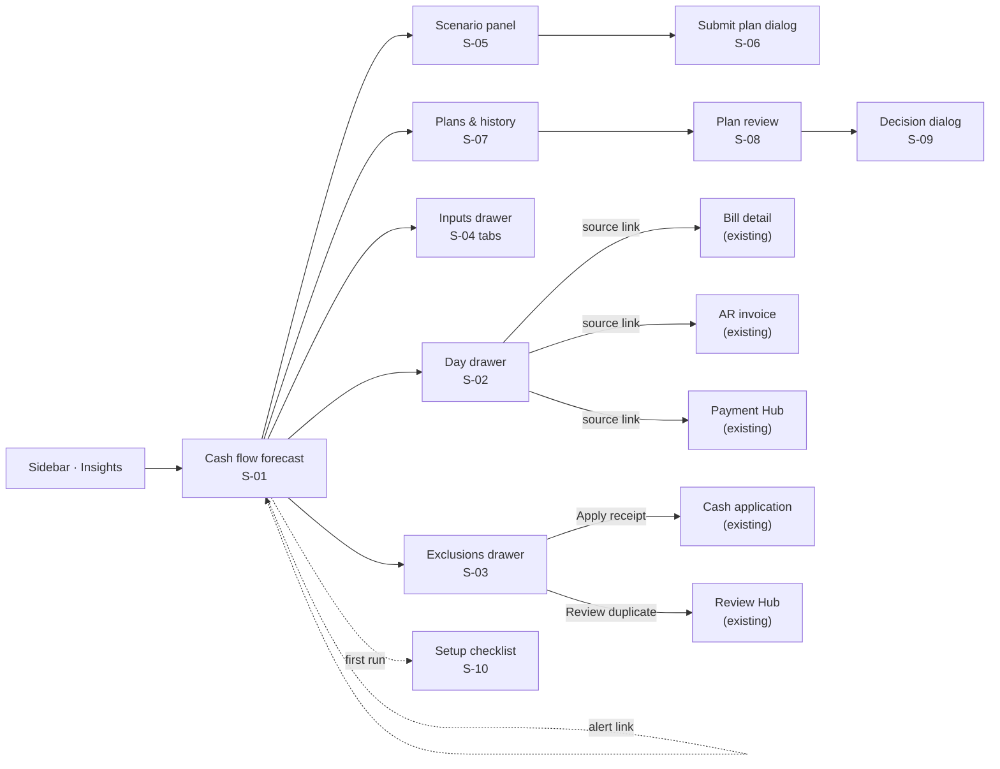

Deep links use the URL state, for example `/finance-desk/cash-forecast?view=downside&day=2026-11-30`, `…?scenario={id}` and `…/plans/{id}`.

---

## UF-01 · First run: set up the forecast

**Trigger:** the first visit by any `edit` user to a tenant with no `cf_settings` row, or with no included balance.
**Preconditions:** the `cash_forecast` entitlement is on and the user has the `accountant`, `finance_controller` or `admin` role.
**Goal:** the first forecast in under 10 minutes.

| # | User | System | Screen / API |
|---|---|---|---|
| 1 | Opens Insights → Cash flow forecast | Detects no settings or balance. Shows the setup checklist instead of the chart. | S-10 · `GET /settings`, `GET /accounts` |
| 2 | Step 1, **Accounts**: ticks HDFC Operations and SBI Collections; leaves the SBI CC unticked and enters the ₹40 L limit | Saves the include flags and the OD limit | `PATCH /accounts/{id}` (#4) |
| 3 | Step 2, **Balances**: sees statement balances already found for HDFC (₹43,51,483) and SBI (₹5,18,949), dated 20 Nov 18:30. Confirms, or types a newer figure. | Marks the statement balance as used, or saves a manual balance | `POST /balances` (#5) |
| 4 | Step 3, **Recurring obligations**: clicks *Add Indian statutory templates* | Creates GST (20th), TDS (7th), PF/ESI (15th), advance tax (quarterly 15th) and payroll (last banking day) with blank amounts | `POST /setup/seed-templates` (#10) |
| 5 | Fills in the amounts: payroll ₹21,80,000; GST ₹9,84,300; and so on. Adds rent ₹3,15,000 on the 5th and EMI ₹2,15,800 on the 10th. | Validates and saves. Templates still blank stay listed as *needs setup*. | `PATCH /recurring/{id}` (#8), `POST /recurring` (#7) |
| 6 | Step 4, **Reserve**: an owner-only field. An accountant sees “Ask your owner to set the reserve” and can continue with a ₹0 reserve. | Saves the reserve (owner only) | `PUT /settings` (#2) |
| 7 | Clicks **Build forecast** | Builds snapshot rev 1 and opens the forecast | `POST /snapshots` (#15) → S-01 |

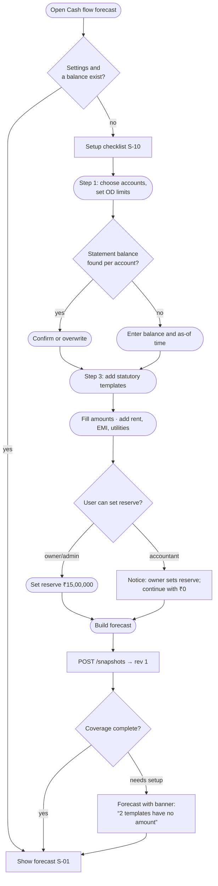

**Exits:** the forecast is visible, or the user leaves with the checklist progress saved. Every step persists on its own.
**Edge cases:**
- An account in a foreign currency is listed as “not supported in this release” and cannot be ticked.
- An as-of time in the future is refused (422).
- A user without `edit` sees “Your admin hasn't set up the cash forecast yet” and no form.

---

## UF-02 · Morning cash check

**Trigger:** the daily routine, or the 07:00 snapshot.
**Preconditions:** a snapshot exists.
**Goal:** answer “are we OK this month?” in under 30 seconds.

| # | User | System |
|---|---|---|
| 1 | Opens the page (bookmark or sidebar) | Loads the latest snapshot and the expected view (#14, #16). If the snapshot is older than today's 07:00, or the balance is stale, shows the freshness banner. |
| 2 | Reads the KPI strip | Shows Cash today **₹48,70,432** · Lowest **₹9,99,874 on Mon 30 Nov** · First breach **30 Nov (−₹5,00,126 vs reserve)** · Runway without collections **5 days** · 30-day net **+₹30,26,415** · CC headroom **₹40,00,000** |
| 3 | Scans the chart | The line dips below the dashed reserve on 30 Nov, with a red marker |
| 4a | All clear → closes the page | — |
| 4b | Breach shown → continues to UF-03 | — |
| 5 | (Optional) Switches to **Downside** | Same revision. Lowest −₹32,44,064 on 30 Nov. First breach 23 Nov. |
| 6 | (Optional) Clicks **Refresh** after importing today's statement | `POST /snapshots`. A toast says “Updated to revision 2”, or “No changes since 07:00”. |

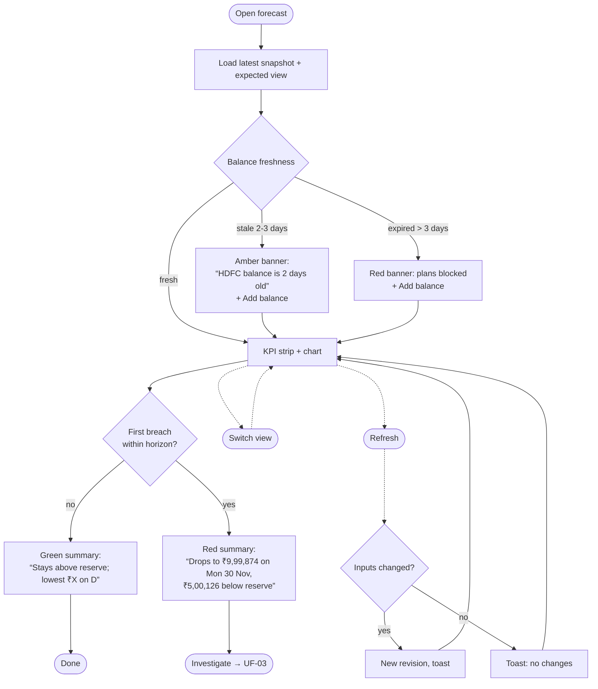

Runway check: in the no-collections view the first negative day is 26 Nov, five days after the 21 Nov start.

---

## UF-03 · Investigate a reserve breach

**Trigger:** a red marker on the chart, or the “First breach” KPI.
**Goal:** know exactly which payments and collections cause the dip, and spot errors.

| # | User | System |
|---|---|---|
| 1 | Clicks the 30 Nov marker, a ledger row, or the KPI | Opens the day drawer (S-02, #17). Header: opening ₹42,83,944 · in ₹18,93,408 · out ₹51,77,478 · closing ₹9,99,874. |
| 2 | Reviews the outflows, sorted by amount | Payroll ₹21,80,000 (*fixed*, last banking day); insurance ₹6,85,000; six supplier bills ₹22,66,478, of which Raigad RAI/2610/203 (₹4,95,180) has an **agreed window to 2 Dec** chip; diesel ₹46,000. The other two windowed bills fall earlier in the week (Ankur ANK/2610/234 on 25 Nov, Indus IND/2610/884 on 26 Nov). Together the three hold ₹15,26,805 of movable outflow. |
| 3 | Hovers the date basis of an inflow | “Kalinga Home Essentials · 5 days overdue; remaining 7 days median (customer, n = 13)” |
| 4 | Opens a source link | Bill or invoice detail in a new tab. The drawer keeps its state. |
| 5 | Opens **Exclusions** | Seven rows. The ₹2,35,800 Polyshield duplicate links to Review Hub, and Kalinga's ₹2,84,333 links to Cash application. |
| 6 | Spots a wrong date (for example, a supplier agreed to a later date) | Goes to UF-04 (payment window), or straight to UF-05 to try a change |

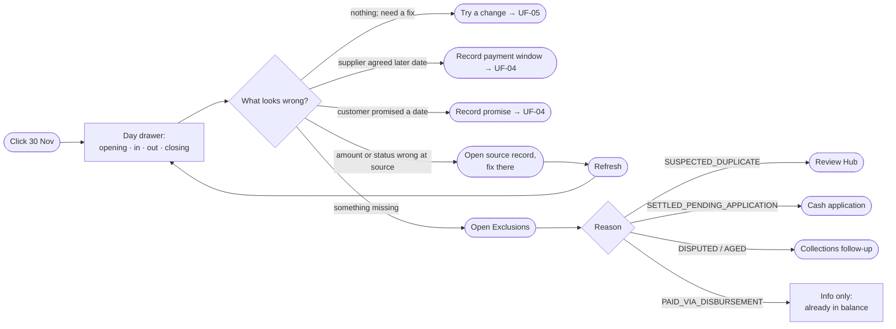

**Edge cases:**
- A day with more than 50 events paginates within the drawer, and the totals are still for the whole day.
- An auditor sees the same drawer without the *Move* actions.
- A source the user cannot open (no module access) shows the label and amount with “No access to source”.

---

## UF-04 · Maintain inputs

All inputs live in the **Inputs drawer (S-04)** tabs and can also be reached from the day drawer's context actions. Every save shows a toast and offers **Refresh forecast**. Inputs never change the open snapshot until a refresh.

### UF-04a · Record a manual balance

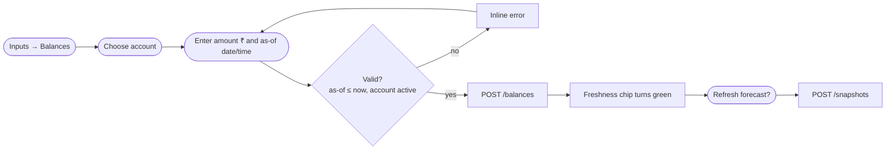

### UF-04b · Add or edit a recurring obligation

| Field | Example | Validation |
|---|---|---|
| Name | “Warehouse rent - Bhiwandi (net of TDS)” | 1–120 characters |
| Category | Rent | Enum |
| Amount | ₹3,15,000 | > 0. Blank keeps it as a template. |
| Frequency and anchor | Monthly, on the 5th | Monthly 1–31 or *last banking day*; weekly Mon–Sat; quarterly with months |
| If not a banking day | Pay next banking day | Statutory and payroll default to *previous* |
| Confidence | Committed | committed / estimated |
| Starts / ends | 1 Apr 2026 / — | end ≥ start |

A preview line under the form shows the next three dates. For example: “Next: Sat 5 Dec, Tue 5 Jan, Fri 5 Feb” (these dates come from the tenant calendar).

### UF-04c · Record a supplier payment window

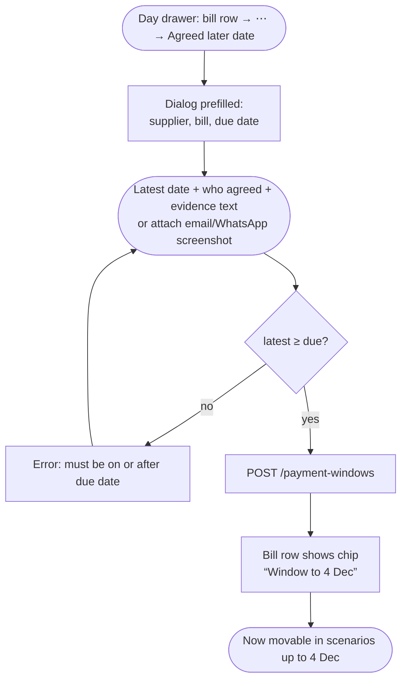

### UF-04d · Record a promise to pay

From the AR invoice row in the day drawer, or the Inputs tab: enter the date, amount (defaults to the outstanding amount, net of expected TDS), source (call, email, meeting…) and a note. The expected view moves the receipt to that date, with basis *promise to pay*. The downside view is unchanged. A promise that passes unpaid shows as **Broken promise** in that day's drawer (P1: alert).

### UF-04e · Add a one-off adjustment

Name, category, in/out, amount, date and confidence. Use it for things that are not in AP: insurance renewal ₹6,85,000 (30 Nov), forklift down payment ₹4,50,000 (9 Dec), expected GST refund ₹1,42,000 (16 Dec, *estimated*, so it appears in the expected view only).

---

## UF-05 · Build a what-if scenario

**Trigger:** a breach to fix, or a question like “what if Sahyadri pays late?”.
**Preconditions:** the `edit` capability and a snapshot.

| # | User | System |
|---|---|---|
| 1 | Clicks **New scenario** (or *Move* on an event in the day drawer) | The scenario panel opens with the active view and revision shown |
| 2 | Adds a change: **Move payment** Ankur ANK/2610/234 → 4 Dec | Date picker greys out non-banking days and dates outside the window (after 4 Dec). Preview runs (#19). |
| 3 | Adds Indus → 3 Dec and Raigad → 2 Dec | Each change updates the dashed scenario line and the delta card: “Lowest ₹9,99,874 → ₹19,13,700 · breach cleared” |
| 4 | Tries Raigad → 3 Dec | The picker blocks it. If typed through the API: 422 `OUTSIDE_PAYMENT_WINDOW`, and the row shows the error with “Window ends 2 Dec”. |
| 5 | Tries to move payroll | No *Move* action on fixed items. Tooltip: “Payroll and statutory dues can't be moved in a plan.” |
| 6 | Adds an assumption: **Delay customer** Sahyadri +10 days | The row is tagged *Assumption*. Closing on 20 Dec drops by ₹14,50,000; the minimum is unchanged. |
| 7 | Clicks **Save as** “Defer three windowed supplier payments” | `POST /scenarios`. The scenario appears in the selector. |
| 8 | Switches to **Downside** with the scenario on | Downside minimum −₹32,44,064 → −₹17,66,767. The breach persists, and the CC headroom (₹40 L) chip is highlighted. |
| 9 | Continues to UF-06 | — |

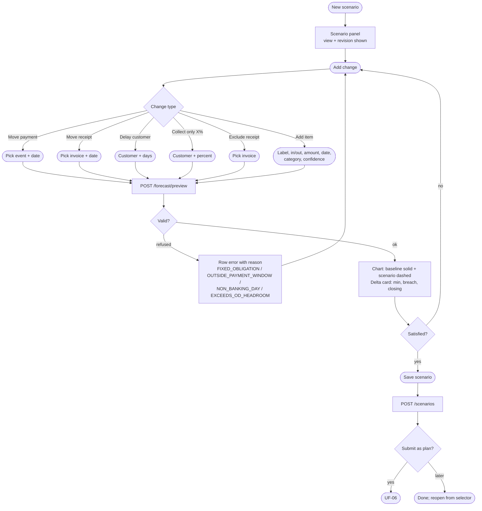

**Rebase on reopen:** opening a scenario saved on an older revision triggers revalidation. Each change gets a badge: ✓ *still valid*, ⚠ *now outside window* (the window was shortened), or ✕ *bill no longer open* (it was paid). The scenario status becomes *Needs review* until the user resolves the badges.

---

## UF-06 · Submit, review and decide a cash plan

Swimlane view: accountant and owner.

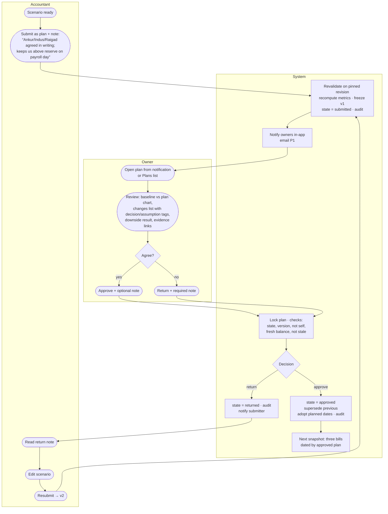

**Plan review screen (S-08) content, from the fixture:**
- Header: “Defer three windowed supplier payments · v1 · submitted by Accountant · rev 1 · Expected view”.
- Outcome card: “Lowest balance ₹9,99,874 → **₹19,13,700**. Reserve breach on 30 Nov → **none**.”
- Downside card: “Still below reserve from 23 Nov; lowest −₹17,66,767 on 2 Dec. Depends on collections or the CC line (₹40 L available).”
- Changes list: three *decisions*, each with its window evidence (“Email from supplier accounts, 17 Nov”).
- A notice that cannot be dismissed: “Approving records the plan. It does not make or schedule any payment. Payments go through Payment Hub as usual.”

**Decision rules (server-enforced):** the approver must have the `approve` capability, must not be the submitter (unless the tenant allows self-approval), and the balance must not be expired. The plan must not be stale (UF-07). A double click on Approve creates one decision, because both requests share an idempotency key.

---

## UF-07 · Plan went stale before approval

**Trigger:** the owner clicks Approve, but inputs changed after submission. For example, a new bill was approved, or Indus was paid.

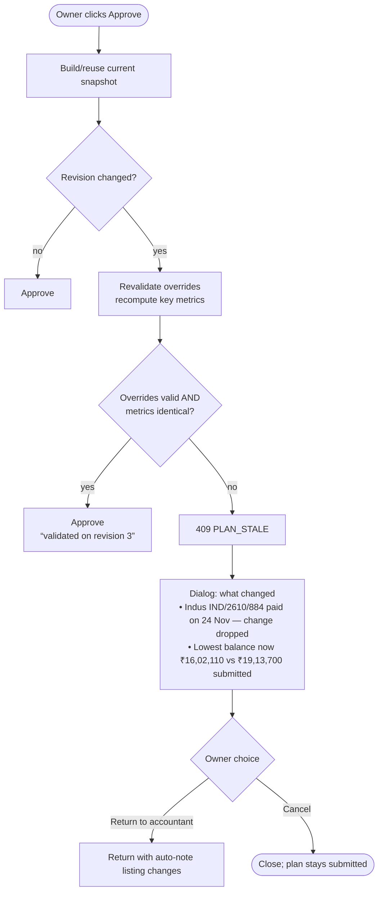

The values in this diagram illustrate the dialog. The diff is computed live.

---

## UF-08 · Breach alert to action (P1)

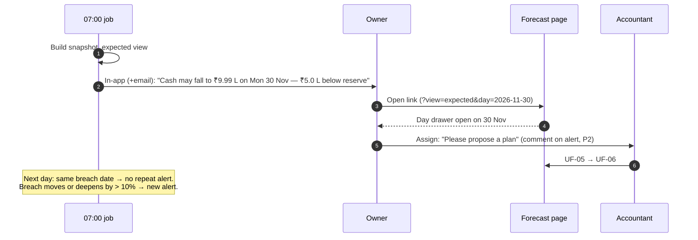

---

## UF-09 · Auditor review and export

| # | Auditor | System |
|---|---|---|
| 1 | Opens Cash flow forecast | Read-only: no Refresh, no Move, no inputs editing. View switch and drawers work. |
| 2 | Opens **Plans & history** (S-07) | Lists plans with state, version, submitter, approver, timestamps and the revision used |
| 3 | Opens an approved plan | Shows the frozen metrics, overrides, decision note, `validated_on_revision` and the audit trail |
| 4 | Clicks **Export CSV** | `GET /export.csv`. The file header carries the tenant, revision, view, as-of, reserve and plan ID. It has a daily rows section, an events section (with date basis) and an exclusions section. |

---

## UF-10 · Degraded and empty states

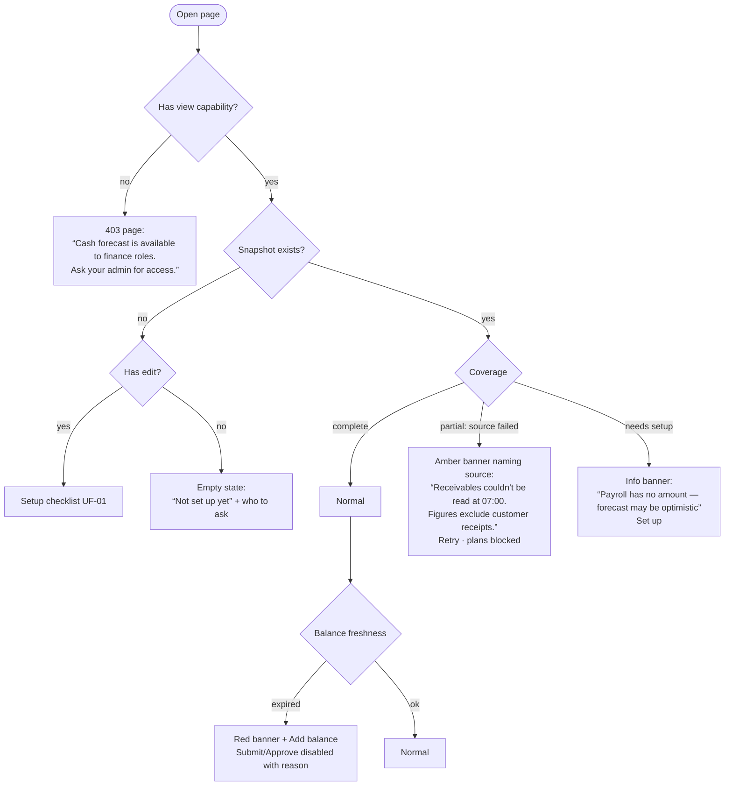

| State | Copy (headline) | Primary action |
|---|---|---|
| No access | “Cash forecast is available to finance roles.” | — |
| Not set up (edit) | “Set up your cash forecast” | Start setup |
| Not set up (view only) | “Your finance team hasn't set up the cash forecast yet.” | — |
| No balance | “Add today's bank balance to see your forecast.” | Add balance |
| Stale balance | “HDFC Operations balance is 2 banking days old.” | Add balance |
| Expired balance | “Balances are over 3 banking days old. Plans can't be submitted or approved until you update them.” | Add balance |
| Partial sources | “Receivables couldn't be read. Figures exclude customer receipts.” | Retry |
| No breach | “Stays above your ₹15,00,000 reserve. Lowest ₹X on D.” | — |
| Preview refused | Reason-specific (see [UI spec §8](06_UI_SPEC.md#8-copy-and-messages)) | Fix the change |
