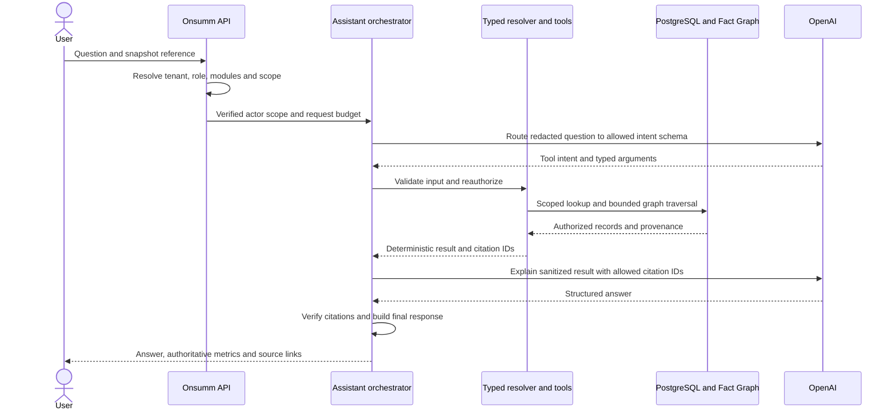

# Scalable finance assistant on the Onsumm Fact Graph

## Integration and authorization

Use the existing [tenant/auth context](../../backend_ocr/app/security/auth.py), [role capabilities](../../backend_ocr/app/security/capabilities.py), [ownership checks](../../backend_ocr/app/security/tenancy.py) and module licensing. Existing access tokens may rely on role rather than permission claims. Source-specific visibility remains authoritative for every tool, graph edge, total and citation. A graph match grants no further access.

| Actor | Proposed assistant policy |
|---|---|
| Accountant / finance controller | Read allowed AP, AR, cash and inventory domains for the current tenant. Submit a plan only through the plan API if eligible. |
| Approver | Inspect sources within their existing access and assigned plan scope. Decide through the plan API with a separate approval capability and actor check. |
| Auditor | View authorized finance evidence and decision history. All plan mutations remain unavailable. |
| Member or platform support | Default to denied unless explicitly entitled. Support access never implicitly grants tenant finance chat; impersonation is disabled for the pilot. |

Treat these as policy mappings to validate against current tenant roles. A tenant owner in the product story maps to an explicitly authorized tenant approver, separate from platform owner roles.

## Retrieval and citations

- Resolve exact invoice, vendor and SKU references first. Reuse the [Fact Graph](../../backend_ocr/app/domain/fact_graph.py) for related parties, bills and evidence. Add SKU, offer, purchase-order and scenario projections with source revisions. Use semantic search only as a recall aid. Filter tenancy and candidate visibility before ranking and recheck every hydrated record; include only authorized edges and nodes.
- Canonical typed tools include cash forecast, receivables due, payables due, stock risk, offer comparison and record explanation. Each returns units, currency, as-of, filter scope, assumptions, partial-result state, and typed rows. Aggregates run over the same authorized query scope. If incomplete permissions make a tenant-wide total misleading, return a labeled scope or refuse the aggregate.
- Citation fields are `citation_id`, `source_type`, authorized `source_id`, revision or as-of, safe title, field or calculation ID, and a server-built application path. Display cached citations only if the actor still has access on replay. An answer referencing an unknown citation ID is discarded. Calculated figures are rendered from typed results, with documented formula lineage to input IDs. Never synthesize a source path in model output.
- State limits explicitly. Use the same snapshot across parallel tools, cap graph expansions and result rows, and report partial coverage. Answers to unsupported or ambiguous questions identify missing data or ask which date, company or SKU is intended.

## OpenAI path and scale

**Hackathon:** Reuse the app's async [OpenAI wrapper](../../backend_ocr/app/ai/llm.py) and pinned SDK. Route with JSON output, validate with Pydantic, execute the allowlisted tool in application code, and format a structured answer. No need for an SDK migration for the first release. Use a template response when the model or validation fails.

**Pilot target:** After reviewing SDK compatibility and OpenAI project data controls, optionally adopt the Responses API with strict function schemas. Use application-side schema validation and allowlists in either integration. Keep project keys in Secrets Manager, inject per environment, and prohibit secrets or bank account details in prompt context. Verify endpoint-specific storage behavior before production; when supported set `store:false`. Review provider retention, processing regions, contract terms and approved fields with data owners. Context is minimized regardless of provider configuration. [Function calling](https://platform.openai.com/docs/guides/function-calling) · [Structured Outputs](https://platform.openai.com/docs/guides/structured-outputs) · [API data controls](https://platform.openai.com/docs/guides/your-data)

Run stateless assistant replicas with separate model concurrency and per-tenant request/token budgets. Cap turns, tool calls, context bytes and per-tool deadlines. Keep a bounded database pool and release connections before network calls. Cache only deterministic read results using tenant, effective authorization fingerprint, snapshot revision, policy version, intent and normalized parameters. Invalidate on permission or data change. Start with a synchronous response and queued graph enrichment. Add asynchronous answers only if pilot latency warrants it. Stream validated response events only after policy and citation checks; use heartbeat/status events during tool execution.

Monitor per-tool p50/p95 latency, model tokens/cost, timeouts, fallback rate, citation validation and denied requests. Track request and snapshot IDs without storing raw sensitive prompts. Deploy versioned prompts and validate against a fixed set of scoped questions before changing models. See [controls](FINANCIAL_GUARDRAILS.md) and [AWS deployment](AWS_DEPLOYMENT.md).
