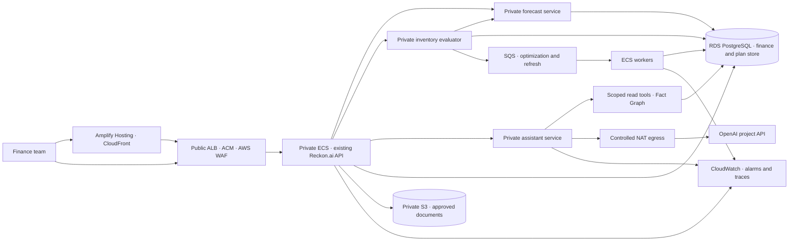

# AWS deployment and application architecture

**Status:** Target architecture and runbook proposal. No infrastructure changes are included.

## Current integration and rollout path

The [UAT2 notes](../aws-deploy/DEV_ENVIRONMENT.md) describe Amplify for the frontend and a FastAPI process on EC2 behind HTTPS, with PostgreSQL access and a separate worker process. They also document a historical shared development/production database arrangement. Confirm the actual deployment topology with the operator before changing it. The [application architecture](../architecture/ARCHITECTURE.md), [backend composition](../../backend_ocr/app/main.py) and [worker process](../../main.py) remain the integration points.

1. **Hackathon:** Use the existing application shell and a seeded adapter with a local plan database. Set a separate development OpenAI project key only if live AI is used. Keep bank, procurement and email integrations out of the demo execution path.
2. **First AWS pilot:** Serve under a feature-gated route on the existing application, with finance data in an isolated development or pilot database and separate signing/secrets configuration. Keep calls internal and apply the three domain boundaries in-process. Make read-only source access and migration credentials separate. Verify bank and procurement side effects remain disabled for these services.
3. **Scale:** Move forecast/optimization work and assistant traffic to independent ECS task groups after load and cost data justify it. Preserve the same HTTP types and auth model. Use managed job queues for heavy work. Keep the existing AP/AR routes and workers operating during the migration.

## Infrastructure and scaling

| Layer | AWS target and controls |
|---|---|
| Accounts and network | Separate nonproduction and production accounts or equivalent isolation. Start in the approved region, with Mumbai as the existing design reference. Use at least two AZs, public ALB subnets and private task/database subnets. RDS accepts traffic only from approved task security groups; use TLS for DB connections. |
| Frontend and edge | Amplify/CloudFront builds the React app. Use HTTPS ACM certificates, WAF rate and size policies where appropriate and restrictive CORS. Keep credentials out of Vite public variables. |
| Runtime | ECS Fargate tasks on private networks. One API entry point resolves auth. Internal services accept only service-authenticated requests and independently validate actor scope. Strip/ignore externally supplied identity headers. Set timeouts and concurrency limits per service. |
| Database and evidence | RDS PostgreSQL, Multi-AZ for production when required, encrypted storage and automated backups with a tested restore. Confirm pgvector support on the selected engine if semantic search is enabled. Use exact graph/source lookups otherwise. Size DB pools across all task replicas. Evaluate pooling carefully for any worker that uses persistent LISTEN/NOTIFY sessions. |
| Jobs | SQS with DLQ for larger inventory runs and evidence refresh. Use visibility timeout above a bounded job execution window and acknowledge only after durable completion. Deduplicate by tenant, job type and input revision. A stale job cannot overwrite a newer snapshot. |
| Files and secrets | Private S3 with access controls, encrypted objects and narrowly scoped retrieval. Secrets Manager for database credentials, signing material and OpenAI API keys. Grant task roles only the relevant environment secrets. Keep privileged schema credentials on the migration task. |
| Egress and observability | Controlled NAT or approved egress route to OpenAI, with provider-specific rate limits and no direct DB or document URLs in context. Use VPC endpoints where supported. CloudWatch dashboards and alarms for API errors, forecast latency, queue age, DLQ, model budget/fallback and DB saturation. Exclude raw sensitive prompts and account details from logs. |

Isolate operational headroom separately for user API calls, forecasting workers and model calls. Forecast previews scale by CPU/latency, queued runs by backlog age, and assistant replicas by in-flight requests subject to tenant and OpenAI budgets. Avoid raising task count beyond the global DB connection capacity.

## Configuration checklist

- Scope application toggles to eligible tenants and default all new services off. Validate model, provider project, timeout and cost limits before enabling assistant traffic.
- Supply isolated database URLs and IAM task execution/task roles. Configure encryption, backup retention and log retention according to the approved environment policy.
- Version app images, migrations, policies and prompts. Generate compatible OpenAPI from FastAPI contracts. Run migrations once in a controlled task with a separate identity. Keep migrations additive across rolling releases.
- Use a launch checklist with named finance, security and engineering owners. Validate network routes, sample authorization, data redaction, snapshot reconciliation and provider fallback before expanding access.

## Deployment and recovery sequence

1. Build and scan images, pin deployable digests, and run reducer, permission, contract and fixture checks in CI. Apply reviewed migrations to the isolated pilot database. Confirm restore readiness before data import.
2. Deploy workers and API with tenant flags off. Check health, metrics, migration version, job ownership and dead-letter routing. Enable one synthetic tenant. Confirm forecast, stock comparison, citation access, OpenAI fallback and plan history across reload.
3. Canary one approved tenant with the same read model. Watch latency, queue lag, denied access, fallback and database limits. Compare normalized finance totals to reconciled source records. Record approvals and results.
4. On failure, disable affected flags and pause consuming new jobs. Roll back task definitions to the previously verified image. Keep additive schemas so the prior app can continue reading. If data recovery is needed, restore to a separate instance, review and reconcile before reconnecting. Do not replay decision writes without idempotency verification.

Validate RPO/RTO and environment cost with the operator. Include Amplify, ALB/WAF, Fargate, RDS, NAT, S3, SQS, logs and model usage in pilot estimates. [ECS guidance](https://docs.aws.amazon.com/AmazonECS/latest/developerguide/Welcome.html) · [RDS PostgreSQL](https://docs.aws.amazon.com/AmazonRDS/latest/UserGuide/CHAP_PostgreSQL.html) · [SQS DLQs](https://docs.aws.amazon.com/AWSSimpleQueueService/latest/SQSDeveloperGuide/sqs-dead-letter-queues.html) · [Secrets Manager](https://docs.aws.amazon.com/secretsmanager/latest/userguide/intro.html)
