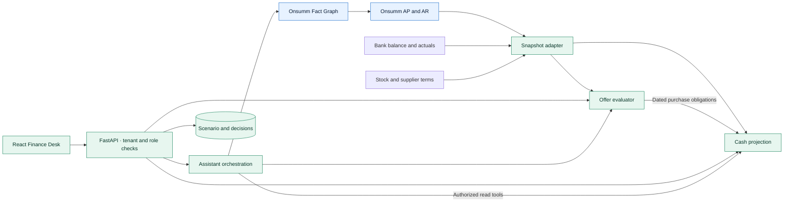

# Finance Desk high-level design

## Context and boundaries

The desk extends the existing React and FastAPI application. A snapshot adapter reads authorized AP, AR and bank inputs and combines them with imported stock and supplier offers. The forecasting and inventory services share **one versioned snapshot**, so purchasing constraints and what-if projections use the same figures. The assistant calls these services through typed read tools.

## Component responsibilities

| Component | Owns | Boundary |
|---|---|---|
| Snapshot adapter | Canonical statuses, local business dates, normalized money, provenance and revision | Read scoped finance data. Accept inventory imports through a separate typed source. A seeded adapter uses the same contract. |
| Cash service | Daily buckets, baseline and scenario calculations, reserve risk and source attribution | Pure calculation over a snapshot. No database mutation. |
| Offer evaluator | Stock projection, pack/MOQ/lead-time feasibility, landed spend and dated cash implications | Calls the cash service for each candidate. No order submission. |
| Evidence service | Entity resolution, bounded graph traversal, and authorized source links | Graph is a relationship index. Re-read authoritative records for balances and statuses. |
| Assistant | Intent routing, tool calls and concise evidence-backed response | Read capabilities only. Text generation can fail independently of deterministic results. |
| Plan service | Drafts, submitted revisions, decisions, idempotency and audit references | Persists plan state. Payout and procurement remain in their own domains. |

## Decision records

| Decision | Rationale | Revisit when |
|---|---|---|
| Use current Onsumm application and PostgreSQL read adapters. | Existing bills, receivables and authorization are the product foundation. | Dedicated deployment is needed for a significant scaling or operational boundary. |
| Use the existing Fact Graph, with exact-reference fallback. | Evidence discovery can reuse entity relationships. Exact IDs and SQL remain sufficient for the demo. | Pilot measurements show graph coverage or traversal quality limits answers. |
| Enumerate a small number of offers and enforce hard cash constraints. | Demonstrates transparent vendor trade-offs in one day. | Multi-SKU coupling and order volumes make enumeration impractical. |
| Use an isolated fixture and durable local plan store for the demo. | Prior environment checks could not connect to configured PostgreSQL. | A dedicated development database and representative inventory source are reachable. |
| Restrict AI to interpretation and explanation. | The same deterministic numbers appear in the chart, the decision record, and the assistant. | Additional read intents have explicit contracts and tenant permission tests. |

### Failure behavior

Unavailable finance sources degrade to an explicit coverage state. Missing opening cash blocks cash approval. Stale inputs allow clearly marked review of the previous snapshot while requiring recomputation before approval. A model outage still returns deterministic values and source links. Keep graph evidence lookup bounded and fall back to the authorized source record when graph data is missing.

See [source evidence](REFERENCES.md) and [implementation contracts](LLD.md).

## Overall application and service evolution

Start the three bounded domains inside the existing FastAPI app. The forecast owns daily cash arithmetic, inventory owns stock and quote feasibility, and the assistant owns scoped question routing and evidence. They share canonical snapshot contracts. The [AWS deployment design](AWS_DEPLOYMENT.md) describes the current integration and the conditions for independently deploying each service, with AP/AR and the plan store behind the existing app boundary. See the [financial controls](FINANCIAL_GUARDRAILS.md) and [contracts](API_AND_DATA_MODELS.md).
