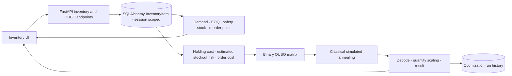

# Inventory optimization reference and Onsumm adaptation

## What the Paytm code does

Source inspected at commit `cc1a4133022dfdde9cd1e5928623b8eab0aec5a1`. This reference is limited to inventory optimization. The finance assistant, cash model and deployment below are Onsumm designs.

| Reference code | Observed behavior |
|---|---|
| [InventoryItem model](https://github.com/r-rishit27/paytm/blob/cc1a4133022dfdde9cd1e5928623b8eab0aec5a1/backend/models.py#L81) | Session-based item state with stock, reorder level, cost, selling price and units sold over 30 days. |
| [Inventory endpoints](https://github.com/r-rishit27/paytm/blob/cc1a4133022dfdde9cd1e5928623b8eab0aec5a1/backend/main.py#L378) and [inventory agent](https://github.com/r-rishit27/paytm/blob/cc1a4133022dfdde9cd1e5928623b8eab0aec5a1/backend/agents/inventory.py#L58) | List and alert endpoints plus a deterministic heuristic. Daily demand is 30-day units divided by 30. EOQ uses configured constants for ordering and holding costs. Reorder point combines lead-time demand, safety stock and the item's existing reorder floor. |
| [Portfolio preparation and history](https://github.com/r-rishit27/paytm/blob/cc1a4133022dfdde9cd1e5928623b8eab0aec5a1/backend/agents/quantum_inventory.py#L21) | Builds per-item holding, stockout and order costs, passes budget and capacity to the solver and persists run metadata. |
| [Solver](https://github.com/r-rishit27/paytm/blob/cc1a4133022dfdde9cd1e5928623b8eab0aec5a1/backend/agents/qubo_solver.py) | Uses a binary order/skip vector with classical simulated annealing. The budget and capacity terms are squared deviations from targets. Decoding scales selected EOQs down and rounds quantities. |

Squared deviations favor proximity to a budget or capacity target and do not enforce an upper bound. The decoder's rounding and minimum quantity can still leave an infeasible result. The reference also estimates capacity from quantities. These are useful prototype choices to compare against an exact feasibility check. No source code is copied.

## Own the decision in Onsumm

1. Read stock, observed demand, open purchase orders and verified offers at a single revision. Identify whether lateness, absent history or unavailable terms limit inference. Use current catalog and vendor links after confirming their identities. Treat stock CSV and quote data as separate source records.
2. Calculate daily availability, shortage unit-days and earliest stockout per SKU/location. For existing receipts or reservations already represented upstream, deduplicate using source identity. Use lead-time demand plus safety stock; compute EOQ only when reliable order and holding costs are present.
3. Enumerate supplier offers and viable pack quantities. The candidate carries MOQ, landed cost components, physical units, lead-time date and dated deposit/final obligations. Use the cash service to preview those obligations on each day of the scenario.
4. Validate hard constraints after pack rounding. Check quote validity and pickup/arrival, authorization window, MOQ, aggregate capacity where trusted, and the reserve on each dated cash bucket. An already-breached scenario can show impact, but no candidate is eligible for approval as reserve-feasible.
5. Rank eligible options by stockouts averted, unmet units, landed cost and inventory tied up. Apply a stable tie-break. Return failed constraints with business dates and the fallback action, such as splitting a quote or collecting a dated receivable. Approval records a recommendation and never dispatches an order.

**Scale path:** Run bounded enumeration inline for one SKU. Queue larger runs; partition by tenant, location and source revision, impose a solve deadline, and return best verified feasible options with coverage and termination status. Consider an integer optimization model for coupled SKUs, shared cash and order increments. Benchmark against enumeration on small cases; revalidate every solver result with the same deterministic cash and stock routines before approval.

See the [contracts](API_AND_DATA_MODELS.md), [financial controls](FINANCIAL_GUARDRAILS.md), and [demo outcomes](DELIVERY_AND_VERIFICATION.md).
