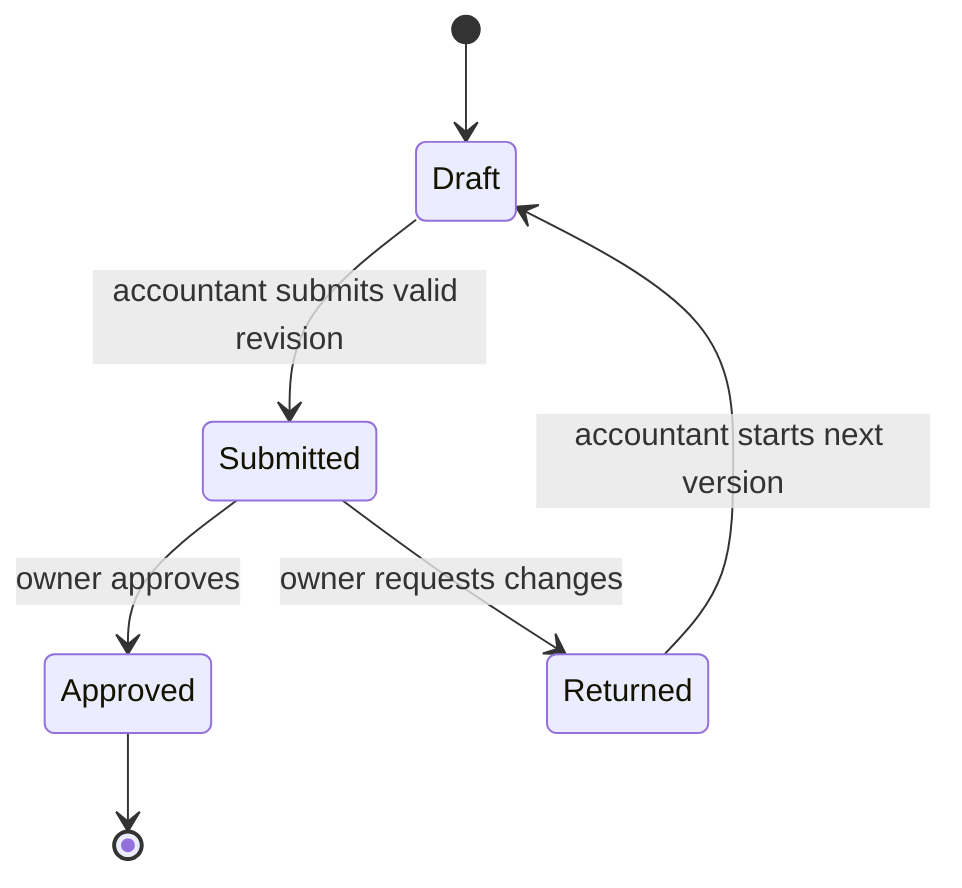

# Finance Desk low-level design

Contracts below describe planned behavior. The earlier [technical design](TECHNICAL_DESIGN.md) supplies the business rationale and full feature inventory.

## Data and service contracts

All keys are tenant-scoped. Amounts are signed or unsigned integer paise according to the field contract. Quantities use explicitly normalized units. Business dates are local dates with an explicit timezone; timestamps are stored in UTC. Default demo timezone is Asia/Kolkata.

| Type | Important fields and constraints |
|---|---|
| Snapshot | Tenant, UUID, revision, as-of timestamp, balance timestamp, INR balance, reserve, timezone, source watermarks, missing inputs. Immutable after creation. |
| Cash event | Snapshot, source type and ID, occurrence key, category, signed paise, date, status, linked settlement ID, eligibility and evidence. Unique per tenant/snapshot/occurrence key. Amount must be accounted for in just one effective cash event. |
| Stock input | SKU, location, unit, on-hand, reserved, as-of date, demand history quality, firm inbound lines. Keep historic snapshots and enforce a consistent unit across comparisons. |
| Offer | SKU, vendor, quote revision, effective dates, MOQ, pack size, lead time, landed unit and fixed cost, payment schedule, evidence. Require positive pack size and nonnegative costs. |
| Scenario | Snapshot revision, view, proposed date changes, candidate quantities and finance policy. Canonicalize inputs before hashing or caching. |
| Plan | Tenant, plan ID, snapshot revision, version, state, scenario, metrics, proposer. Submitted version is frozen. |
| Decision | Tenant, plan ID/version, actor, decision, reason, idempotency key, timestamp, forecast and evidence references. Unique decision per submitted version. |

Adapters implement `read_snapshot(actor, scope)`, `read_stock(actor, sku, location)`, `read_offers(actor, sku)`, and `read_evidence(actor, source_ref)`. Production reads use existing role-checked repository paths. Request fields supply scope within the authenticated tenant. The local adapter uses equivalent synthetic roles and fixtures.

## Deterministic reducers

**Cash computation**

1. Reject an unavailable opening balance and a forecast that mixes unsupported currencies. Normalize actuals after the balance timestamp through the snapshot cutoff and include each once. A reconciled balance may already reflect a payment. An invoice, match allocation and bank movement are different representations of the same settlement when their references link.
2. Use remaining outstanding amounts. Add future commitments and receipts according to the scenario inclusion policy. A settled row reflected in the opening balance, a held duplicate, and a missing-date item each stay out of scheduled buckets for different reasons. Report each exclusion.
3. Apply only allowed override fields to the canonical events. Validate dates server-side. For a planned purchase, expand deposits and final payments into dated obligations, without replacing an existing commitment unless its identity is explicitly given.
4. For each local date, compute `closing = opening + sum(signed_paise)`. Find the minimum and first day where closing is strictly less than the reserve. Return each bucket's opening, inflows, outflows, closing and evidence.
5. Committed view excludes estimated receipts. Expected view adds dated estimated receipts. Downside view uses named delays against the expected view. Compare only views calculated on the same snapshot, or mark the revision difference.

**Stock and offer computation**

- Project receipts that arrive at the start of each day for the demo. Consume forecast demand after arrivals. Record unmet units rather than carrying negative physical stock into the next period.
- Convert demand and offers to the stock unit. Avoid double-counting reserved orders already in recognized demand. Use the configured safety floor when calibration history is missing.
- Enumerate pack-rounded quantities at or above MOQ. Validate quote expiry, capacity, lead time and payment schedule. For each offer, run both stock and cash reducers against the same base scenario.
- Exclude offers with any cash reserve breach in the selected planning view. Rank feasible offers by avoiding stockouts, then minimizing shortage unit-days and landed spend, with a stable tie-break. Show why each excluded offer failed. If none are feasible, surface the constraints and require review.

## HTTP contracts

Proposed prefix is `/api/finance-desk`. Complex previews use POST and are side-effect free. Return a structured error with `code`, a safe `message`, and a field or record reference where authorized.

| Operation | Endpoint | Required input | Response |
|---|---|---|---|
| Load snapshot | `GET /snapshot` | Authorized account scope | Revision, opening balance, timestamps and coverage |
| Cash preview | `POST /forecast/preview` | Snapshot ID/revision, view, overrides | Day buckets, breaches, evidence, assumption warnings |
| Offer comparison | `POST /inventory/compare` | Snapshot ID/revision, scenario, SKU and location | Stock series, ranked offers, rejected reasons and linked cash previews |
| Ask assistant | `POST /assistant/query` | Question, snapshot and scenario | Narrative, typed result, cited refs, as-of date and warnings |
| Create or submit plan | `POST /plans` | Snapshot revision, normalized scenario, submission state | Plan ID/version, state, persisted summary |
| Owner decision | `POST /plans/{plan_id}/decision` | Expected plan version, approve/return, note, idempotency key | Recorded decision and resulting plan state |

Use 422 for unsupported or invalid parameters, 409 for stale revisions or incompatible repeated decisions, and existing authorization status conventions for protected resources. Validate payload limits, horizon and result bounds. Use parameterized queries and the existing tenant session. Never accept assistant-generated SQL as a query.

## Plan lifecycle and concurrency

At decision time, check owner permission, lock or compare-and-swap the submitted plan, and confirm its version and source snapshot applicability. Persist the decision and state change in one transaction. Return the existing result only when replaying the same idempotency key and equivalent payload. Reusing that key with a different payload returns a conflict. Failed or stale decisions leave the plan unchanged and require a refresh. Capture source IDs and metrics for reproducibility. This transaction submits no bank payout or vendor order.

## Assistant execution

Resolve identity and tool entitlement before routing. Allow bounded, typed intents for cash risk, AR due, AP due, stock risk, supplier comparison or evidence explanation. Rehydrate graph references through the same source authorization as direct lookups. Send the model only the necessary fields. Validate citations against the returned set and render monetary values from typed results. Use a labeled output template when model generation or citation validation fails. Store request timing, intent, outcome, and source counts with sensitive context omitted.

## Implementation order

Start with pure reducers and the fixture adapter. Add response models and role-checked routers, then the UI and transactional plan store. Add the model only after typed tool outputs match the UI. Follow [verification gates](DELIVERY_AND_VERIFICATION.md) before using live data.

## Companion specifications

Use [API and data models](API_AND_DATA_MODELS.md) for request and response types and idempotency. Use the [inventory adaptation](INVENTORY_REFERENCE.md) for offer evaluation, [assistant architecture](ASSISTANT_ARCHITECTURE.md) for authorization and citations, and [guardrails](FINANCIAL_GUARDRAILS.md) for cross-service release gates.
