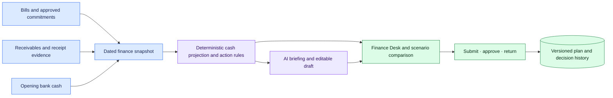

# Onsumm Finance Desk

**Hackathon PRD · One-day build · Primary SaaS reference is Odoo Accounting**

**Pitch:** Give an MSME owner the finance team's morning briefing and decision queue in one place. Onsumm reads approved bills, open receivables, bank balances, and reconciliation exceptions. It shows when cash could run short, proposes actions with supporting evidence, and lets the owner approve a plan while the accountant works the exceptions.

> **Expanded hackathon scope.** See the [technical design](TECHNICAL_DESIGN.md) for the inventory-aware cash forecast, vendor selection and database-backed assistant. The integrated demo and build order are defined in [delivery and verification](DELIVERY_AND_VERIFICATION.md). The cash-only example below explains the initial planning workflow.

## 1. Customer and problem

**First customer:** An Indian B2B wholesaler, distributor, or services firm with one operating entity, uneven collections, recurring vendor commitments, and a small finance team. The owner controls cash decisions. The accountant owns the quality of the books and follows up with customers and vendors.

**Job to be done:** “Before I approve today's vendor payments, tell me what cash is available, which customer receipts are reliable, what could go wrong this week, and who needs to do what.”

Today's workflow typically involves gathering balances, reconciling receipts, copying due dates into a sheet, checking duplicate bills, drafting reminders, and getting approvals over messages. The product automates those repetitive tasks and preserves accountant judgment for ambiguous evidence, statutory treatment, and corrections. Owners retain authority over payment timing and release.

## 2. Reference product and innovation

| Reference | Pattern to borrow |
|---|---|
| [Odoo Accounting](https://www.odoo.com/app/accounting) | **Primary reference.** A single work surface for invoices, bills, banking, and reconciliation. |
| [RazorpayX](https://razorpay.com/x/) | A clear separation between preparing a payout and approving or releasing it. |
| [Zoho Books](https://www.zoho.com/in/books/) | Accessible invoicing, collection reminders, and reporting for smaller teams. |
| [QuickBooks](https://quickbooks.intuit.com/) | Make bank activity, open invoices, and the books easy for an accountant to review together. |
| [Mysa](https://www.mysa.io/) | Payables and finance operations tailored to Indian businesses. |

**Innovation to show:** Convert a cash forecast into an **evidence-backed action plan**. Each proposal shows which bill, invoice, or receipt produced it, its expected cash effect, and what needs human approval. The owner can try a change in payment timing and immediately see the cash impact. An approved plan becomes a dated accountability record. These references identify design patterns for the build.

## 3. What ships in one day

One **Finance Desk** page, one synthetic distributor, one INR bank account, one stock location, and a seven-day horizon. Build the complete decision loop before expanding the UI.

**Integrated MVP:** Show when cash falls below reserve, evaluate two offers for a stockout-prone SKU, answer cash and vendor questions from authorized records, and persist an owner's decision. The expected case produces a clear choice. A delayed collection shows whether that choice still holds. See the [requirements and acceptance criteria](REQUIREMENTS.md).

| Priority | Feature | Definition of done |
|---|---|---|
| P0 | Morning cash briefing | Show opening available cash with its date and source, minimum projected balance, first reserve breach, expected receipts, and upcoming payments. Each number drills into its source records. |
| P0 | Action queue | Surface three tasks from the fixture: review a suspected duplicate, follow up on a material receivable, and propose a vendor payment reschedule. Show immediate next step, owner, amount, and evidence. |
| P0 | What-if plan | Preview a receipt delay or a permitted payment date change. Recompute balances immediately and show the difference against the baseline. |
| P1 | AI-generated briefing and drafts | Generate a short narrative grounded in the forecast and a customer follow-up draft tied to an invoice. Show the actual source records and allow the accountant to edit and copy the draft. |
| P0 | Cash-aware supplier comparison | Compare two offers on availability, stock cover and payment-date cash. Show the reserve constraint that rules an option out. |
| P0 | Evidence-backed assistant | Answer cash risk, due receivables and vendor comparison questions using tenant-scoped tools and source links. |
| P0 | Owner approval and history | Accountant submits a versioned plan. Owner approves or returns it with a note. Persist the decision, actor, timestamp, source revision, and before/after projection. The plan carries no payout authority. |
| P1 | Fresh evidence changes the plan | Import or confirm a synthetic bank receipt using cash application and refresh the desk. Show that the receipt becomes actual cash and leaves expected inflows exactly once. |
| P1 | Shareable decision record | Download the approved plan as a CSV with dates, amounts, assumptions, and tasks. |
| Later | Multi-entity cash, recurring expenses, rolling forecasts, collections sequences, live bank and ERP onboarding | Follow the pilot after the team validates the action queue and source data quality. |

The existing [bills and vendors UI](../../frontend/src/App.tsx), [payment queue](../../backend_ocr/app/routers/disbursement.py), [Review Hub](../../backend_ocr/app/routers/review_hub.py), and [cash application API](../../backend_ocr/app/routers/receivables.py) provide the product foundations. Build against a small snapshot interface. Use a seeded adapter for the hackathon and connect the existing read paths where the environment supports them. Live PostgreSQL access was unverified during the baseline review, so the end-to-end demo can run against a local fixture and durable local plan store.

## 4. Decision flow

1. **Accountant opens the Finance Desk.** Cash available is dated. Expected receipts and approved commitments are visible. The desk flags the first date cash falls below the reserve.
2. **Accountant investigates.** Selecting a number opens the bill, receivable, or imported evidence behind it. The accountant sees a suspected duplicate held for review and drafts a follow-up for a material receipt.
3. **Accountant simulates.** Delay the expected receipt to see downside. Move a vendor payment within an agreed window and see the impact on minimum cash.
4. **Owner decides.** Compare the baseline and proposal, review risk and evidence, then approve or return the plan with a note. A pending approval refreshes if the source snapshot changes.
5. **Accountant exports or follows the action list.** An approved plan records what the team agreed to do. The existing payment workflow applies its usual authorization and OTP when someone later initiates a real payout.

## 5. Demo dataset and expected results

**Scenario:** A distributor starts Day 1 with ₹2,40,000 in available bank cash and a ₹50,000 operating reserve. The ₹1,50,000 customer receipt is expected on Day 4 and has yet to clear. The ₹90,000 vendor bill has a finance-approved payment window through Day 5. Show this agreed window in the bill evidence.

| Event | Amount | Baseline | Proposed |
|---|---:|---:|---:|
| Opening cash, as of Day 1 | ₹2,40,000 | Day 1 | Day 1 |
| Approved vendor payment | −₹1,80,000 | Day 2 | Day 2 |
| Approved vendor payment with flexible date | −₹90,000 | Day 3 | Day 5 |
| Expected customer receipt | +₹1,50,000 | Day 4 | Day 4 |
| Suspected duplicate, held for review | ₹40,000 | Visible as an exception | Visible as an exception |
| Minimum projected cash | | **−₹30,000 on Day 3** | **₹60,000 on Days 2–3** |
| Day 7 projected closing cash | | **₹1,20,000** | **₹1,20,000** |

**Downside demo:** Move the receipt from Day 4 to Day 6. Even with the proposed vendor schedule, cash drops to **−₹30,000 on Day 5**. The desk shows that the plan depends on receipt timing and gives collections a concrete task. The payables and receivables are unchanged in these previews.

**Three-minute judge walkthrough:** Open the briefing and explain the Day 3 risk. Open the two supporting bills and the receivable. If the draft feature is ready, generate and inspect a follow-up. Simulate the vendor move, then stress-test a delayed receipt. Return to the expected scenario, submit it, approve as the demo owner, and reload to show the saved decision.

## 6. Engineering design

- **Snapshot.** One tenant, account, currency, opening balance, balance timestamp, and a revision. Cash events carry source type, source ID, date, amount in integer paise, flow direction, and status. Include balance and event provenance in the UI.
- **Projection.** Starting cash plus cumulative inflows minus cumulative outflows, grouped by date. Show a committed view and an expected view. Count a cleared receipt or payment in opening cash if it is already reflected in the opening balance. Exclude it from projected flows. Exclude held duplicates from commitments and show their amount in the review queue. Order the action list by reserve impact and due date.
- **Scenario.** Save proposed date changes separately from source records. Reject changes outside the allowed window. The approval screen shows the starting revision, proposed changes, remaining downside, and forecast delta. A change to source evidence requires a fresh preview.
- **AI.** Pass only relevant structured fields, approved source IDs, and computed numbers. Require a structured response with cited IDs. Validate references before display. Keep generated text separate from calculations and decisions. Use a clearly labeled template fallback if the model is unavailable. Draft generation has no send permission and uses only synthetic data in the hackathon.
- **Decisions.** Use the states `draft → submitted → approved / returned`. Persist transitions through the API, enforce the demo accountant/owner permissions on the server, and make repeated approvals idempotent. The simulated workflow does not mutate live invoices or release funds.

## 7. Acceptance and business measurement

| Check | Acceptance |
|---|---|
| Forecast correctness | Fixture yields −₹30,000 baseline minimum and ₹60,000 proposed minimum. Both close at ₹1,20,000. The delayed-receipt scenario breaches the reserve after the move. |
| Evidence integrity | Every amount or proposed action opens a source row or a labeled assumption. The ₹40,000 duplicate stays visible and stays out of scheduled outflows. |
| AI usefulness | The briefing identifies the cash risk and a concrete next action. The draft names the correct fixture invoice and amount. An invalid evidence reference triggers the fallback. |
| Approval integrity | Only the owner role can approve. Refresh retains the record. Stale revisions are refused. Approving the same plan twice creates one decision. |
| Demo speed | A judge can complete briefing → scenario → approved plan in under three minutes. Local scenario recalculation targets under one second on the seeded dataset. |
| Pilot outcome | Time three tasks before and after adoption: daily cash-plan preparation, collection follow-up preparation, and exception review. Track time saved, manual touches, duplicate exceptions confirmed, and percentage of recommendations accepted. |

**Cost model for the pitch:** At 30 minutes saved per workday, 22 workdays per month, and a loaded finance cost of ₹500/hour, the example saves **11 hours or ₹5,500 per month** before software costs. Label these as scenario assumptions. Measure actual savings in a pilot and report avoided costs separately from timing shifts in cash.

## 8. Delivery and scope cuts

The [delivery plan](DELIVERY_AND_VERIFICATION.md) prioritizes the forecast, supplier comparison, cited assistant and durable approval. Cut extra accounts, optional exports, live statement refresh and advanced search first. Use the seeded environment if live integrations are unavailable.

**Closing line:** “Your accountant closes exceptions. Your owner sees what can be paid. Onsumm assembles the cash plan and keeps the evidence in one place.”

## Pilot readiness

The planned assistant reads authorized source records and links its answers to their evidence. Forecast and reorder recommendations remain reviewable and the owner approves only a versioned plan. Pilot readiness requires verified tenant isolation, reproducible cash and stock calculations, and an isolated deployment with rollback. See the [guardrails](FINANCIAL_GUARDRAILS.md) and [AWS deployment plan](AWS_DEPLOYMENT.md).
