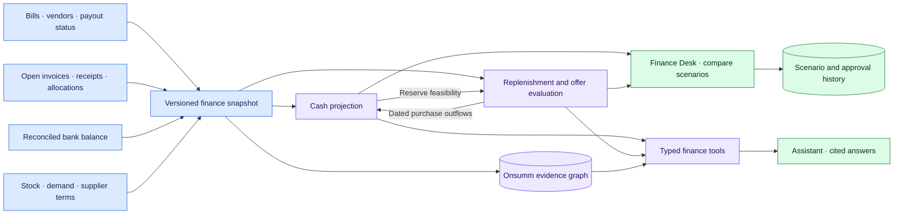

# Onsumm Finance Desk technical design

**Status:** Proposed for the hackathon on `uat2`

**Product reference:** Odoo Accounting. The [product PRD](PRD.md) describes the customer, positioning, and other SaaS references. This design extends that brief with an inventory-aware forecast and an assistant over Onsumm data.

## 1. Product outcome and scope

A distributor should be able to ask, “What can I pay this week, and which stock can I afford to reorder?” The desk returns a date-by-date cash forecast, compares supplier and replenishment options, and shows the invoices, bills, receipts, and inventory evidence behind each answer. The accountant reviews exceptions and prepares options. The owner approves a plan with a record of the assumptions and trade-offs.

| One-day slice | Pilot expansion |
|---|---|
| One tenant, one INR account, seven days of daily cash, and one stock location. | Multiple accounts, a 13-week rolling view, and warehouse-level demand. |
| Compare the expected forecast with a receipt delay and a vendor payment reschedule. | Rolling backtests, holiday calendars, receipt-delay distributions, and calibrated cash-risk ranges. |
| Evaluate two offers for one SKU using stock cover, lead time, minimum order quantity, and cash timing. | Multiple SKUs and suppliers, pack and cash constraints, vendor reliability from actual receipts, and portfolio optimization. |
| Chat answers across known AP, AR, cash, and inventory topics using source records and computed results. | Expand question coverage as approved read tools and source quality improve. Ask for clarification or identify missing evidence when an answer is unavailable. |
| Save a scenario and approve it through an isolated demo decision store. | Add procurement workflow integration after pilot validation. Approving a plan grants no bank or supplier-order authority. |

## 2. Baseline and system boundaries

| Capability | Source or extension |
|---|---|
| AP commitments, vendor master, payment status | Use authorized read paths from the [bills API](../../backend_ocr/app/routers/bills.py), [vendors API](../../backend_ocr/app/routers/vendors.py), and [disbursement queue](../../backend_ocr/app/routers/disbursement.py). Translate statuses and actual payment references in the snapshot adapter. |
| AR open invoices, applied cash and evidence | Use the [receivables API](../../backend_ocr/app/routers/receivables.py) and [receivables repository](../../backend_ocr/app/receivables/repo.py). Outstanding amounts must reflect allocations, reversals, and partial payments as of the snapshot. |
| Inventory position, sales demand, supplier offers and open POs | Introduce an explicit import adapter backed by reviewed sample CSVs for the demo. Use catalog SKU links where verified. Accounting vouchers alone cannot establish available physical stock or the timing of inbound units. |
| Bank opening balance | Use a timestamped, reconciled account balance when available. Use a labeled fixture or owner-provided snapshot until an account feed is connected. |
| Evidence relationships | Extend the [Onsumm Fact Graph](../../backend_ocr/app/domain/fact_graph.py) and [Agent Hub routes](../../backend_ocr/app/routers/agent_hub.py). PostgreSQL source records remain authoritative. |
| Local execution | Keep the same adapter contracts for existing PostgreSQL and the seeded dataset. Use an isolated local store for demo snapshots and plans if the cloud database remains unreachable. The earlier cloud probe returned connection refused. |

## 3. Canonical data contracts

Every record carries `tenant_id`, stable source identity, source revision, and timestamps. Store INR amounts as integer paise and dates in the tenant business timezone. Use Asia/Kolkata for the demo. Treat timestamps for source ingestion separately from business dates.

| Logical record | Required fields |
|---|---|
| Finance snapshot | `snapshot_id`, `as_of`, `opening_account_balance`, `balance_at`, `reserve`, `currency`, `sources`, `missing_sources`, `revision` |
| Cash event | `event_id`, `source_type`, `source_id`, `amount_paise`, `direction`, `effective_date`, `status`, `confidence_basis`, optional `bank_transaction_id` and rescheduling window |
| Stock position | `sku_id`, `location_id`, `on_hand`, `reserved`, `snapshot_at`, `unit_of_measure` |
| Demand and inbound | Daily sold/consumed quantities, data-quality flags and firm customer commitments. Open PO lines carry expected arrival, remaining units and source IDs. Define whether actual demand history includes fulfilled commitments. |
| Supplier offer | `vendor_id`, `sku_id`, landed unit cost, fixed order cost, minimum quantity, pack size, lead-time days, deposit/balance terms, quote expiry, verification status and evidence reference |
| Scenario and approval | `scenario_id`, base snapshot revision, event overrides, candidate order references, before/after metrics, approval state, actor, timestamp and reason |

For production, create forecast and inventory tables through explicit migrations and index tenant/date and tenant/SKU/location access paths. For the seeded demo, validate the same logical schema at import and store plans in a local transactional store. Re-imports use stable source keys. Never count a source event twice merely because it appears as an invoice, a bank transaction, and an allocation.

## 4. Cash-flow forecasting

### Forecast model

1. Select a balance snapshot and normalize later cleared transactions through the forecast cutoff. Exclude cleared transactions already reflected in opening cash. Link receipts and payouts to their underlying commitments. Include only the open amount of partially paid items.
2. Schedule approved AP for the most recent approved payment date, or the due date with an explicit assumption. Surface disputed or suspected duplicate bills as exceptions. An overdue item with no future date appears in an unscheduled queue and requires a date before scenario approval.
3. Schedule AR on a promised date when present. Otherwise start from the due date plus a customer-specific median delay if recent matched history is sufficient. Display data-quality labels and let the user set a date where evidence is missing. Keep expected receipts separate from confirmed receipts.
4. Compute daily closing cash as prior closing cash plus inflows minus outflows. Report the minimum, first day below reserve, depth of the shortfall, and source contributions. In the demo, group by day and disclose that intraday ordering is outside the model.
5. Compare a committed view using confirmed future receipts only, an expected view including dated estimates, and a downside view based on named receipt delays. Show the opening and balance date, last source refresh, and unscheduled items so users can judge coverage.

A scenario overlays date or quantity changes on an immutable snapshot. Reevaluation injects deposit and balance events for a candidate PO and removes replacement events only where an explicit source identifies a superseded commitment. A stale snapshot requires a fresh preview before approval. Reserve checks apply on every projected date, including when the PO payment is due after stock arrives.

**Pilot metrics:** Daily closing-balance absolute error, receipt timing error, first-breach recall, assumption coverage, and time spent preparing the plan. Use time-ordered backtests against settled bank records before presenting a probabilistic range.

## 5. Vendor and inventory optimization

### Inventory reference and scope

The linked [Paytm repository](https://github.com/r-rishit27/paytm/tree/cc1a4133022dfdde9cd1e5928623b8eab0aec5a1) is an **inventory optimization reference only**. Its [inventory agent](https://github.com/r-rishit27/paytm/blob/cc1a4133022dfdde9cd1e5928623b8eab0aec5a1/backend/agents/inventory.py) illustrates daily demand, EOQ, safety stock, reorder point and alert reasons. Its [QUBO solver](https://github.com/r-rishit27/paytm/blob/cc1a4133022dfdde9cd1e5928623b8eab0aec5a1/backend/agents/qubo_solver.py) illustrates a budget/capacity objective decoded into a reorder plan. Use those concepts as design input. No external code is copied into this proposal. Onsumm uses supplier-specific terms and hard feasibility checks after rounding quantities to packs.

### Replenishment and supplier selection

- **Demand:** Use a trailing daily average from clean observations. Display the observation window and completeness. Identify stockout days where sales understate demand. Add firm incremental orders only when they are outside the baseline demand estimate. With sparse history, require a manual rate or mark the result for review.
- **Stock outlook:** Project stock by day from physical on-hand, reservations, firm inbound, and demand. Align units of measure and prevent double-counting reservations already included in projected demand. Forecast the first stockout date.
- **Reorder point:** Use lead-time demand plus safety stock. With reliable daily demand deviation and fixed lead time, the initial safety-stock estimate is `ceil(z × daily_demand_sd × sqrt(lead_time_days))`. A configured safety-stock floor replaces a statistical estimate where data is sparse. Optional EOQ gives a starting order size when ordering and holding costs exist.
- **Candidates:** Enumerate approved supplier offers and limited pack-rounded quantities around the shortfall and target cover. Enforce quote validity, minimum order quantity, pack size, receiving lead time, and capacity where available. Calculate landed cost consistently and apply the agreed deposit and due dates.
- **Cash constraint:** Run every candidate against the same scenario forecast. Reject candidates that create a reserve breach in the owner's selected planning view. Show the downside result even when the expected view is feasible. If all options fail, show the binding dates and recommend escalation or a new quote.
- **Ranking:** Prefer preventing stockouts, then minimizing stockout unit-days, landed spend and cash tied up. Break ties using verified lead-time reliability and a stable offer ID. Display the cost breakdown and the reason each alternative was rejected. The demo can use deterministic enumeration; a future multi-SKU solver can optimize across a shared budget while enforcing constraints after quantity rounding.

## 6. Database-backed finance assistant

The assistant answers natural-language questions over existing finance data and configured inventory sources. Record retrieval and calculations run through authorized backend tools. The model interprets the question and shapes the response around returned results.

| Tool | Example question | Deterministic result |
|---|---|---|
| `cash_forecast` | “When could we be below ₹50,000 next week?” | Scenario, daily series, first breach, drivers, balance timestamp. |
| `receivables_due` | “Who owes us over ₹1 lakh this week?” | Scoped invoices, open amounts, dates, and total. |
| `payables_due` | “What can I pay before Friday?” | Eligible bills, exclusions, dates and forecast headroom. |
| `inventory_risks` | “What will run out before replenishment?” | Projected stockout date, demand basis, inbound and SKU source. |
| `compare_vendor_offers` | “Which supplier keeps cash above reserve for SKU PKG-01?” | Candidate quantities, arrivals, payment timing, minimum cash, ranking and rejected reasons. |
| `explain_record` | “Why was this bill held?” | Scoped source details, links, reconciliation findings and status. |

**Query path**

1. Resolve the tenant, identity and permissions from the current session. Map the question to allowlisted intents with typed parameters. Ask for clarification when the date, entity, currency, or SKU is ambiguous.
2. Resolve exact references in authorized records. Use the existing graph to expand a limited set of relevant neighbors. Fetch authoritative numeric values and current statuses from PostgreSQL using parameterized, tenant-scoped queries. The seeded adapter implements the same contracts.
3. Return calculations, source IDs, freshness, assumptions, scope and truncation flags to the model. Numeric charts and tables render directly from those tool results. Generate a short explanation and validate its cited IDs against the returned set.
4. Return the explanation with date, scope and source links. For missing records, incompatible permissions, or unsupported questions, explain what evidence is available and identify the missing input. Keep templates available when the model is offline.

**Graph design:** Reuse tenant-scoped Fact Graph nodes and edges for evidence discovery and drill-down. Add or project `SKU`, `stock_snapshot`, `purchase_order`, `supplier_offer` and `cash_scenario` nodes as needed. Example relations include `vendor supplies SKU`, `purchase order replenishes SKU`, `offer has payment event`, and `scenario references bill`. Bind graph IDs to canonical records and filter by tenant and permissions at retrieval and source rehydration. Traverse up to two hops within a bounded result set. Exact SKU and invoice lookups work without embeddings. The graph helps explain relationships while SQL and domain services own totals.

**Controls:** Use scoped read functions and bounded date ranges/result sizes. The model receives no SQL execution or write tool. Exclude secrets, full bank details and unnecessary PII from its context. Treat invoices and uploaded documents as evidence. Redact and minimize assistant logs. The owner approval route stays separate from chat and uses idempotency keys and a revision check.

## 7. Proposed API and UI

| Endpoint | Contract |
|---|---|
| `GET /api/finance-desk/snapshot` | Snapshot ID, freshness, opening cash, source coverage and identifiers. |
| `POST /api/finance-desk/forecast/preview` | Snapshot ID, named scenario and bounded overrides. Returns baseline and revised cash, day buckets, breach and evidence. |
| `POST /api/finance-desk/inventory/compare` | Snapshot ID, SKUs, location and scenario. Returns stock risk, feasible/rejected offers and cash impact. |
| `POST /api/finance-desk/assistant/query` | Question and active snapshot/scenario IDs. Returns narrative, typed results, source links, scope and assumptions. |
| `POST /api/finance-desk/plans` | Persist a versioned proposal with snapshot and selected options. |
| `POST /api/finance-desk/plans/{plan_id}/decision` | Authorize owner, check revision, and persist approve/return with the decision note and idempotency key. |

A single Finance Desk page has a scenario chart, a vendor comparison table, and a docked assistant. Source chips open existing bill or invoice pages, or an inventory evidence panel. Use typed frontend response models. Label expected and downside views visibly, and give empty, stale, and pending states useful next actions.

## 8. End-to-end demo and release gates

**Seeded distributor:** Use the product PRD's ₹2,40,000 opening cash, ₹50,000 reserve, ₹1,80,000 Day 2 payment, ₹90,000 Day 3 payment with a permitted shift to Day 5, and ₹1,50,000 expected on Day 4. A ₹40,000 suspected duplicate remains in review. SKU PKG-01 starts with 10 units and demand of four units per day. Both offers arrive at the start of Day 3 and require full payment on Day 3.

| Demo outcome | Expected result |
|---|---|
| Baseline cash | Minimum **−₹30,000 on Day 3**. |
| Reschedule vendor payment to Day 5 | Expected minimum **₹60,000**, leaving **₹10,000** headroom at the reserve floor. |
| Leave inventory unchanged | Stock reaches zero during **Day 3** and cannot cover all Day 3 demand. |
| Offer A, 20 units at ₹400 | ₹8,000 spend. Minimum projected cash **₹52,000**; Day 7 closing stock **2 units**. Feasible in the expected scenario. |
| Offer B, 30 units at ₹400 | ₹12,000 spend. Minimum projected cash **₹48,000**. Fails the reserve constraint despite the larger delivery. |
| Delay AR receipt to Day 6 after selecting Offer A | Minimum projected cash **−₹38,000 on Day 5**. The plan still depends on collection timing. |

**Judge walkthrough:** Ask “Which vendor should I choose for PKG-01 and why?” Show the assistant's cited answer and offer calculations. Preview the late-receipt scenario, open the underlying AR invoice, return to the expected view, generate a collection draft, and approve the proposal as owner. Reload to show the saved decision.

**Release checks**

- Forecast unit tests cover reserve math, partial allocation, settlement counted once, held duplicates, missed due dates, and revised scenario rounding.
- Optimizer tests cover arrival vs stockout, quote expiry, pack/MOQ constraints, cash payment dates, and the no-feasible-offer case.
- Assistant tests cover correct calculations and citations, ambiguous questions, stale evidence, unsupported intent, and tenant- or role-restricted records.
- Workflow tests cover snapshot revision changes across submit/approve, duplicate decision requests, and persistence after reload.
- Demo targets are scenario recalculation under one second and a full walkthrough under three minutes on the seeded dataset. Measure finance-team time saved, stockout days, reserve breaches, and recommendation acceptance during the pilot.

## 9. Eight-hour delivery order

| Time | Outcome |
|---|---|
| 0:00–1:00 | Lock the snapshot contract and seed the two-supplier scenario. Verify expected results before adding UI. |
| 1:00–2:45 | Implement forecast, scenarios and the chart with drill-down to source rows. |
| 2:45–4:15 | Implement stock projection and offer feasibility using the same cash model. Show both supplier results and the binding constraint. |
| 4:15–6:00 | Add chat routing, three high-value intents, citations and fallback. Prioritize cash risk, who owes money, and vendor comparison. Use exact graph lookups and bounded evidence traversal where available. |
| 6:00–7:15 | Add durable plan submission/approval and run calculation, access and persistence checks. |
| 7:15–8:00 | Rehearse the seeded end-to-end demo. Cut export, live connectors, advanced solver and semantic search before cutting the forecast, vendor choice or cited assistant. |

## Expanded design references

The [inventory code review](INVENTORY_REFERENCE.md) documents the pinned Paytm source and Onsumm adaptation. The [assistant architecture](ASSISTANT_ARCHITECTURE.md), [financial guardrails](FINANCIAL_GUARDRAILS.md), [API and data models](API_AND_DATA_MODELS.md) and [AWS design](AWS_DEPLOYMENT.md) specify the integration and scale path.
