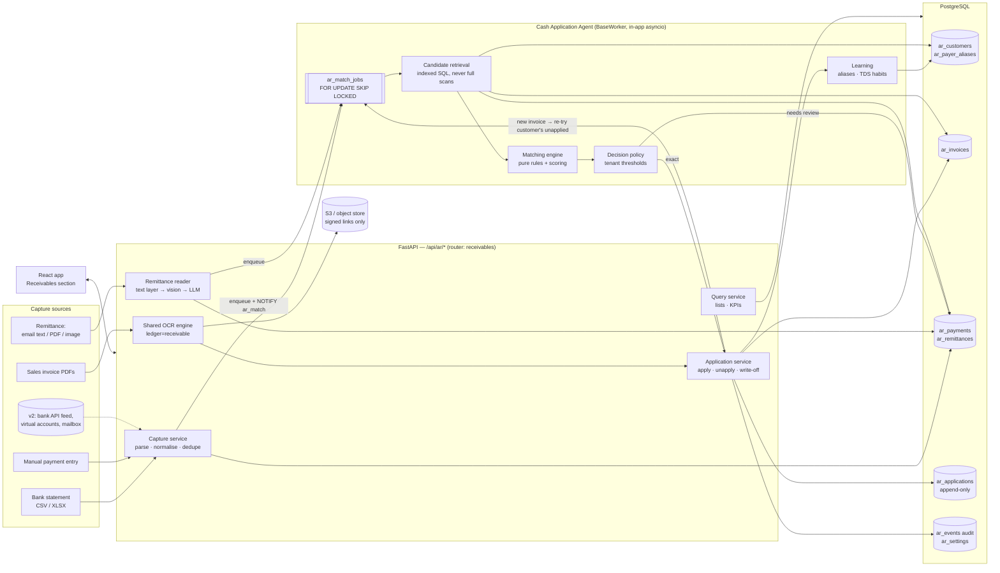
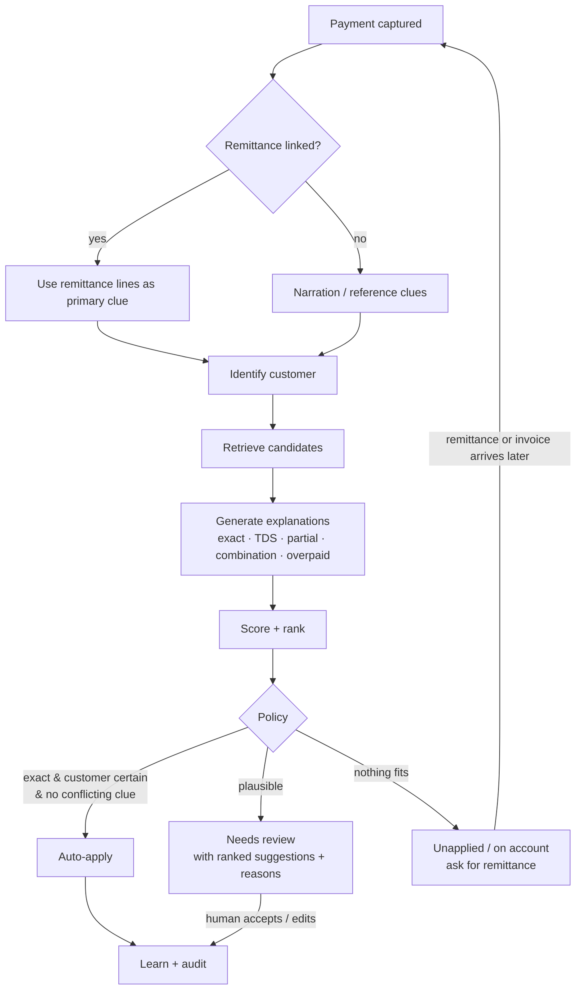

# Cash Application Agent — High-Level Design

Status: draft v1 · 2026-11-17 · branch `feat/receivables-cash-app`
Companion docs: [02_LLD.md](02_LLD.md) · [03_USER_FLOWS.md](03_USER_FLOWS.md) ·
[04_EDGE_CASES.md](04_EDGE_CASES.md) · [05_HUMAN_IN_THE_LOOP.md](05_HUMAN_IN_THE_LOOP.md) ·
research: [CASH_APPLICATION_RESEARCH.md](CASH_APPLICATION_RESEARCH.md)

---

## 1. Problem

Money arrives in the bank. Finance has to answer, for every credit: **who paid, which
invoices it settles, and what happened to any difference.** Today that is done by hand
from bank narrations, emails and spreadsheets. In India it is harder than the textbook
case because:

- customers deduct **TDS** before paying (so the receipt is never the invoice total);
- narrations are truncated bank strings (`NEFT-HDFCN5202…-ACME TRADIN`), rarely with an
  invoice number;
- remittance advice arrives separately — by email, as a PDF from the customer's ERP, or
  not at all;
- one transfer often clears several invoices, and one invoice is often paid in parts.

## 2. Goals and non-goals

| Goals (v1) | Non-goals (v1) |
|---|---|
| Capture payments from bank statements (CSV/XLSX) and manual entry | Live bank feeds / virtual accounts (v2 — adapter slot exists) |
| Capture remittance advice from pasted email text and PDFs/images | Reading a mailbox automatically (v2 — reuse Agent Hub mailbox) |
| Match payments to invoices with an explanation and a confidence | Posting to Tally / Zoho / SAP (v2 — `posted_at` columns reserved) |
| Auto-apply **exact** matches only; queue everything else with a ranked suggestion | Dunning / collections emails |
| Handle partials, multi-invoice, TDS, deductions, overpayment, missing remittance | 26AS TDS reconciliation (v2) |
| Learn payer aliases and TDS habits from human confirmations | Cash-flow forecasting (v2 — data model supports it) |
| KPIs: match rate, exception rate, time to apply, applied cash %, unapplied aging, DSO | Multi-currency FX gain/loss posting (v1 flags it for a human) |

## 3. Shape of the solution

Receivables reuses the **payable machinery** but keeps **its own data**:

- **Reused:** the OCR engine (`utils/ocr_engine.py`, now ledger-aware — the prompt says
  whether the document is a bill we received or an invoice we issued), the upload
  endpoint `/api/invoices/ocr` (`ledger=receivable`), object storage and signed links,
  tenancy (`require_tenant`), licensing (`require_service("receivables")`), the
  `BaseWorker` + scheduler, the frontend UI kit (`DataTable`, `PageHeader`, `Badge`,
  `Modal`…) and the Upload page itself.
- **Separate:** `ar_*` tables. `fact_invoices` is read by ~170 payable queries; putting
  sales invoices there would leak them into payable reports, the Payment Hub and the
  Review Hub.

## 4. Technical architecture

### Why this scales

| Concern | Design choice |
|---|---|
| Matching cost grows with tenant size | **Candidate retrieval, not scans.** The engine only ever sees: invoices whose normalised number appears as a token window of the narration (indexed equality on `ar_invoices.number_norm`), the identified customer's oldest *N* open invoices (partial index on open status), and invoices with outstanding within ±tolerance of the amount (partial index on `outstanding`). Bounded combinatorics: ≤20 invoices, ≤4 per combination. |
| Bursty imports (a 5,000-line statement) | Import only **parses and inserts** (one transaction, `ON CONFLICT DO NOTHING` on a fingerprint) and enqueues jobs; matching runs in the worker. The HTTP request returns in seconds. |
| Many workers / restarts | Jobs claimed with `FOR UPDATE SKIP LOCKED`; idempotent job handler; stale `RUNNING` jobs re-queued on start-up (recon's 2026-11-13 lesson). Today one process runs workers (scheduler advisory lock); the queue already allows N. |
| Concurrency (worker vs. human on the same payment) | Row locks on payment + invoices taken in id order (no deadlocks); a `version` column on payments rejects a stale "Apply" with 409. |
| Correctness of money | `NUMERIC(18,2)` end-to-end, `Decimal` in Python, strings over JSON. Invoice `outstanding` is a **generated column**. Applications are **append-only**; reversal is a new state, never a delete. |
| Re-imports, overlapping statements, same payment from two sources | Fingerprint = date + amount + UTR + reference + narration + occurrence index within the file. UTR uniqueness check across sources. |
| Fuzzy customer lookup at scale | `pg_trgm` GIN index on normalised customer names/aliases, top-5 by similarity; Python `rapidfuzz` re-ranks only those 5. Falls back gracefully if the extension is absent. |
| KPIs on large tenants | Indexed aggregate queries for v1; `ar_kpi_daily` snapshot table reserved for v2. |
| Tenant isolation | Every table carries `tenant_id`; every query filters on the JWT tenant; route-map guard tests cover the new routes. |

## 5. The agent's loop

## 6. Modules

| Module | Responsibility | Location |
|---|---|---|
| Ledger-aware OCR | Reads sales invoices with the receivable perspective | `utils/ocr_engine.py` (`system_prompt(ledger)`) |
| Capture | Bank statement parsing, narration parsing (rail, UTR, payer), manual entry, fingerprints | `receivables/bank_statement.py` |
| Remittance reader | Email/PDF/scan → structured lines | `receivables/remittance.py` |
| Matching engine | Pure: identify customer, build/score candidates, explain | `receivables/matching.py` |
| Policy | Thresholds and tolerances per tenant → auto / review / unapplied | `receivables/policy.py` |
| Repository | All SQL; candidate retrieval; locking | `receivables/repo.py` |
| Application service | Apply, unapply, write-off, on-account, learning, audit | `receivables/service.py` |
| Worker | Drains `ar_match_jobs` | `receivables/worker.py` |
| API | `/api/ar/*` | `routers/receivables.py` |
| UI | Payables ⇄ Receivables switch; Cash Application, Invoices, Upload, Customers | `frontend/src/pages/receivables/*` |

## 7. Human in the loop (summary)

The agent applies cash on its own **only when the amount is explained to the rupee and
the customer is certain**. Everything involving judgement — a deduction, a write-off, an
overpayment, a guess between equal candidates, a fuzzy customer, a reversal — is a
suggestion a person accepts, edits or rejects. Every acceptance teaches the agent (payer
aliases, the customer's TDS rate), and tenants can promote specific cases to automatic
once trusted. Full matrix: [05_HUMAN_IN_THE_LOOP.md](05_HUMAN_IN_THE_LOOP.md).

## 8. KPIs

| KPI | Definition |
|---|---|
| Match rate (auto) | payments auto-applied on first pass ÷ payments received |
| Exception rate | payments needing a person ÷ payments received |
| Applied cash % | applied amount ÷ total receipts |
| Time to apply | mean(applied_at − captured_at) |
| Unapplied cash aging | unapplied remainder by age of receipt: 0–30, 31–60, 61+ days |
| DSO | open receivables ÷ invoiced in last 90 days × 90 |
| Suggestion acceptance | suggestions accepted unchanged ÷ suggestions reviewed (quality of the agent) |

## 9. Security & compliance

- Documents are never public: invoice PDFs and remittance files go to the object store
  and are served only via the authenticated route → 5-minute signed link.
- All routes: JWT tenant, `require_service("receivables")`, role check for apply /
  unapply / write-off (`receivables.apply`; v1 maps to existing payables roles).
- Full audit trail in `ar_events`: who/what applied, reversed or wrote off, with the
  agent's explanation captured at the time.

## 10. Rollout

1. Service `receivables` in the licensing catalog (off by default in prod; on for the
   pilot tenant).
2. Run `scripts/run_api_migrations.py` (adds `ar_*` tables, `pg_trgm` if permitted).
3. Worker flag `CASHAPP_WORKER_ENABLED` — **off locally** (shared dev DB; see the review
   worker lock incident), on for the dev and prod services.
4. Measure match rate on the pilot's last 3 months of statements before enabling
   auto-apply (`ar_settings.auto_apply_enabled`, default **on for exact matches only**).
