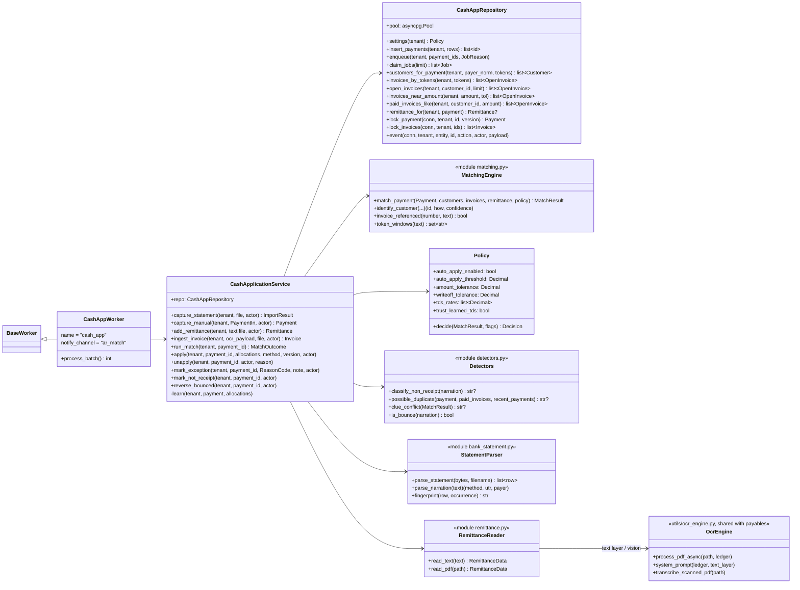
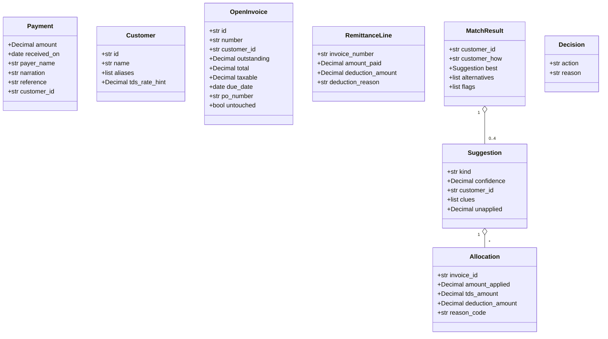
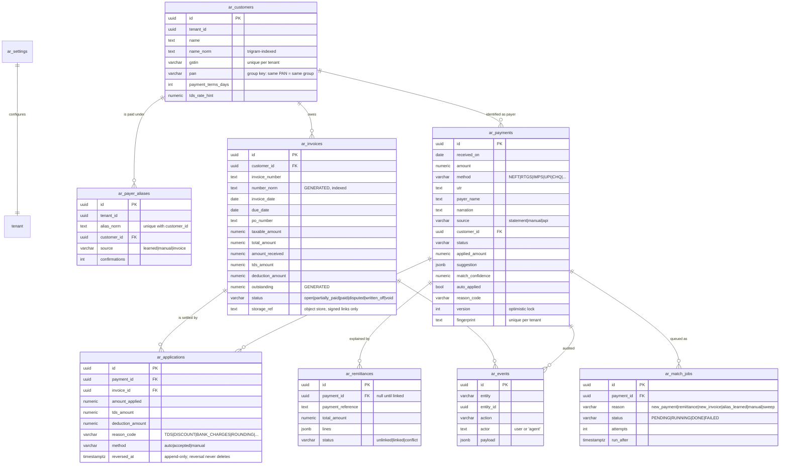
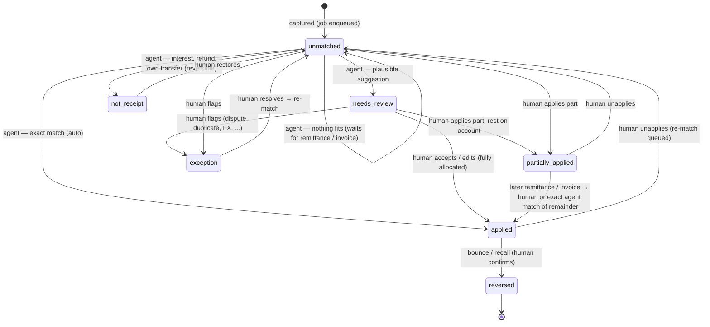
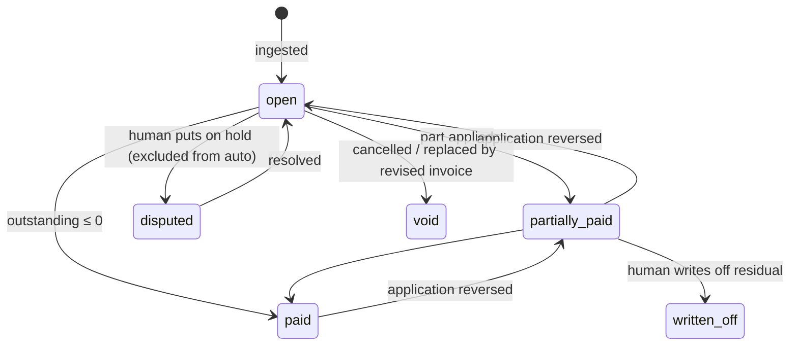
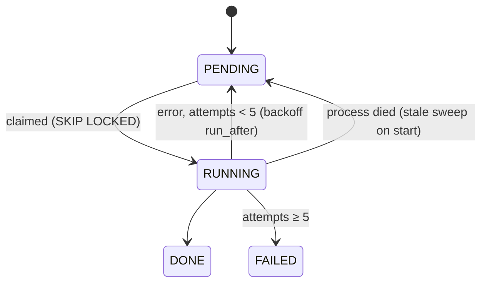
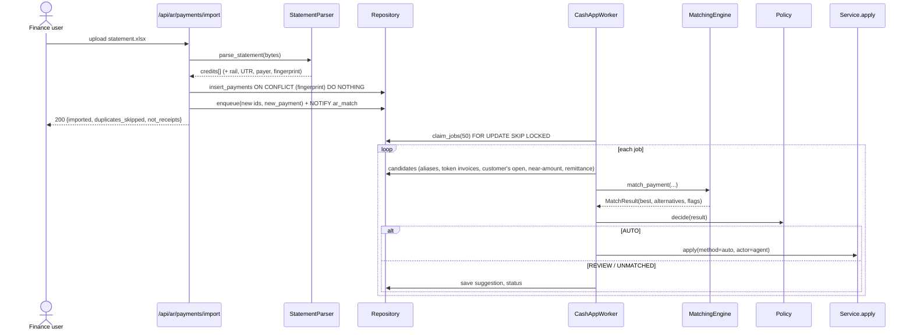
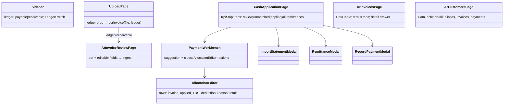

# Cash Application Agent — Low-Level Design

Companion to [01_HLD.md](01_HLD.md). Code: `backend_ocr/app/receivables/`,
`backend_ocr/app/routers/receivables.py`, `frontend/src/pages/receivables/`.

---

## 1. Package layout

```
backend_ocr/app/receivables/
  schema.py          DDL (idempotent), applied by migrations._ensure_receivables_tables
  types.py           enums: PaymentStatus, InvoiceStatus, ReasonCode, JobReason, Method
  matching.py        PURE engine: identify customer → candidates → score → MatchResult
  policy.py          PURE: Policy (from ar_settings) → Decision(AUTO | REVIEW | UNMATCHED)
  detectors.py       PURE: non-receipt classifimonk forcast cashflow in cash application

campfire do -> churn rate analysis
Track expansion, contraction, and churn as it happens.


Invoice: The document sent to customers detailing products or services provided and payment terms. It's the foundation for matching payments in accounts receivable.
Payment: Funds received from customers through various methods, including checks processed through lockbox services, ACH transfers, wire transfers for larger amounts, and credit card payments processed through payment gateways
Remittance advice: A notification or document from the customer that confirms payment and includes details such as invoice numbers, amounts paid, and any adjustments. It shows up in email bodies and attachments, EDI files, bank file references, customer AP portals, or paper check stubs, and it often arrives separately from the money.
remittance data collection , payment capture and matching with remittance data

Applied Cash % = Applied Cash / Total Receipts × 100

Common Matching Clues
Invoice number
Customer account
Payment amount
Purchase order
Bank reference


common issues:
Missing or incomplete remittance information
Multiple payment formats
Data capture issues  Payment data often comes from scattered sources (emails, bank files, vendor portals)

Partial payments and deductions

ERP inefficiencies: Entering payment data into outdated or disconnected systems slows reconciliation. Inefficiencies in an ERP system make it harder to track receivables and resolve payment remittances promptly.


Track cash application KPIs

Cash application KPIs are the metrics that show how efficiently and accurately your team applies payments. Monitor these key performance indicators to measure your process:

Match rate: The percentage of payments automatically matched on the first pass
Exception rate: The percentage of payments requiring manual intervention
Time to apply: The average time from payment receipt to posting (in hours or days)
Unapplied cash aging: A report showing how long payments have been sitting unmatched, usually grouped in buckets such as 0–30, 31–60, and 61+ days


AI-powered matching: The system should use artificial intelligence to learn your customer payment patterns over time, improving match rates continuously.
Multi-format remittance capture: Look for a solution that can automatically read and extract data from all remittance formats, including check stubs, EDI files, email bodies and attachments, and web portals.
Exception management: The software should provide a dedicated workflow to queue, route, and manage unmatched payments, giving your staff the context to resolve them quickly.
Reporting and analytics: Dashboards and reports are essential for tracking match rates, processing time, exception trends, and other key metrics.er, duplicate-payment, clue-conflict detectors
  bank_statement.py  PURE: statement → rows; narration → (rail, UTR, payer)
  remittance.py      remittance text/PDF → structured lines (LLM, via shared OCR engine)
  repo.py            CashAppRepository (asyncpg): all SQL, candidate retrieval, locking
  service.py         CashApplicationService: capture, match, apply, unapply, learn, audit
  worker.py          CashAppWorker(BaseWorker): drains ar_match_jobs
routers/receivables.py  /api/ar/* — thin: auth, validation, calls service
```

Pure modules have no I/O, so the whole decision surface is unit-tested without a DB.

## 2. Class diagram — backend



### Matching value objects



## 3. Data model



Key indexes:

| Index | Serves |
|---|---|
| `ar_invoices (tenant_id, number_norm)` | invoice-number token lookup |
| `ar_invoices (tenant_id, customer_id, due_date) WHERE status IN ('open','partially_paid')` | oldest-first candidates |
| `ar_invoices (tenant_id, outstanding) WHERE status IN ('open','partially_paid')` | amount-near lookup when payer unknown |
| `ar_payer_aliases (tenant_id, alias_norm)` | exact payer → customer |
| `ar_customers USING gin (name_norm gin_trgm_ops)` | fuzzy payer → customer (top 5) |
| `ar_payments (tenant_id, fingerprint) UNIQUE` | idempotent import |
| `ar_payments (tenant_id, utr)` | cross-source dedupe, remittance linking |
| `ar_match_jobs (status, run_after) WHERE status='PENDING'` | job claim |
| `ar_match_jobs (payment_id) UNIQUE WHERE status IN ('PENDING','RUNNING')` | job coalescing |

## 4. State machines

### Payment



### Invoice



### Match job



## 5. Sequences

### 5.1 Statement import → auto-apply



### 5.2 Human accepts a suggestion

```mermaid
sequenceDiagram
  actor U
  participant API as POST /api/ar/payments/{id}/apply
  participant S as Service
  participant DB as Postgres
  U->>API: allocations[], version
  API->>S: apply(...)
  S->>DB: BEGIN; SELECT payment FOR UPDATE (version check → 409)
  S->>DB: SELECT invoices FOR UPDATE ORDER BY id
  S->>S: validate Σ applied ≤ unapplied; per invoice applied+tds+deduction ≤ outstanding + tol
  S->>DB: INSERT ar_applications; UPDATE invoices; UPDATE payment (status, version+1)
  S->>DB: learn: upsert alias, tds_rate_hint; INSERT ar_events
  S->>DB: COMMIT
  API-->>U: payment + applications
```

### 5.3 Late remittance re-splits an on-account payment

```mermaid
sequenceDiagram
  participant API as POST /api/ar/remittances
  participant RR as RemittanceReader
  participant R as Repository
  participant W as Worker
  API->>RR: read_text / read_pdf
  RR-->>API: lines[], reference, total
  API->>R: find payment: UTR = reference → else amount±tol & date±10d & unique
  alt linked
    API->>R: remittance.payment_id = p; enqueue(p, remittance)
    W->>W: re-match: if payment untouched by a human → normal policy
    W->>W: if a human already applied differently → status needs_review, flag REMITTANCE_DISAGREES
  else not linked
    API->>R: status unlinked — linked automatically when the payment is imported
  end
```

## 6. Algorithms

### 6.1 Customer identification (strongest first)

| # | Signal | Confidence |
|---|---|---|
| 1 | User chose the customer | 1.00 |
| 2 | Normalised payer name = a confirmed alias of exactly one customer | 1.00 |
| 2a | Alias maps to several customers (group company / shared payer) | → flag `AMBIGUOUS_PAYER`, review |
| 3 | Invoice number(s) quoted in narration all belong to one customer | 1.00 |
| 4 | Remittance names invoices of one customer | 1.00 |
| 5 | Trigram top-5 → rapidfuzz `token_set_ratio` ≥ 90 | 0.90 |
| 6 | Same, 80–89 | 0.75 |
| 7 | None | — (amount-only search across tenant, never auto) |

Name normalisation drops `M/S, PVT, PRIVATE, LTD, LIMITED, LLP, INDIA, THE, CO…`,
punctuation and case: `M/s. Acme Trading Pvt. Ltd.` → `ACME TRADING`.

### 6.2 Invoice reference detection (`token_windows`)

Narrations break numbers apart (`INV 24-25 0045`). The text is split on non-alphanumerics
and every window of 1–4 adjacent tokens is concatenated and normalised; the set is looked
up by equality on `number_norm` — one indexed query, no `LIKE '%…%'`. Short all-digit
numbers (< 6 digits) must stand alone in the raw text so `1045` never matches inside a UTR.

### 6.3 Candidate generation and base confidence

Final confidence = base × customer confidence (for customer-scoped candidates).

| Kind | Rule | Base |
|---|---|---|
| `remittance` | every remittance line resolves and Σ paid = amount (±tol) | 1.00 |
| `remittance_partial` | some lines unresolved or Σ ≠ amount | 0.80 |
| `reference_exact` | quoted invoices' outstanding Σ = amount | 1.00 |
| `reference_tds` | quoted invoices Σ(outstanding − r·taxable) = amount for one rate r | 0.92 |
| `reference_partial` | amount < quoted Σ → fill oldest first, rest open | 0.75 |
| `reference_overpaid` | amount > quoted Σ → rest on account | 0.80 |
| `amount_exact` | exactly one of the customer's open invoices = amount | 0.97 |
| `amount_exact_ambiguous` | several equal invoices → oldest | 0.70 |
| `amount_tds` | exactly one invoice net of TDS at r (customer's usual r first) | 0.85 (0.90 at learned rate) |
| `oldest_first` | prefix of oldest invoices sums to amount | 0.88 |
| `combination` | unique 2–4-invoice subset (gross or net of one TDS rate) | 0.82 |
| `combination_ambiguous` | several subsets | 0.60 |
| `oldest_partial` | amount < oldest invoice | 0.50 |
| `overpaid` | amount > everything owed | 0.60 |
| `amount_only` | payer unknown; one invoice tenant-wide equals amount | 0.60 |

TDS is computed on the **taxable value** (pre-GST); if the invoice has no taxable value the
total is used and the suggestion says so. TDS is only considered on an **untouched**
invoice (nothing yet received).

### 6.4 Flags (always force review, regardless of confidence)

| Flag | Raised when |
|---|---|
| `CLUE_CONFLICT` | quoted invoice ≠ the invoice the amount matches |
| `POSSIBLE_DUPLICATE` | amount equals an invoice of this customer that is already **paid**, or a payment with same amount/payer within 7 days already applied to it |
| `AMBIGUOUS_PAYER` | alias maps to more than one customer |
| `CROSS_CUSTOMER` | allocations span customers (group payment) |
| `ADVANCE` | payment date before the invoice date |
| `FOREIGN_CURRENCY` | invoice currency ≠ INR |
| `REMITTANCE_DISAGREES` | late remittance contradicts a human's application |
| `DISPUTED_INVOICE` | candidate invoice is on hold |

### 6.5 Decision policy

```
if payment is not_receipt/reversed/exception           → no action
if flags                                               → REVIEW
if best is None                                        → UNMATCHED
if best.kind in AUTO_KINDS and conf ≥ threshold
   and auto_apply_enabled and no deduction other than rounding   → AUTO
if best.kind == amount_tds/reference_tds and trust_learned_tds
   and rate == customer.tds_rate_hint and conf ≥ threshold      → AUTO
else                                                   → REVIEW
AUTO_KINDS = {remittance, reference_exact, amount_exact}
```

Residual within `writeoff_tolerance` (default 0 = off) is written off as `ROUNDING`/
`BANK_CHARGES` only when the tenant enabled it.

### 6.6 Application invariants (enforced in `apply`, in one transaction)

1. `Σ amount_applied ≤ payment.amount − payment.applied_amount` (+ ₹0.01)
2. per invoice: `amount_applied + tds + deduction ≤ outstanding + tolerance`
3. invoice must be `open | partially_paid` (not disputed/void/written-off) unless the
   caller is a human who explicitly overrides
4. `version` matches, else 409 (somebody — or the agent — changed it)
5. negative application only via `unapply` (reversal), never edits

### 6.7 Learning

On every human-confirmed application:
- upsert `(alias_norm(payer_name) → customer)` with `confirmations += 1`;
- if a TDS line was confirmed: `tds_rate_hint = round(tds / taxable × 100, 3)`;
- enqueue `alias_learned` jobs for that customer's other `unmatched` payments.

## 7. Job queue

```sql
-- claim
UPDATE ar_match_jobs SET status='RUNNING', locked_at=now(), attempts=attempts+1
 WHERE id IN (SELECT id FROM ar_match_jobs
               WHERE status='PENDING' AND run_after <= now()
               ORDER BY run_after LIMIT $1 FOR UPDATE SKIP LOCKED)
RETURNING id, tenant_id, payment_id, reason;
-- enqueue (coalesces: one live job per payment)
INSERT INTO ar_match_jobs (tenant_id, payment_id, reason) VALUES (...)
ON CONFLICT (payment_id) WHERE status IN ('PENDING','RUNNING') DO NOTHING;
SELECT pg_notify('ar_match', '');
```

Triggers for enqueue: new payment (statement import / manual entry), remittance added
(its linked payment, or — when it can't be linked on arrival — the waiting payments of about
its amount, each of which links it only by UTR or by amount + date + a fitting payer name),
invoice ingested (the customer's waiting payments and payer-unknown ones), alias learned or
added, unapply (re-matched, never auto-applied), exception resolved / receipt restored,
and a sweep of `unmatched` payments older than a day.

**Every upload is matched straight away.** The repository records the payments a request
queues; the route hands them to `CashApplicationService.drain` as a background task that
runs right after the response, claiming only those payments' jobs (`FOR UPDATE SKIP
LOCKED`). So a statement, remittance, invoice or alias is acted on within seconds whether or
not `CashAppWorker` runs; the worker remains the safety net for retries, overflow (> 500
payments in one upload) and the sweep. The Cash Application page polls every 3 s for 30 s
after any upload so the results appear.

## 8. API contract (`/api/ar`, service `receivables`)

| Method | Path | Body / query | Returns |
|---|---|---|---|
| GET | `/summary` | `days=30` | KPIs, aging, AR totals |
| GET | `/settings` · PUT `/settings` | Policy fields | Policy |
| POST | `/invoices/ingest` | `{payload}` (OCR result, `_ledger=receivable`) | invoice |
| GET | `/invoices` | `status, customer_id, q, limit, offset` | page |
| GET | `/invoices/{id}` | | invoice + applications |
| PATCH | `/invoices/{id}` | `status: disputed|open|void`, fields | invoice |
| GET | `/invoices/{id}/document` | `signed=1` | PDF / signed link |
| GET | `/customers` · POST `/customers` | | list / customer |
| GET | `/customers/{id}` · PATCH | aliases, terms, contacts | customer + invoices + payments |
| GET | `/payments` | `status, customer_id, q, limit, offset` | page |
| POST | `/payments` | manual payment | payment (job queued) |
| POST | `/payments/import` | multipart `file`, `bank_account` | `{imported, duplicates, not_receipts}` |
| GET | `/payments/{id}` | | payment + suggestion + alternatives + candidate invoices + applications + remittances + events |
| POST | `/payments/{id}/match` | | re-runs synchronously, returns suggestion |
| POST | `/payments/{id}/apply` | `{allocations[], customer_id?, version, method}` | payment |
| POST | `/payments/{id}/unapply` | `{reason}` | payment |
| POST | `/payments/{id}/exception` | `{reason_code, note}` | payment |
| POST | `/payments/{id}/resolve` | | payment (re-match queued) |
| POST | `/payments/{id}/not-receipt` · `/restore` | | payment |
| POST | `/remittances` | multipart `file` or `text` | remittance + linked payment |
| GET | `/remittances` | `status` | list |

Money is serialised as strings. All writes record an `ar_events` row.

## 9. Frontend



Routes: `/receivables/cash-application`, `/receivables/invoices`,
`/receivables/upload` (+ `/review`), `/receivables/customers[/:id]`. The sidebar's ledger
switch is derived from the path (`/receivables/*` → receivable) and remembered for
neutral pages.
