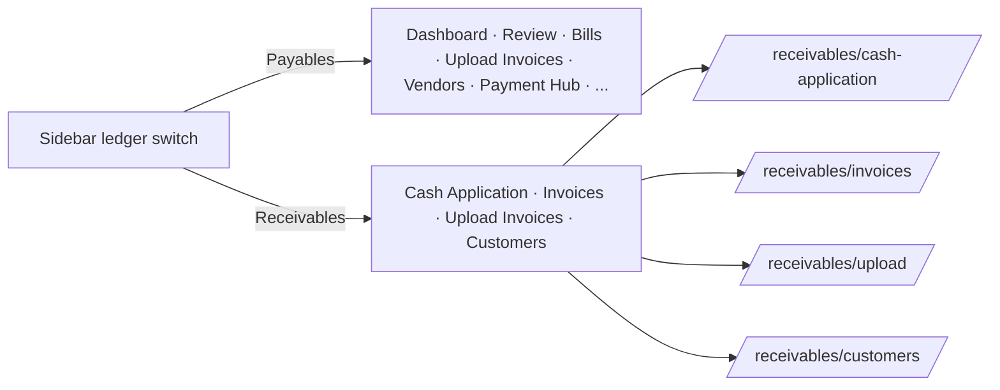
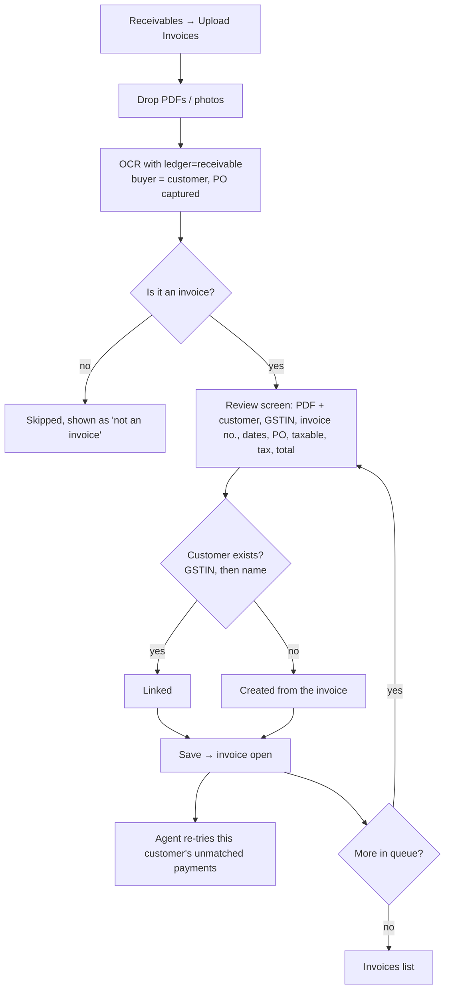
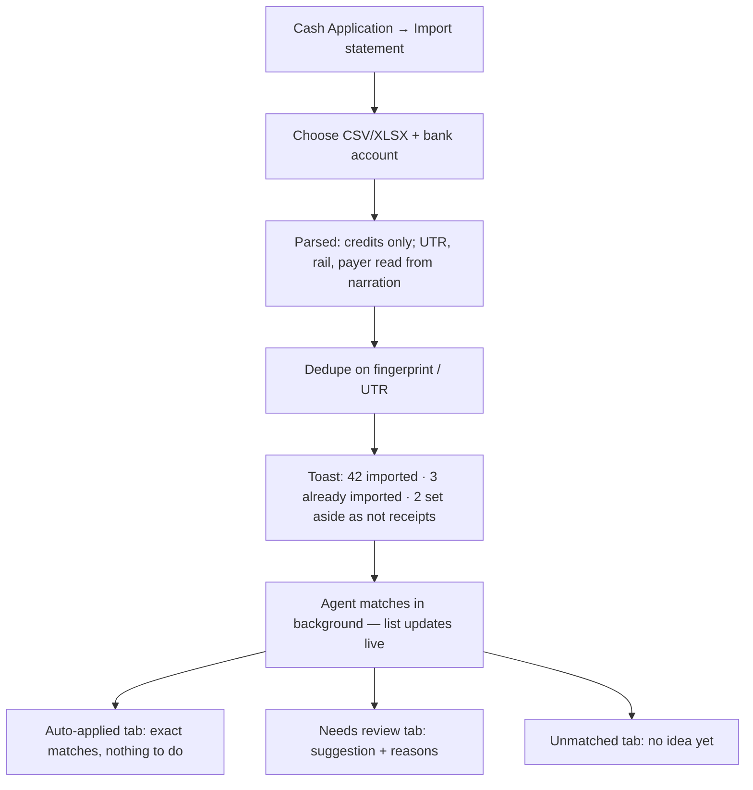
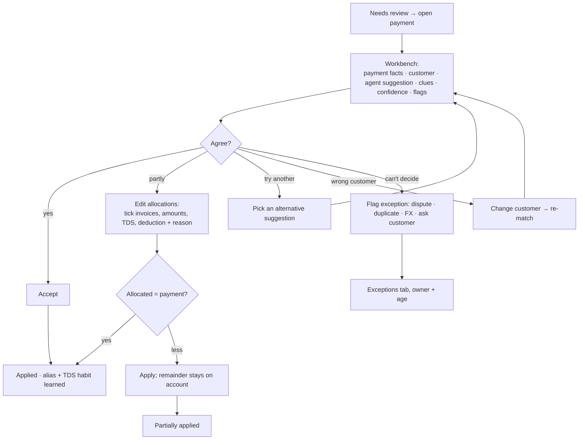
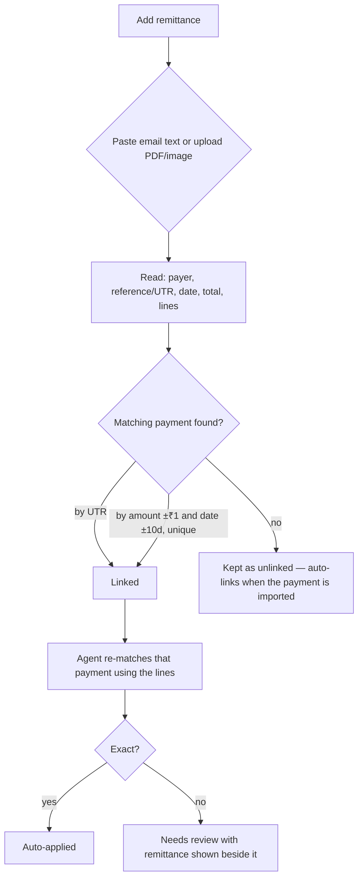
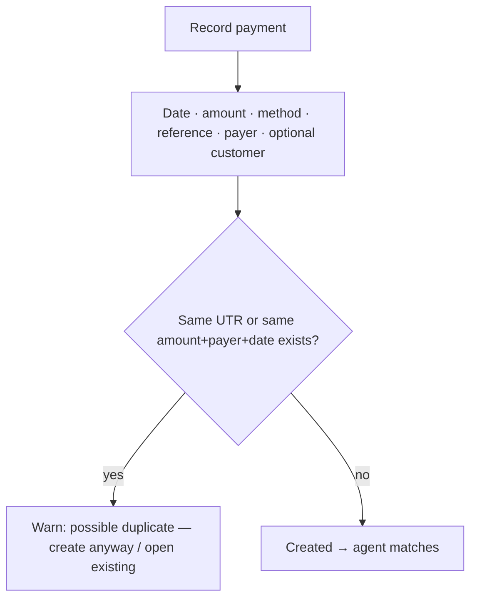
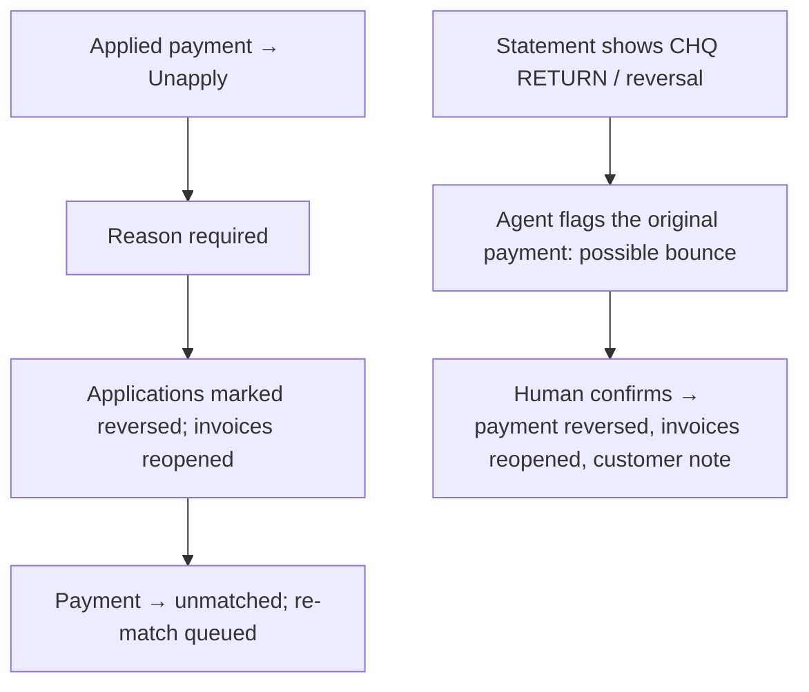

# Cash Application — User Flows

Persona: **AR accountant** (daily), **finance controller** (approves write-offs,
settings, reversals). Screens live under the **Receivables** side of the sidebar switch.

---

## F0. Navigation — Payables ⇄ Receivables



The switch shows only when the tenant is licensed for `receivables`. The mode follows the
URL, so a shared link opens on the right side.

## F1. Upload sales invoices (reuses the payable Upload page)



Duplicate invoice number for the same customer → save is refused with "already exists",
offering to open it.

## F2. Daily: import the bank statement



## F3. Review a suggestion (the core loop)



## F4. Add remittance advice



## F5. Record a payment by hand (cheque, cash, a credit not in a statement yet)



## F6. Unapply / reverse



## F7. Customers

```mermaid
flowchart LR
  A[Customers list:<br/>outstanding · overdue · unapplied credit · last payment] --> B[Customer detail]
  B --> C[Payer names (aliases): add / remove]
  B --> D[Usual TDS rate (learned, editable)]
  B --> E[Open invoices · payments · on-account credit]
```

## F8. Controller: settings and KPIs

```mermaid
flowchart LR
  A[Cash Application header KPIs] --> B[Match rate · exception rate · applied cash % · time to apply · unapplied aging · DSO]
  C[Settings] --> D[Auto-apply on/off · threshold · rupee tolerance]
  C --> E[Write-off tolerance (off by default)]
  C --> F[Trust learned TDS rate for auto-apply (off by default)]
```
