# Cash Application — Edge Cases

Every case the agent can meet, how it is detected, what the agent does, and whether a
person must decide. **Auto** = agent applies alone. **Review** = agent suggests, person
confirms. **Hold** = agent parks it with a reason; person acts.

Legend for diagrams: rectangles = agent steps, diamonds = decisions, rounded = outcome.

Index

| # | Case | Outcome |
|---|---|---|
| **A** | **Amount vs. invoice** | |
| A1 | Exact payment of one invoice, number quoted | Auto |
| A2 | Exact payment, no number, customer known, unique amount | Auto |
| A3 | Partial payment of one invoice | Review |
| A4 | Instalments: several partials over time | Review → last one may be Auto |
| A5 | One payment, several invoices, remittance given | Auto if exact |
| A6 | One payment, several invoices, no remittance — oldest first | Review |
| A7 | One payment, several invoices, any combination | Review |
| A8 | Several equal combinations / equal invoices | Review (ambiguous) |
| A9 | Overpayment | Review → on account |
| A10 | Payment larger than everything owed (advance) | Hold on account |
| A11 | Paise / ₹1 rounding difference | Auto (absorbed) |
| A12 | Small residual left on an invoice | Review / tolerance write-off |
| **B** | **Deductions** | |
| B1 | TDS deducted on taxable value | Review (Auto if trusted rate) |
| B2 | TDS deducted on gross (customer error) | Review |
| B3 | TDS at a rate not in the list / lower-deduction certificate | Review |
| B4 | TDS on several invoices in one payment | Review |
| B5 | Early-payment discount taken | Review |
| B6 | Short-pay for damage / short supply / rate difference | Hold (dispute or write off) |
| B7 | Bank charges deducted (foreign / RTGS) | Review / tolerance |
| B8 | Debit note / credit note set off in remittance | Review |
| B9 | TDS + another deduction together | Review |
| **C** | **Missing or bad information** | |
| C1 | No invoice number anywhere | Customer + amount logic |
| C2 | No remittance at all | Unmatched → ask customer |
| C3 | Remittance arrives after the payment | Re-match |
| C4 | Remittance arrives before the payment | Kept, auto-links |
| C5 | Remittance invoice number has typo / missing prefix | Review |
| C6 | Remittance total ≠ payment amount | Review |
| C7 | One remittance covers several payments | Review |
| C8 | Narration has no payer name (cheque clearing) | Amount-only, Review |
| C9 | Customer quotes the wrong invoice (conflict) | Review, flagged |
| C10 | Customer quotes their PO, not our invoice no. | Match via PO |
| C11 | Short numeric invoice no. collides with UTR digits | Guarded |
| **D** | **Who paid** | |
| D1 | Payer name truncated / abbreviated | Fuzzy → Review, then learned |
| D2 | Third party pays (parent, group co., financier) | Review, alias learned |
| D3 | One payer name used by several customers | Review, flagged |
| D4 | One payment settles invoices of several customers | Review, flagged |
| D5 | Customer has several GSTINs / branches | Group by PAN |
| D6 | Unknown customer, invoice not in system yet | Unmatched, waits |
| D7 | Same invoice number at two customers | Disambiguate by customer |
| **E** | **Duplicates, reversals, non-receipts** | |
| E1 | Customer pays an already-paid invoice again | Hold (duplicate) |
| E2 | Same statement imported twice / overlapping statements | Auto-skipped |
| E3 | Two genuinely identical credits on the same day | Both kept |
| E4 | Same payment from two sources (manual + statement) | Warn / dedupe by UTR |
| E5 | Bounced cheque / recalled transfer | Hold → reverse |
| E6 | Credit that isn't a customer receipt (interest, refund, sweep, loan) | Set aside (reversible) |
| E7 | Debits in the statement | Ignored |
| **F** | **Invoice state** | |
| F1 | Invoice disputed / on hold | Excluded from auto |
| F2 | Invoice voided / replaced by a revised one | Excluded; Review |
| F3 | Payment before the invoice date (advance) | Review, flagged |
| F4 | Invoice uploaded after the payment arrived | Re-match |
| F5 | Foreign-currency invoice | Review, flagged |
| **G** | **System / concurrency** | |
| G1 | Human and agent act on the same payment | Version check → 409 |
| G2 | Late remittance disagrees with a human's application | Review, flagged |
| G3 | Unapply after application | Reverse, re-match |
| G4 | Worker crash mid-job | Re-queued |
| G5 | OCR / LLM failure reading remittance | Kept raw, Review |
| G6 | Very large customer (thousands of open invoices) | Bounded search |

---

## A. Amount vs. invoice

### A1 — Exact payment of one invoice, number quoted
`NEFT-…-ACME TRADING-INV 1045` for ₹1,18,000; INV-1045 outstanding ₹1,18,000.
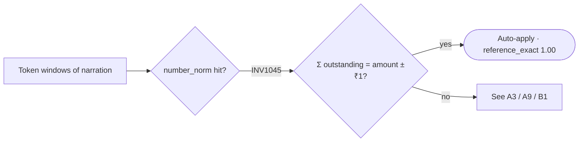

### A2 — Exact payment, no number, customer known
Payer `ACME TRADING` is a confirmed alias; exactly one open invoice equals the amount.
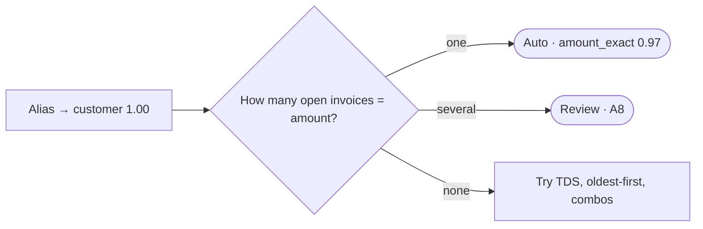

### A3 — Partial payment of one invoice
₹50,000 against INV-1045 (₹1,18,000).
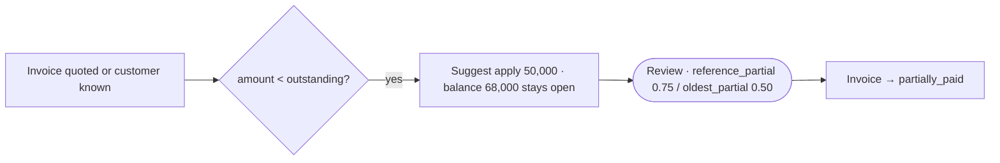
Never auto: a short payment might be a TDS/deduction the agent didn't recognise, and
"part-payment" vs "short-pay to dispute" is a human call.

### A4 — Instalments
Three UPI payments of ₹40,000 against one ₹1,18,000 invoice.
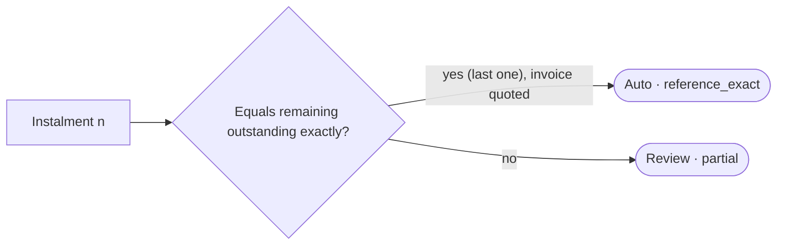
TDS is never inferred on a part-paid invoice (`untouched = false`).

### A5 — Several invoices, remittance given
Remittance: INV-1045 ₹1,18,000 · INV-1046 ₹59,000; payment ₹1,77,000.
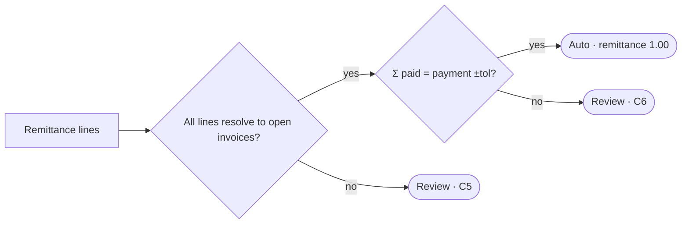

### A6 — Several invoices, no remittance, oldest first
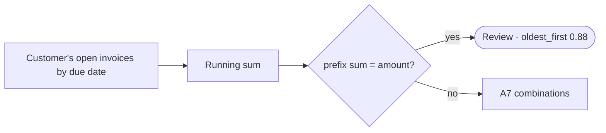

### A7 — Several invoices, any combination
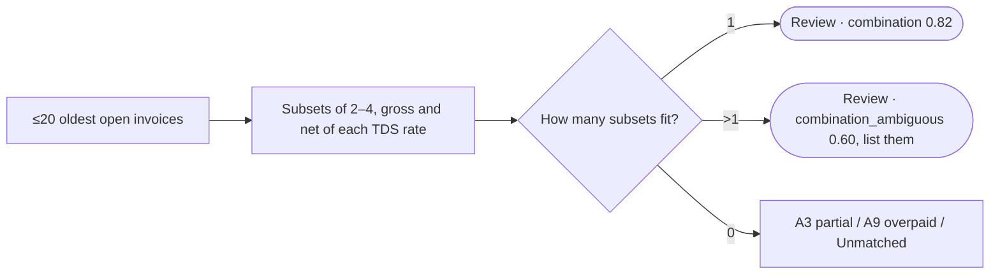

### A8 — Ambiguous equal candidates
Two open invoices of ₹59,000 each, payment ₹59,000, no reference.
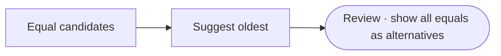

### A9 — Overpayment
Quoted INV-1045 ₹1,18,000; paid ₹1,20,000.
```mermaid
flowchart LR
  A[Quoted Σ < amount] --> B[Apply full outstanding]
  B --> C[₹2,000 remains on account (customer credit)]
  C --> D([Review · reference_overpaid 0.80])
  D --> E{Human: refund / keep for next invoice / bank charge reversal?}
```

### A10 — More than everything owed (advance)
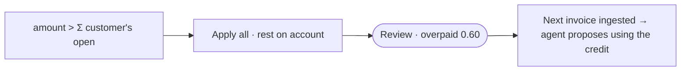

### A11 — Rounding
₹1,17,999.50 vs ₹1,18,000.
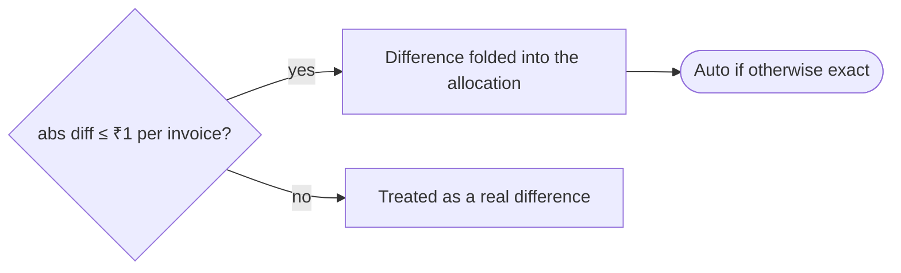

### A12 — Small residual on an invoice
₹3 left after a payment.
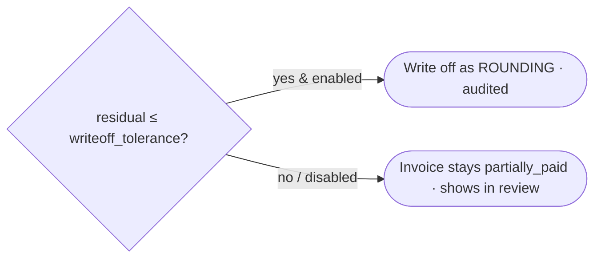

## B. Deductions

### B1 — TDS on taxable value
INV-1045 taxable ₹1,00,000, GST ₹18,000, total ₹1,18,000; 194C @2% → paid ₹1,16,000.
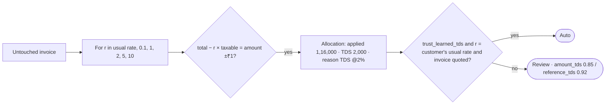
TDS amount is recorded on the invoice as `tds_amount` (a receivable from the government,
to be checked against 26AS), so the invoice reads **paid**.

### B2 — TDS on gross (customer error)
Paid ₹1,15,640 = 1,18,000 − 2% × 1,18,000.
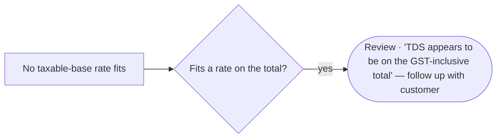

### B3 — Unusual rate / lower-deduction certificate (Sec. 197)
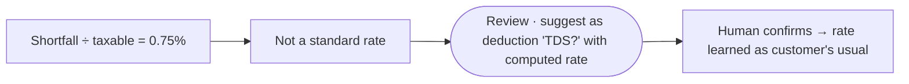

### B4 — TDS on several invoices at once
```mermaid
flowchart LR
  A[Quoted or combination invoices] --> B{Σ(outstanding − r × taxable) = amount for one r?}
  B -- yes --> C([Review · TDS split per invoice])
```

### B5 — Early-payment discount
Terms "2/10 Net 30"; paid 2% less within 10 days.
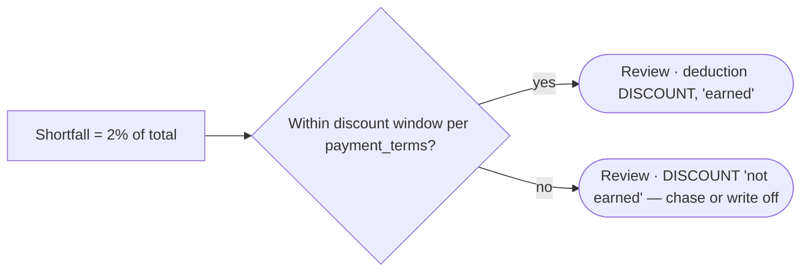

### B6 — Short-pay for damage / short supply / rate difference
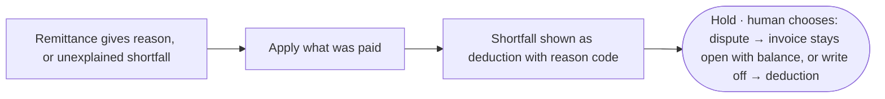
Never silently "mark paid".

### B7 — Bank charges
₹1,18,000 invoice, ₹1,17,850 received via foreign wire.
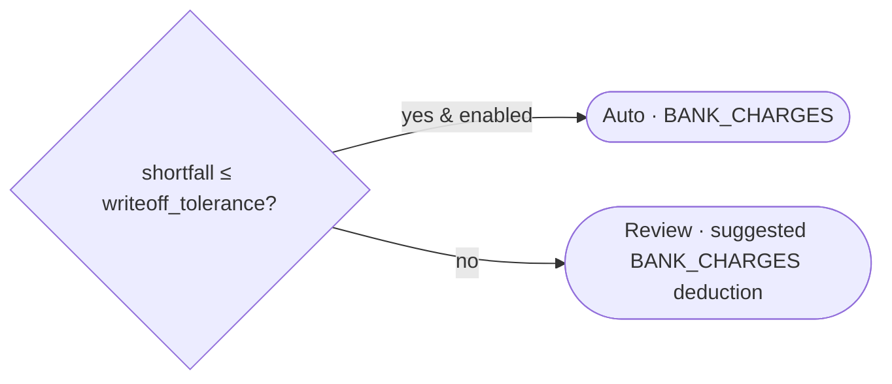

### B8 — Debit / credit note set off
Remittance: INV-1045 ₹1,18,000, DN-77 −₹5,000 → paid ₹1,13,000.
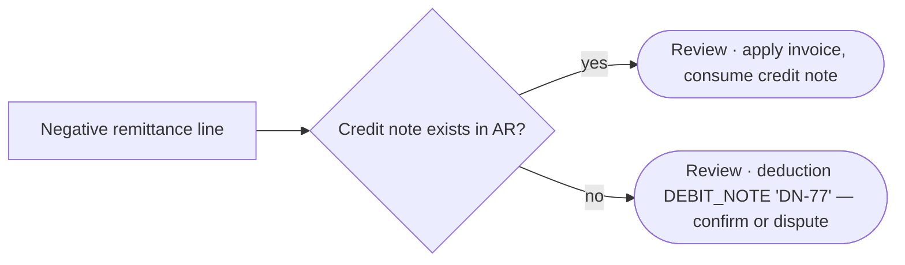

### B9 — TDS plus another deduction
```mermaid
flowchart LR
  A[TDS fits part of the gap] --> B[Remaining gap ≠ 0]
  B --> C([Review · TDS line + 'unexplained ₹x' deduction for the human to classify])
```

## C. Missing or bad information

### C1 — No invoice number anywhere
```mermaid
flowchart TD
  A[No tokens hit] --> B{Customer identified?}
  B -- "alias / fuzzy" --> C[A2 exact → A6 oldest → A7 combos → B1 TDS → A3 partial]
  B -- no --> D{Exactly one invoice tenant-wide = amount?}
  D -- yes --> E([Review · amount_only 0.60])
  D -- no --> F([Unmatched · ask customer for remittance])
```

### C2 — No remittance at all
```mermaid
flowchart LR
  A[Unmatched > N days] --> B[Shows in unapplied aging]
  B --> C([Human: request remittance from customer · v2 agent drafts the email])
```

### C3 — Remittance after payment
```mermaid
flowchart LR
  A[Remittance read] --> B{Payment by UTR / amount+date?}
  B -- found --> C{Payment touched by a human?}
  C -- no --> D[Re-match with remittance → normal policy]
  C -- yes --> E([G2 · Review if it disagrees])
```

### C4 — Remittance before payment
```mermaid
flowchart LR
  A[Remittance unlinked] --> B[Payment imported later]
  B --> C[Match job looks for unlinked remittance by UTR / amount±tol date±10d]
  C --> D[Linked → used as primary clue]
```

### C5 — Typo / missing prefix in remittance invoice number
Remittance says `1045`; invoice is `INV/24-25/1045`.
```mermaid
flowchart LR
  A[Exact number_norm miss] --> B{Unique suffix match within customer?}
  B -- yes --> C([Review · 'matched 1045 → INV/24-25/1045'])
  B -- no --> D{Edit distance ≤1 within customer, amount agrees?}
  D -- yes --> C
  D -- no --> E([Review · line unresolved])
```

### C6 — Remittance total ≠ payment
```mermaid
flowchart LR
  A[Σ lines ≠ amount] --> B[Apply lines that resolve]
  B --> C([Review · remittance_partial 0.80 · show gap])
```

### C7 — One remittance, several payments
```mermaid
flowchart LR
  A[Remittance total = Σ of 2–3 payments same payer within 10 days] --> B([Review · split lines across payments])
```

### C8 — No payer name (cheque clearing)
`BY CLG 004512`
```mermaid
flowchart LR
  A[No payer] --> B{Cheque no. in a remittance?}
  B -- yes --> C[Linked → customer]
  B -- no --> D([Review · amount_only, or Unmatched])
```

### C9 — Wrong invoice quoted (conflict)
Narration says INV-1045 (₹1,18,000) but paid ₹59,000 = INV-1054 exactly.
```mermaid
flowchart LR
  A[reference candidate] --> C{Different invoice from amount candidate?}
  B[amount candidate] --> C
  C -- yes --> D([Review · CLUE_CONFLICT · both shown])
```

### C10 — PO quoted instead of invoice no.
```mermaid
flowchart LR
  A[Token windows] --> B{Hit on po_number?}
  B -- yes --> C[Treat invoices on that PO as quoted]
  C --> D[A1 / A3 / A5 logic]
```

### C11 — Short invoice number inside a UTR
Invoice `1045`, UTR `HDFCN52026110451234`.
```mermaid
flowchart LR
  A{All-digit and < 6 digits?} -- yes --> B[Must stand alone: not preceded/followed by a digit]
  B --> C([Not matched inside UTR])
```

## D. Who paid

### D1 — Truncated payer name
`ACME TRADIN` vs `Acme Trading Pvt Ltd`.
```mermaid
flowchart LR
  A[No alias] --> B[Trigram top-5 → rapidfuzz]
  B --> C{score ≥ 90?}
  C -- yes --> D([Review · conf × 0.90])
  D --> E[Human confirms → alias learned → next time Auto]
```

### D2 — Third party pays
`XYZ HOLDINGS` pays for subsidiary `XYZ Retail`.
```mermaid
flowchart LR
  A[Payer unknown] --> B{Same PAN group or invoice quoted?}
  B -- yes --> C([Review · 'paid by group company'])
  B -- no --> D([Unmatched])
  C --> E[Confirmed → alias XYZ HOLDINGS → XYZ Retail]
```

### D3 — Payer name shared by several customers
```mermaid
flowchart LR
  A[alias → 2 customers] --> B([Review · AMBIGUOUS_PAYER · candidates from both])
```

### D4 — One payment for several customers' invoices
```mermaid
flowchart LR
  A[Remittance / quotes span customers] --> B([Review · CROSS_CUSTOMER · allowed only with confirmation])
```

### D5 — Several GSTINs / branches
```mermaid
flowchart LR
  A[Customer per GSTIN] --> B[Same PAN = one group]
  B --> C[Group invoices searched when payer is the group's alias]
```

### D6 — Invoice not in the system yet
```mermaid
flowchart LR
  A[Unmatched] --> B[Invoice uploaded later]
  B --> C[new_invoice job for the customer's unmatched payments]
  C --> D[Normal matching]
```

### D7 — Same invoice number at two customers
```mermaid
flowchart LR
  A[number_norm hits 2 customers] --> B{Customer identified?}
  B -- yes --> C[Use that customer's]
  B -- no --> D([Review · both shown])
```

## E. Duplicates, reversals, non-receipts

### E1 — Already-paid invoice paid again
```mermaid
flowchart LR
  A[Amount = a paid invoice of this customer / quoted invoice is paid] --> B([Hold · POSSIBLE_DUPLICATE · refund or keep as credit])
```

### E2 — Statement re-imported
```mermaid
flowchart LR
  A[Row fingerprint] --> B{exists?}
  B -- yes --> C([Skipped · counted as duplicate])
  B -- no --> D[Inserted]
```

### E3 — Two identical credits on one day
```mermaid
flowchart LR
  A[Same date, amount, narration] --> B[Occurrence index 1, 2 in the fingerprint]
  B --> C([Both kept; a re-import still dedupes])
```

### E4 — Same payment from two sources
```mermaid
flowchart LR
  A{Same UTR exists?} -- yes --> B([Skip / merge])
  A -- no --> C{Same amount + payer ±2 days?}
  C -- yes --> D([Warn on manual entry])
  C -- no --> E[Insert]
```

### E5 — Bounced cheque / recall
`CHQ RETURN 004512` debit of ₹1,18,000.
```mermaid
flowchart LR
  A[Debit with RETURN/REV/BOUNCE] --> B[Find credit with same cheque/UTR/amount]
  B --> C([Hold · human confirms → payment reversed, applications reversed, invoices reopened])
```

### E6 — Not a customer receipt
`INT.PD`, `SWEEP FROM FD`, `REFUND FROM VENDOR`, `LOAN DISB`, own-account transfer.
```mermaid
flowchart LR
  A[Narration keywords] --> B([Set aside as not_receipt · never matched · one click to restore])
```

### E7 — Debits
```mermaid
flowchart LR
  A[Row without a credit] --> B([Ignored, except E5 bounce detection])
```

## F. Invoice state

### F1 — Disputed invoice
```mermaid
flowchart LR
  A[Candidate status = disputed] --> B([Excluded from auto · Review with DISPUTED_INVOICE])
```

### F2 — Voided / revised invoice
```mermaid
flowchart LR
  A[Quoted invoice is void] --> B{Revised invoice for same customer & PO?}
  B -- yes --> C([Review · apply to revised])
  B -- no --> D([Review])
```

### F3 — Payment before invoice date
```mermaid
flowchart LR
  A[received_on < invoice_date] --> B([Review · ADVANCE flag])
```

### F4 — Invoice uploaded after payment
See D6.

### F5 — Foreign currency
```mermaid
flowchart LR
  A[Invoice USD, payment INR] --> B([Review · FOREIGN_CURRENCY · FX difference as deduction FX])
```

## G. System / concurrency

### G1 — Human and agent on the same payment
```mermaid
flowchart LR
  A[Apply with version v] --> B{row version = v?}
  B -- yes --> C[Commit · v+1]
  B -- no --> D([409 · 'This payment changed — reload'])
```

### G2 — Late remittance disagrees with a human
```mermaid
flowchart LR
  A[Payment applied by a human] --> B[Remittance arrives]
  B --> C{Same invoices & amounts?}
  C -- yes --> D([No change])
  C -- no --> E([Review · REMITTANCE_DISAGREES · nothing changed automatically])
```

### G3 — Unapply
```mermaid
flowchart LR
  A[Unapply + reason] --> B[applications.reversed_at set]
  B --> C[Invoices reopened]
  C --> D[Payment unmatched · re-match queued]
```

### G4 — Worker crash
```mermaid
flowchart LR
  A[Job RUNNING, process died] --> B[On start: stale RUNNING → PENDING]
  B --> C[Handler is idempotent: re-reads state, never applies twice]
```

### G5 — Remittance unreadable
```mermaid
flowchart LR
  A[LLM / OCR error] --> B([Remittance kept with raw text, status unlinked · human can enter lines])
```

### G6 — Very large customer
```mermaid
flowchart LR
  A[10,000 open invoices] --> B[Token lookup + amount-near index + 20 oldest]
  B --> C[Combinations capped at 4 of 20]
  C --> D([Bounded time per payment])
```
