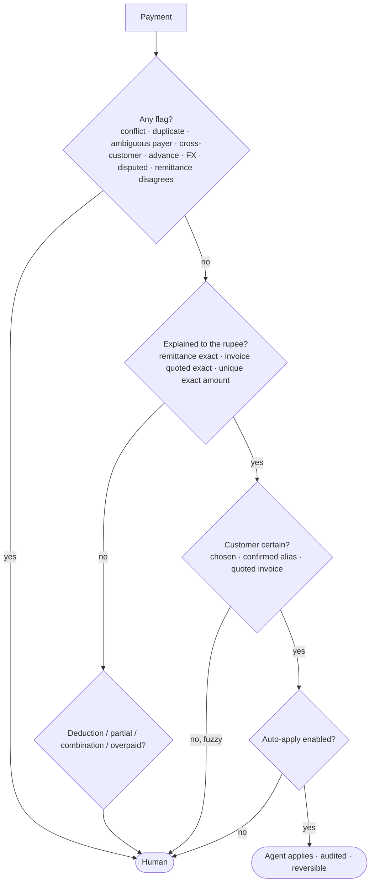

# Cash Application — What the Agent Decides vs. What a Person Decides

Principle (from the research): **the agent applies cash alone only when the amount is
explained to the rupee and the customer is certain.** Anything that involves judgement,
money left over, or money held back is a suggestion with reasons. Autonomy grows only
when the tenant turns it on, case by case.

## 1. The agent verifies and acts alone

| Action | Why it is safe |
|---|---|
| Parse statements, read UTR / rail / payer | Deterministic; raw narration kept |
| Skip re-imported rows (fingerprint, UTR) | Idempotent; counts shown |
| Read remittance advice and link by exact UTR | Exact identifier |
| Identify customer by confirmed alias, chosen customer, or quoted invoice | Previously confirmed by a person |
| Apply **remittance-exact**, **reference-exact**, **unique amount-exact** matches | Amount explained to ₹1, customer certain |
| Absorb ≤ ₹1 rounding per invoice | Below any materiality |
| Set aside obvious non-receipts (interest, sweeps, refunds) | Never applied; one-click restore |
| Re-try matching when an invoice, remittance or alias arrives | Matching only; same policy applies |
| Compute and rank suggestions with reasons | Advisory |
| Recompute KPIs, aging | Read-only |

## 2. The agent suggests, a person confirms

| Situation | What the person decides | Edge cases |
|---|---|---|
| TDS short-pay | Accept the TDS split (teaches the customer's rate) | B1–B4 |
| Partial payment | Part-payment vs. short-pay to dispute | A3, A4 |
| Several invoices, no remittance | Which set | A6–A8 |
| Overpayment / advance | Keep as credit, refund, or apply to next invoice | A9, A10 |
| Fuzzy customer | Is this the customer (teaches alias) | D1, D2 |
| Remittance with typos / mismatched totals | Accept the resolved lines | C5–C7 |
| Customer quoted the wrong invoice | Which clue to trust | C9 |
| Amount-only match (payer unknown) | Is this the customer | C1, C8 |
| Discount taken | Earned or not | B5 |
| Debit / credit note set-off | Accept set-off | B8 |

## 3. A person must act (agent holds)

| Situation | Why a human | Edge cases |
|---|---|---|
| Write-off above tolerance | Money given up — controller approval | A12, B6, B7 |
| Dispute (damage, short supply, rate difference) | Commercial decision, customer conversation | B6 |
| Duplicate payment | Refund vs. credit is a customer decision | E1 |
| Bounced cheque / recall | Reverses revenue collection; customer follow-up | E5 |
| Cross-customer or group payment | Who owns the money | D3, D4 |
| Foreign-currency difference | FX gain/loss posting | F5 |
| Late remittance contradicting a person's application | Never overrule a human silently | G2 |
| Unapply | Undoes recorded cash | G3 |
| Unmatched beyond N days | Ask the customer for remittance | C2 |

## 4. Graduated autonomy (tenant settings, all off by default except exact auto-apply)

| Setting | Effect | Default |
|---|---|---|
| `auto_apply_enabled` | Exact matches applied without a person | **on** |
| `auto_apply_threshold` | Minimum confidence for auto | 0.95 |
| `amount_tolerance` | Rounding absorbed per invoice | ₹1.00 |
| `writeoff_tolerance` | Residual written off automatically (ROUNDING / BANK_CHARGES) | ₹0 (off) |
| `trust_learned_tds` | Auto-apply TDS at the customer's confirmed rate when the invoice is quoted | off |

## 5. Every automatic action is reversible and explained

- Each application stores the agent's `kind`, `confidence`, and `clues` at the time.
- `ar_events` records `actor = 'agent'` vs. the user.
- Unapply restores the invoice balances and queues a re-match; nothing is deleted.
- Suggestion acceptance rate is tracked as a KPI; if it drops, auto-apply should be
  tightened.
