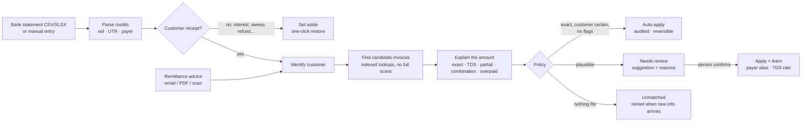

# Receivables — Cash Application Agent

When a customer pays us, money shows up in the bank with a short, cut-off narration and
usually no invoice number. The **Cash Application Agent** works out, for every credit:

1. **who paid** (which customer),
2. **which of our sales invoices it settles**, and
3. **what happened to any difference** (TDS, a deduction, a part-payment, an overpayment).

It applies the payment by itself **only when the amount is explained to the rupee and the
customer is certain**. Everything else becomes a ranked suggestion, with reasons, for a
person to accept, edit or reject. Each confirmation teaches the agent: it learns the
customer's payer names and usual TDS rate.

Status: **design v1 + pure core built** · branch `feat/receivables-cash-app` · 2026-11-17

---

## Why this is hard in India

| What happens | What it means for matching |
|---|---|
| Customers deduct **TDS** before paying | The receipt never equals the invoice total. It is `total − rate × taxable value` |
| Narrations are truncated bank strings (`NEFT-HDFCN5202…-ACME TRADIN`) | Payer names are fragments and invoice numbers are rare |
| Remittance advice arrives separately (email, ERP PDF, or never) | The best clue may come before the payment, after it, or not at all |
| One transfer clears several invoices; one invoice is paid in parts | Many-to-many matching, with partial balances |

## How it works

**Identifying the customer** uses the strongest signal available, in this order: a customer
the user chose, then a confirmed payer alias, then invoice numbers quoted in the narration,
then the remittance, then a fuzzy name match. A fuzzy name match never auto-applies.

**Explaining the amount** tries remittance lines first, then quoted invoice numbers, then
the customer's open invoices: an exact amount, the amount net of TDS, oldest first, any
combination of 2–4 invoices, a part-payment or an overpayment. Each explanation has a
`kind`, a confidence and the clues behind it. The full table is in
[02_LLD.md §6.3](02_LLD.md#63-candidate-generation-and-base-confidence).

**Flags** always send a payment to review, whatever the confidence: conflicting clues,
a possible duplicate, a payer name shared by several customers, a cross-customer payment,
an advance, foreign currency, a disputed invoice, or a late remittance that disagrees with
a person's earlier decision.

**Retrying.** The agent re-matches a payment whenever something new arrives: an invoice,
a remittance, a learned alias, an unapply, or the nightly sweep.

## What the agent does alone vs. what a person decides

| Agent acts alone | Agent suggests, person confirms | Person must act |
|---|---|---|
| Exact matches: remittance, quoted invoice, unique amount | TDS short-pay | Write-off above tolerance |
| Rounding up to ₹1 per invoice | Partial payment | Dispute (damage, short supply, rate difference) |
| Set aside interest, sweeps, refunds | Several invoices, no remittance | Duplicate payment (refund or credit?) |
| Skip re-imported rows (fingerprint, UTR) | Overpayment / advance | Bounced cheque / recall |
| Link remittance to payment by exact UTR | Fuzzy customer name | Cross-customer / group payment |
| Retry matching when new info arrives | Discount, debit/credit note set-off | Unapply |

Tenants can widen autonomy step by step in `ar_settings`. Defaults: `auto_apply_enabled = on`
(exact matches only), threshold 0.95, ₹1 tolerance, write-off tolerance off,
`trust_learned_tds` off. Full matrix: [05_HUMAN_IN_THE_LOOP.md](05_HUMAN_IN_THE_LOOP.md).

## Key design decisions

| Decision | Why |
|---|---|
| **Own `ar_*` tables, not a flag on `fact_invoices`** | ~170 payable queries read `fact_invoices`. Sales invoices would leak into payable reports, the Payment Hub and the Review Hub |
| **Reuse the payable machinery** | OCR engine (now ledger-aware: `ledger=receivable`), upload endpoint, S3 + signed links, tenancy, licensing (`require_service("receivables")`), `BaseWorker`, UI kit |
| **Matching engine is pure** (no DB, no LLM) | Every rule is unit-testable and every suggestion explains itself |
| **Candidate retrieval, never scans** | Indexed lookups only; at most 20 invoices and 4 per combination, so cost stays flat as tenants grow |
| **Import parses and queues; a worker matches** | A 5,000-line statement returns in seconds. Jobs are claimed with `FOR UPDATE SKIP LOCKED`, and stale `RUNNING` jobs are re-queued on start-up |
| **Money is exact** | `NUMERIC(18,2)` in the DB, `Decimal` in Python, strings over JSON. `outstanding` is a generated column |
| **Applications are append-only** | A reversal is a new state, never a delete. A `version` column turns a stale "Apply" into a 409 |
| **TDS on taxable value** (CBDT circular 23/2017) | TDS wrongly taken on the GST-inclusive total is detected and flagged `TDS_ON_GROSS`. TDS is never inferred on an invoice that is already part-paid |
| **Documents are never public** | Invoice and remittance files are served only through the authenticated route as 5-minute signed links |

## Build status

| Piece | File | Status |
|---|---|---|
| Ledger-aware OCR | `utils/ocr_engine.py`, `routers/invoices.py` (`ledger=receivable`) | ✅ built |
| Statement parser (header detection, rail/UTR/payer, fingerprint) | [`receivables/bank_statement.py`](../../backend_ocr/app/receivables/bank_statement.py) | ✅ built |
| Non-receipt + bounce detectors | [`receivables/detectors.py`](../../backend_ocr/app/receivables/detectors.py) | ✅ built |
| Matching engine | [`receivables/matching.py`](../../backend_ocr/app/receivables/matching.py) | ✅ built |
| Decision policy | [`receivables/policy.py`](../../backend_ocr/app/receivables/policy.py) | ✅ built |
| Remittance reader (text layer → vision → LLM) | [`receivables/remittance.py`](../../backend_ocr/app/receivables/remittance.py) | ✅ built, not yet run against a real LLM call |
| DDL for the `ar_*` tables | [`receivables/schema.py`](../../backend_ocr/app/receivables/schema.py) | ✅ wired into `migrations.py` (`_ensure_receivables_tables`) |
| Status vocabulary | [`receivables/types.py`](../../backend_ocr/app/receivables/types.py) | ✅ built |
| Repository (SQL, candidate retrieval, job queue, KPIs) | [`receivables/repo.py`](../../backend_ocr/app/receivables/repo.py) | ✅ built |
| Application service (capture, match, apply, unapply, learning, audit) | [`receivables/service.py`](../../backend_ocr/app/receivables/service.py) | ✅ built |
| Worker (drains `ar_match_jobs`) | [`receivables/worker.py`](../../backend_ocr/app/receivables/worker.py) | ✅ built, started by the review scheduler when `CASHAPP_WORKER_ENABLED=1` |
| API `/api/ar/*` (25 routes, all tenant-scoped, service `receivables`) | [`routers/receivables.py`](../../backend_ocr/app/routers/receivables.py) | ✅ built |
| UI: Payables ⇄ Receivables switch, Cash Application, Invoices, Upload, Customers | `frontend/src/pages/receivables/*`, `components/Sidebar.tsx` | ✅ built, type-checked, ⏳ not yet clicked through in a browser |

Roles: receivables use the **same roles and approval chain as payables** (no separate
receivables chain for now). Capture needs `payables.initiate`; applying, unapplying and
exceptions need `payables.accounting_approval`; settings are admin-only.

**Tests** (2026-11-17):
- `python3.12 -m pytest -q tests/receivables` — 49 engine/parser tests pass, named after the
  edge-case IDs in [04_EDGE_CASES.md](04_EDGE_CASES.md).
- `AR_TEST_DB_URL=postgresql://localhost/ar_test python3.12 -m pytest tests/receivables/test_service_db.py`
  — 2 end-to-end tests against a throwaway Postgres (ingest → import → auto-apply → review/accept →
  version conflict → unapply → re-import dedupe → remittance-first → partial → duplicate warning).
- Frontend: `npm run typecheck`, `npx vitest run` (617 + 4 new route tests) and `vite build` pass.

## Rollout plan

1. Add the `receivables` service to the licensing catalog. Off by default in prod; on for the pilot tenant.
2. Run `scripts/run_api_migrations.py` to add the `ar_*` tables, plus `pg_trgm` if the DB allows it.
3. Set `CASHAPP_WORKER_ENABLED` **off locally**, because local and dev share the dev DB
   (see the review-worker lock incident). Set it on for the dev and prod services.
4. Measure the match rate on the pilot's last 3 months of statements before relying on auto-apply.

KPIs tracked: auto match rate, exception rate, applied cash %, time to apply, unapplied
cash aging, DSO and suggestion acceptance. If suggestion acceptance drops, tighten auto-apply.

## Glossary

| Term | Meaning |
|---|---|
| **Cash application** | Matching a received payment to the invoices it settles, then recording that |
| **Remittance advice** | The customer's note saying which invoices a payment covers |
| **UTR** | Unique Transaction Reference, the bank's ID for a NEFT/RTGS/IMPS transfer |
| **Rail** | Payment channel: NEFT, RTGS, IMPS, UPI or cheque |
| **TDS** | Tax Deducted at Source. The customer withholds a % of the taxable value and pays the rest |
| **On account / unapplied** | Money received but not yet tied to an invoice |
| **Payer alias** | A bank-narration name learned to belong to a customer (`ACME TRADIN` → Acme Trading Pvt Ltd) |
| **Unapply** | Reversing an application. The invoices reopen and the payment is re-matched |

## The docs, and what to read first

| If you want to… | Read |
|---|---|
| Understand the problem, architecture and scaling choices | [01_HLD.md](01_HLD.md) |
| Build it: package layout, ER model, state machines, algorithms, job queue, API | [02_LLD.md](02_LLD.md) |
| See every screen flow: upload, import, review, remittance, unapply, settings | [03_USER_FLOWS.md](03_USER_FLOWS.md) |
| Check how a tricky case is handled (57 cases, A1–G6, each with a diagram) | [04_EDGE_CASES.md](04_EDGE_CASES.md) |
| Know exactly where the agent stops and a person starts | [05_HUMAN_IN_THE_LOOP.md](05_HUMAN_IN_THE_LOOP.md) |
| See how Monk, Doss, Rillet and HighRadius do it, and what we took from them | [CASH_APPLICATION_RESEARCH.md](CASH_APPLICATION_RESEARCH.md) |

Diagrams are Mermaid. They render on GitHub and in VS Code's Markdown preview.
