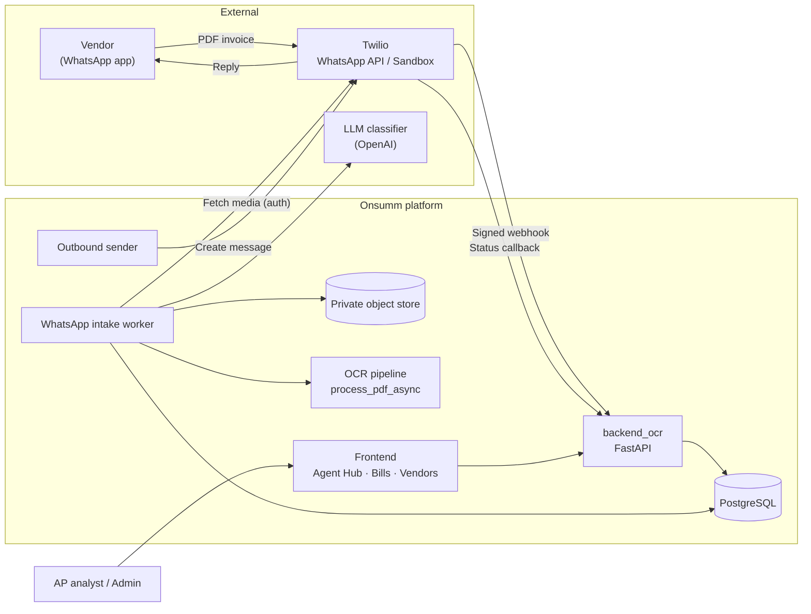
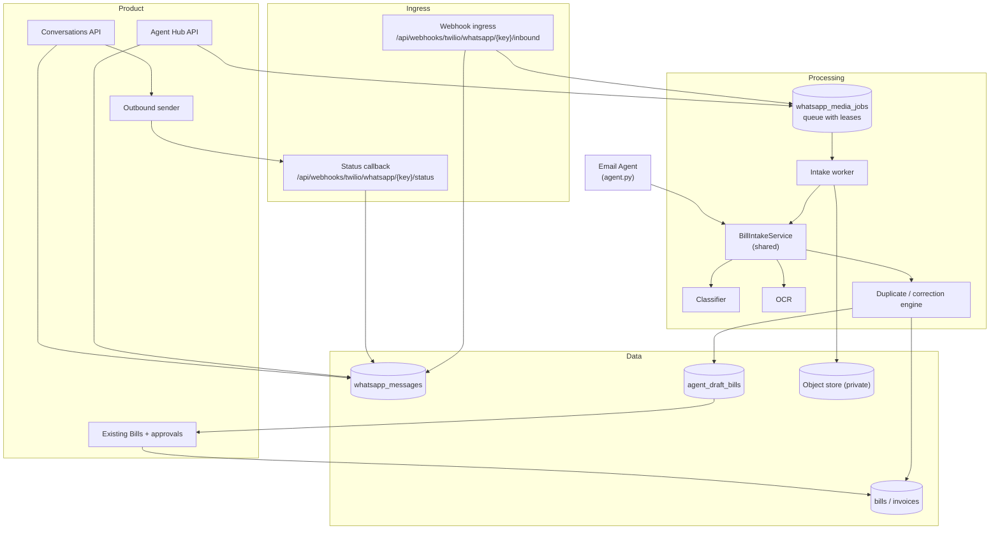
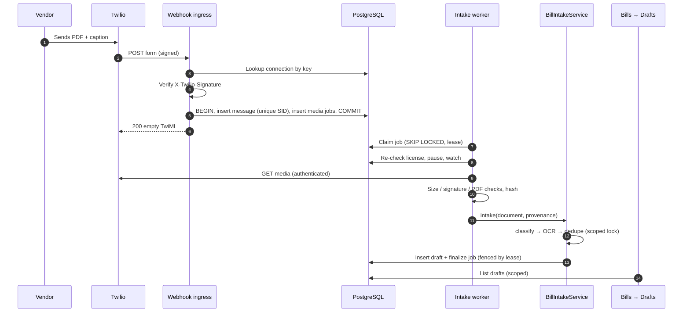
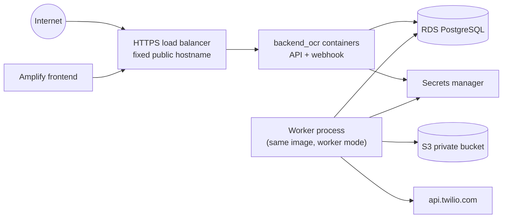
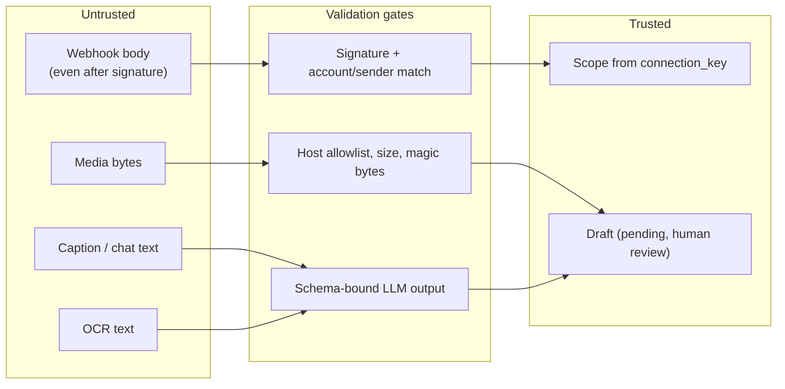

# WhatsApp Agent: high-level design

**Status:** Proposed · See [PRD](01-prd.md) for scope and [LLD](03-lld.md) for class-level detail.

## 1. Design principles

1. **One pipeline for every channel.** WhatsApp is a new *adapter*. Classification, OCR, duplicate checks and drafts move behind a channel-neutral `BillIntakeService` that email and WhatsApp both call.
2. **Save first, then acknowledge.** The webhook only checks, saves and replies. All heavy work happens in a worker reading from a queue in PostgreSQL.
3. **Scope comes from the connection.** Tenant and brand come only from the opaque `connection_key` in the webhook URL. Never from the sender's number, message text or anything the client sends.
4. **Idempotent at every step.** Message SID, (message, media index), file hash, draft key and submit key each guard one step.
5. **People make the money decisions.** The agent produces drafts and suggestions only.

## 2. System context

## 3. Components

| Component | Responsibility | Where it lives |
|---|---|---|
| **Webhook ingress** | Look up connection by key, check signature, normalize, write event + job in one transaction, return empty TwiML | `routers/whatsapp_webhook.py` (new) |
| **Intake worker** | Claim jobs with a lease, re-check license/pause/watch, fetch media safely, call `BillIntakeService` | `agents/whatsapp/worker.py` (new), runs in its own thread like `start_agent_poller` |
| **Twilio adapter** | Signature check, media fetch, message create, status mapping | `integrations/twilio_whatsapp.py` (new) |
| **BillIntakeService** | Classify → OCR → duplicate/correction check → write draft, for any channel | `domain/bill_intake.py` (new, extracted from `agent.py`) |
| **Draft store** | `agent_draft_bills` with channel and provenance columns | Existing table, additive changes |
| **Agent Hub API** | Status, events, connection, settings, refresh, watches | `routers/whatsapp_agent.py` (new) |
| **Conversations API** (R2) | Timeline, summary, attachment save, manual draft, reply | `routers/whatsapp_conversations.py` (new) |
| **Outbound sender** (R2) | Queue → consent/window/template check → Twilio → status | `agents/whatsapp/outbox.py` (new) |
| **Licensing** | `whatsapp_agent` entitlement and route map | `security/services.py`, `security/licensing.py` |
| **Frontend** | Channel tabs in Agent Hub, WhatsApp watch switch, Drafts badge, Conversations | `AgentHubPage.tsx`, `BillsPage.tsx`, vendor pages, `api/agent.ts` |

## 4. Component diagram

## 5. Main data flow (inbound)

## 6. Deployment view

- The webhook URL must be the **exact** public URL Twilio signs. The configured `PUBLIC_BASE_URL` is used to check signatures, never forwarded headers.
- In R1 the worker can run as a background thread in the API process (as the email poller does). It must move to its own process before production so scaling the API doesn't change worker concurrency.

## 7. Trust boundaries

## 8. Key decisions

| Decision | Choice | Why |
|---|---|---|
| Queue | PostgreSQL table with `FOR UPDATE SKIP LOCKED` and leases | No new infrastructure, transactional with drafts, fine at pilot volume |
| Push vs poll | Push (webhook) + Refresh drain | WhatsApp has no inbox to poll. Refresh only drains our own queue |
| Shared service | Extract `BillIntakeService` from `agent.py` | One dedupe engine is the only way to catch email + WhatsApp duplicates |
| Tenant routing | Opaque key in URL → one connection | Senders and content can be spoofed. The key + signature cannot |
| Media | Download in worker, not in webhook | Keeps the acknowledgement fast. Twilio media URLs need auth |
| Outbound | Queue with `unknown` state | A timeout may mean the message was sent. Never blind-retry |

## 9. Capacity (pilot)

| Item | Estimate |
|---|---|
| Inbound messages | under 500/day per tenant |
| PDF size | up to 16 MB (WhatsApp limit), we accept up to the existing PDF limit |
| Worker concurrency | 2 per process. OCR is the bottleneck (~20–60 s per document) |
| Storage | about 300 KB average per PDF |

## 10. Risks

| Risk | Mitigation |
|---|---|
| Sandbox enrollment expires (3 days) mid-pilot | Test-contact rejoin checklist. "Awaiting test" status shown on expiry |
| Trial units run out | Track usage in metrics. Pause outbound first |
| Duplicates race between email and WhatsApp | Scoped advisory lock on invoice identity. Re-check inside the transaction |
| LLM mis-classifies | Confidence floor. Low confidence → review, not drop |
| Leak across tenants | Scope from key only, server-side filters, two-tenant test |
