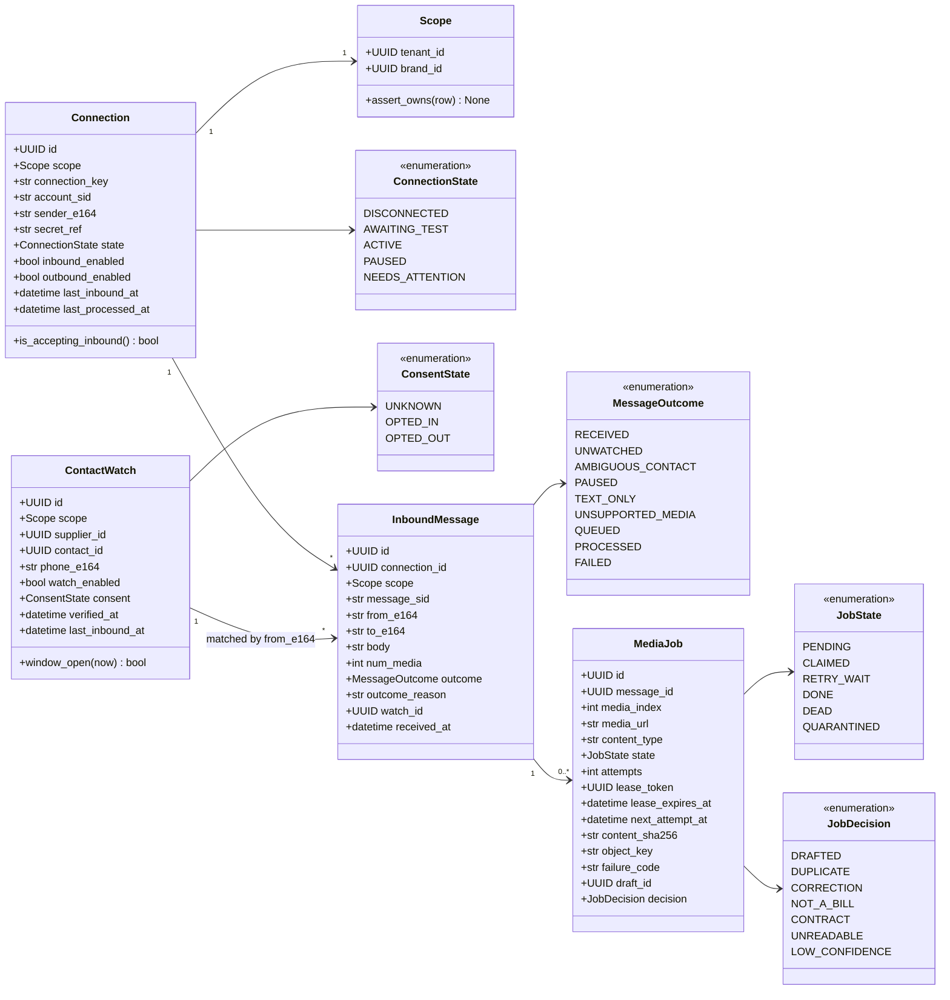
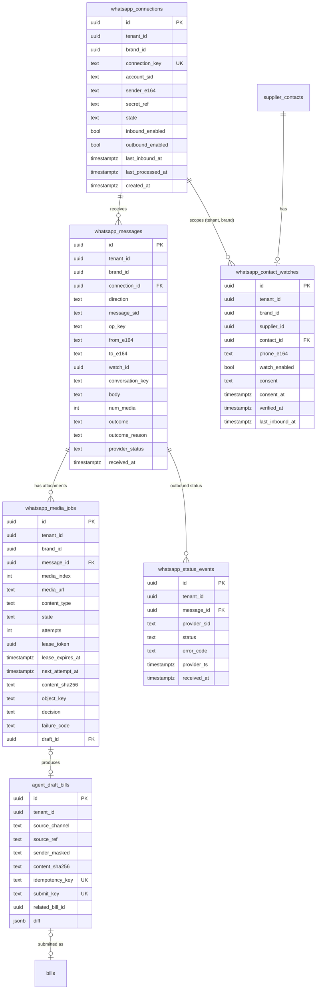
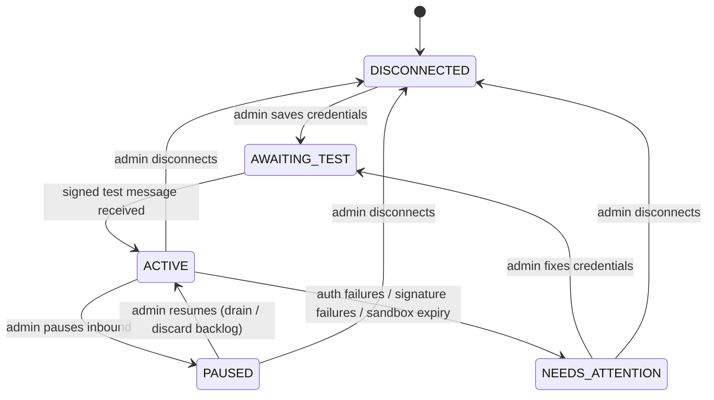
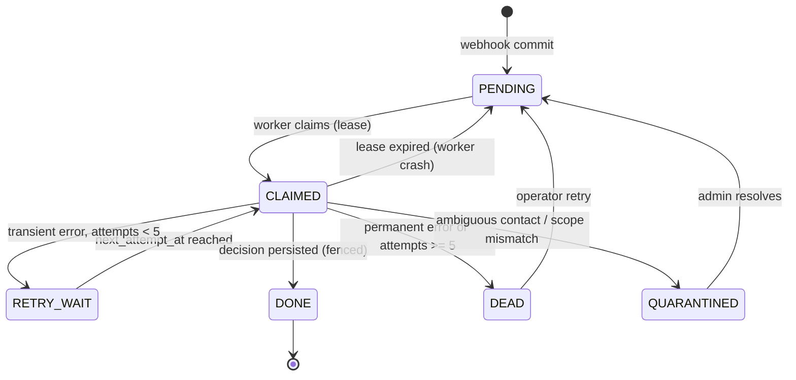
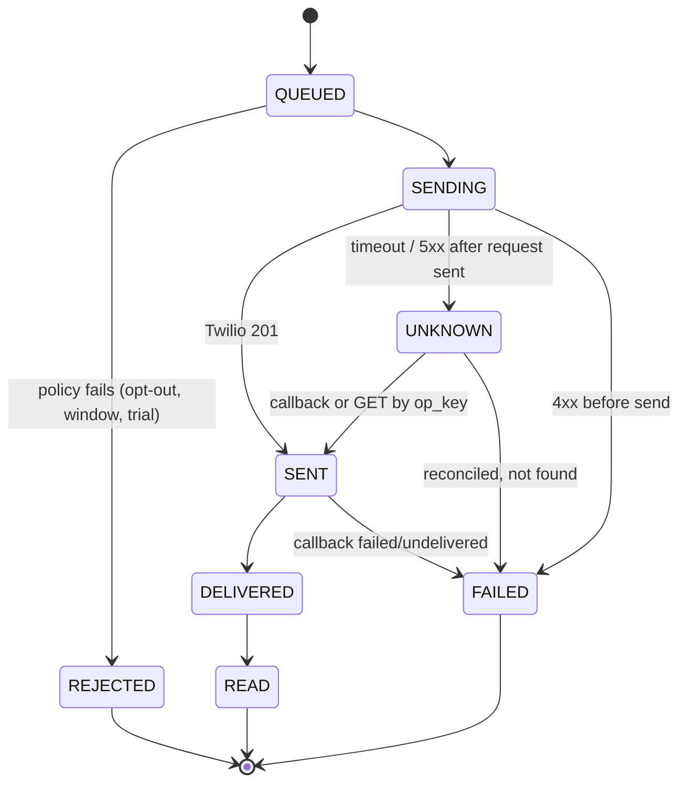
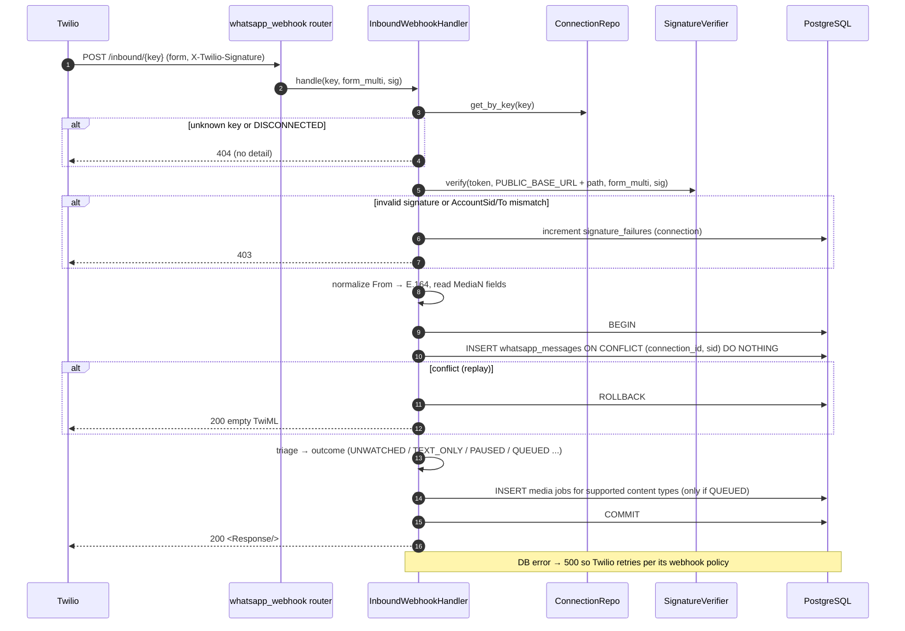
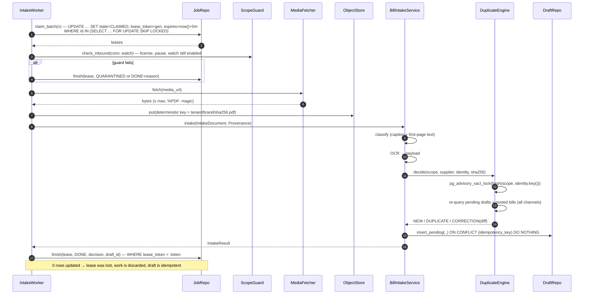
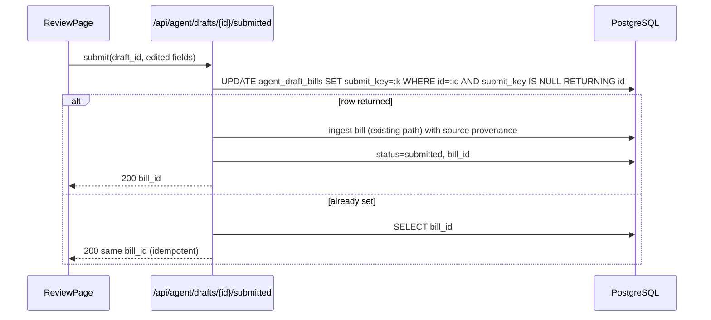

# WhatsApp Agent: low-level design

**Status:** Proposed · Builds on the [HLD](02-hld.md). Class and module names are implementation targets.

## 1. Module layout

```text
backend_ocr/app/
├── integrations/
│   └── twilio_whatsapp.py        # TwilioClient, SignatureVerifier, MediaFetcher, StatusMapper
├── domain/
│   ├── bill_intake.py            # BillIntakeService, IntakeDocument, Provenance, IntakeResult
│   ├── dedupe.py                 # DuplicateEngine, InvoiceIdentity, DedupeDecision
│   └── classification.py         # DocumentClassifier (moved from agent.py)
├── agents/whatsapp/
│   ├── models.py                 # dataclasses + enums below
│   ├── repository.py             # ConnectionRepo, WatchRepo, MessageRepo, JobRepo, OutboxRepo
│   ├── ingress.py                # InboundWebhookHandler
│   ├── worker.py                 # IntakeWorker, JobLease
│   ├── outbox.py                 # OutboundSender, SendPolicy
│   └── scope.py                  # Scope, ScopeGuard
├── routers/
│   ├── whatsapp_webhook.py       # public webhooks (no session auth, signature auth)
│   ├── whatsapp_agent.py         # Agent Hub endpoints
│   └── whatsapp_conversations.py # R2 conversations + replies
└── routers/agent.py              # refactored: email path calls BillIntakeService
```

## 2. Class diagram: domain and models



## 3. Class diagram: services

```mermaid
classDiagram
    direction TB

    class InboundWebhookHandler {
        -ConnectionRepo connections
        -SignatureVerifier verifier
        -MessageRepo messages
        -JobRepo jobs
        -WatchRepo watches
        +handle(connection_key, form, signature) Response
        -normalize(form) TwilioInbound
        -triage(conn, inbound) MessageOutcome
    }

    class SignatureVerifier {
        -str public_base_url
        +verify(auth_token, url_path, form_multi, signature) bool
    }

    class TwilioClient {
        -str account_sid
        -SecretRef token
        +fetch_media(url, max_bytes) bytes
        +create_message(to, body, template_sid, status_cb) str
        +get_message(sid) dict
    }

    class MediaFetcher {
        -list~str~ allowed_hosts
        -int max_bytes
        -int timeout_s
        +fetch(client, url) FetchedMedia
        -check_redirect(location) None
        -sniff_pdf(head) bool
    }

    class IntakeWorker {
        -JobRepo jobs
        -ScopeGuard guard
        -MediaFetcher fetcher
        -BillIntakeService intake
        -ObjectStore store
        -int batch_size
        +run_forever() None
        +drain(scope, limit) int
        -process(lease) None
        -backoff(attempts) timedelta
    }

    class JobLease {
        +UUID job_id
        +UUID lease_token
        +datetime expires_at
        +heartbeat() None
    }

    class ScopeGuard {
        +check_inbound(conn, watch) GuardResult
        +license_active(scope, service) bool
    }

    class BillIntakeService {
        -DocumentClassifier classifier
        -OcrRunner ocr
        -DuplicateEngine dedupe
        -DraftRepo drafts
        +intake(doc, prov) IntakeResult
    }

    class IntakeDocument {
        +bytes pdf
        +str filename
        +str sha256
        +str caption
    }

    class Provenance {
        +Scope scope
        +Channel channel
        +str source_ref
        +UUID supplier_id
        +UUID contact_id
        +str sender_masked
        +str conversation_key
        +str idempotency_key
    }

    class Channel {
        <<enumeration>>
        EMAIL
        WHATSAPP
        UPLOAD
    }

    class IntakeResult {
        +JobDecision decision
        +UUID draft_id
        +UUID related_draft_id
        +UUID related_bill_id
        +dict diff
        +str reason
    }

    class DocumentClassifier {
        +classify(text, pdf_text) Classification
    }

    class OcrRunner {
        +run(pdf_path) dict
    }

    class DuplicateEngine {
        +decide(scope, supplier_id, identity, sha256) DedupeDecision
        -lock_identity(identity) None
        -candidates(scope, supplier_id, identity) list
    }

    class InvoiceIdentity {
        +UUID supplier_id
        +str invoice_number_norm
        +Decimal total
        +date invoice_date
        +str gstin
        +key() str
    }

    class DraftRepo {
        +insert_pending(prov, payload, analysis) UUID
        +find_by_idempotency(key) UUID
    }

    class OutboundSender {
        -OutboxRepo outbox
        -SendPolicy policy
        -TwilioClient client
        +enqueue(scope, watch_id, body, template, op_key) UUID
        +dispatch_once() None
        +reconcile_unknown() None
    }

    class SendPolicy {
        +evaluate(watch, conn, template, now) PolicyResult
    }

    class StatusMapper {
        +apply(current, incoming) OutboundStatus
    }

    InboundWebhookHandler --> SignatureVerifier
    InboundWebhookHandler ..> TwilioClient : none at ingress
    IntakeWorker --> JobLease
    IntakeWorker --> ScopeGuard
    IntakeWorker --> MediaFetcher
    MediaFetcher --> TwilioClient
    IntakeWorker --> BillIntakeService
    BillIntakeService --> DocumentClassifier
    BillIntakeService --> OcrRunner
    BillIntakeService --> DuplicateEngine
    BillIntakeService --> DraftRepo
    BillIntakeService ..> IntakeDocument
    BillIntakeService ..> Provenance
    BillIntakeService ..> IntakeResult
    Provenance --> Channel
    DuplicateEngine ..> InvoiceIdentity
    OutboundSender --> SendPolicy
    OutboundSender --> TwilioClient
    OutboundSender --> StatusMapper
```



### Notes on the extraction from `agent.py`

| Today in `agent.py` | Moves to |
|---|---|
| `classify_email_is_bill`, `classify_email_document` | `DocumentClassifier` (channel-neutral prompt, subject/caption is optional) |
| `analyze_duplicate`, `_prior_invoices_in_thread` | `DuplicateEngine` (thread is one hint among several, not the key) |
| Draft insert inside `_scan_connection` | `DraftRepo.insert_pending` |
| `_claim_message` / `_release_claim` | Stays for email. WhatsApp uses `JobRepo` leases |

`_scan_connection` becomes: fetch Gmail message → build `IntakeDocument` + `Provenance(channel=EMAIL)` → `BillIntakeService.intake`. Email outcomes must stay exactly the same (covered by regression tests in [07-e2e-plan](07-e2e-plan.md)).

## 4. Database schema (ERD)



### DDL highlights

```sql
-- Additive changes to the existing draft table (readers tolerate NULLs first)
ALTER TABLE agent_draft_bills
  ADD COLUMN IF NOT EXISTS source_channel  text NOT NULL DEFAULT 'email',
  ADD COLUMN IF NOT EXISTS source_ref      text,
  ADD COLUMN IF NOT EXISTS brand_id        uuid,
  ADD COLUMN IF NOT EXISTS sender_masked   text,
  ADD COLUMN IF NOT EXISTS content_sha256  text,
  ADD COLUMN IF NOT EXISTS idempotency_key text,
  ADD COLUMN IF NOT EXISTS submit_key      text,
  ADD COLUMN IF NOT EXISTS related_bill_id uuid,
  ADD COLUMN IF NOT EXISTS diff            jsonb;
CREATE UNIQUE INDEX IF NOT EXISTS uq_adb_idem   ON agent_draft_bills (tenant_id, idempotency_key) WHERE idempotency_key IS NOT NULL;
CREATE UNIQUE INDEX IF NOT EXISTS uq_adb_submit ON agent_draft_bills (tenant_id, submit_key)      WHERE submit_key IS NOT NULL;
CREATE INDEX        IF NOT EXISTS ix_adb_sha    ON agent_draft_bills (tenant_id, content_sha256);

-- One active binding per provider account+sender
CREATE UNIQUE INDEX uq_wac_binding ON whatsapp_connections (account_sid, sender_e164)
  WHERE state <> 'DISCONNECTED';

-- One active watch per number per brand (conflicts → quarantine)
CREATE UNIQUE INDEX uq_wcw_active ON whatsapp_contact_watches (tenant_id, brand_id, phone_e164)
  WHERE watch_enabled;

-- Idempotent inbound and outbound
CREATE UNIQUE INDEX uq_wam_sid ON whatsapp_messages (connection_id, message_sid) WHERE message_sid IS NOT NULL;
CREATE UNIQUE INDEX uq_wam_op  ON whatsapp_messages (tenant_id, op_key)          WHERE op_key IS NOT NULL;

-- One job per attachment, plus a fast queue scan
CREATE UNIQUE INDEX uq_wmj_media ON whatsapp_media_jobs (message_id, media_index);
CREATE INDEX ix_wmj_ready ON whatsapp_media_jobs (state, next_attempt_at)
  WHERE state IN ('PENDING','RETRY_WAIT','CLAIMED');
```

Idempotency keys:

| Key | Formula |
|---|---|
| Draft `idempotency_key` | `whatsapp:{connection_id}:{message_sid}:{media_index}` (email: `email:{gmail_id}:{attachment_index}`) |
| `submit_key` | Set once in the same `UPDATE … WHERE submit_key IS NULL` that starts ingest. A second submit reads the existing bill |
| Outbound `op_key` | Client-generated UUID per Send click |

## 5. State machines

### 5.1 Connection



### 5.2 Media job



Backoff: `min(30s × 2^attempts, 30 min)` with ±20% jitter.

### 5.3 Outbound message (R2)



`StatusMapper` uses rank `queued < sent < delivered < read`. `failed`/`undelivered` are terminal. Out-of-order callbacks never move a message to a lower rank.

## 6. Sequences

### 6.1 Webhook ingress



### 6.2 Worker processing one job



### 6.3 Submit draft (exactly one bill)



## 7. API contracts

All endpoints except webhooks need a session and `require_tenant`, and are mapped to the `whatsapp_agent` entitlement in `licensing.py`. `brand_id` is required and checked against the caller's allowed brands.

| Method & path | Body / query | Response | Notes |
|---|---|---|---|
| `GET /api/agent/whatsapp/status` | `brand_id` | `{state, inbound_enabled, outbound_enabled, last_inbound_at, last_processed_at, counts:{queued,retrying,dead,quarantined,drafts_pending}}` | |
| `GET /api/agent/whatsapp/events` | `brand_id, outcome?, supplier_id?, from?, to?, cursor?, limit≤100` | `{items:[{id, received_at, sender_masked, vendor, outcome, reason, draft_id}], next_cursor}` | Keyset pagination |
| `PUT /api/agent/whatsapp/connection` | `{brand_id, account_sid, auth_token, sender_e164}` | `{connection_key, webhook_url, status_url, state:"AWAITING_TEST"}` | Admin only. Token → secret store |
| `DELETE /api/agent/whatsapp/connection` | `brand_id` | `204` | Sets DISCONNECTED and clears the secret |
| `PATCH /api/agent/whatsapp/settings` | `{brand_id, inbound_enabled?, outbound_enabled?, backlog_action?: "drain"\|"discard"}` | status | |
| `POST /api/agent/whatsapp/refresh` | `{brand_id}` | `{drained:int}` | Rate limit 1 per 30 s per scope. Drains ≤ 20 |
| `POST /api/agent/whatsapp/jobs/{id}/retry` | — | job | DEAD → PENDING, `attempts=0` |
| `PATCH /api/vendors/{supplier_id}/contacts/{contact_id}/whatsapp-watch` | `{enabled, phone_e164}` | watch | 409 if the number is watched elsewhere in the brand |
| `GET /api/agent/drafts` | existing + `channel?` | existing + `source_channel, sender_masked` | Backward compatible |
| `GET /api/vendors/{supplier_id}/whatsapp/conversations` | `brand_id` | list | R2 |
| `POST /api/vendors/{supplier_id}/whatsapp/reply` | `{contact_id, body?, template_sid?, op_key}` | `{status}` | R2. 422 with `reason` on policy failure |
| `POST /api/webhooks/twilio/whatsapp/{key}/inbound` | Twilio form | empty TwiML | Signature auth |
| `POST /api/webhooks/twilio/whatsapp/{key}/status` | Twilio form | `204` | Signature auth. Idempotent |

### Error codes (`failure_code` / `outcome_reason`)

| Code | Meaning | Retry? |
|---|---|---|
| `MEDIA_FETCH_TIMEOUT` | Twilio media took too long | Yes |
| `MEDIA_TOO_LARGE` | Over the size limit | No |
| `MEDIA_NOT_PDF` | Content type or magic bytes are not PDF | No |
| `MEDIA_HOST_BLOCKED` | Redirect to a host not on the allowlist | No |
| `PDF_ENCRYPTED` / `PDF_CORRUPT` | Can't be read | No → review |
| `CLASSIFIER_UNAVAILABLE` | LLM error or timeout | Yes |
| `CLASSIFIER_LOW_CONFIDENCE` | Below the confidence floor | No → review |
| `OCR_FAILED` | OCR error | Yes (3 times), then review |
| `CONTACT_AMBIGUOUS` | Number watched by more than one vendor | No → quarantine |
| `LICENSE_INACTIVE` / `CONNECTION_PAUSED` | Scope gate | Kept until resumed |

## 8. Config

| Variable | Default | Purpose |
|---|---|---|
| `PUBLIC_BASE_URL` | — (required) | Exact URL Twilio signs |
| `WA_WORKER_ENABLED` | `false` | Turn the worker on in this process |
| `WA_WORKER_CONCURRENCY` | `2` | Jobs processed in parallel |
| `WA_LEASE_SECONDS` | `300` | Job lease length (heartbeat every 60 s during OCR) |
| `WA_MAX_ATTEMPTS` | `5` | Then DEAD |
| `WA_MEDIA_MAX_BYTES` | `16777216` | Size limit |
| `WA_MEDIA_HOSTS` | `api.twilio.com,*.twiliocdn.com` | Allowed media hosts |
| `WA_CLASSIFY_CONFIDENCE_FLOOR` | `0.6` | Below this → review |

## 9. Logging and redaction

- Log `tenant_id`, `brand_id`, `connection_id`, `message_id`, `job_id`, `decision`, `failure_code`, `latency_ms`.
- Never log: full phone numbers (mask to last 3 digits), message body, OCR payload, media URLs with credentials, auth tokens.
- Trace ID = `message_id`, passed from ingress through worker to draft.
