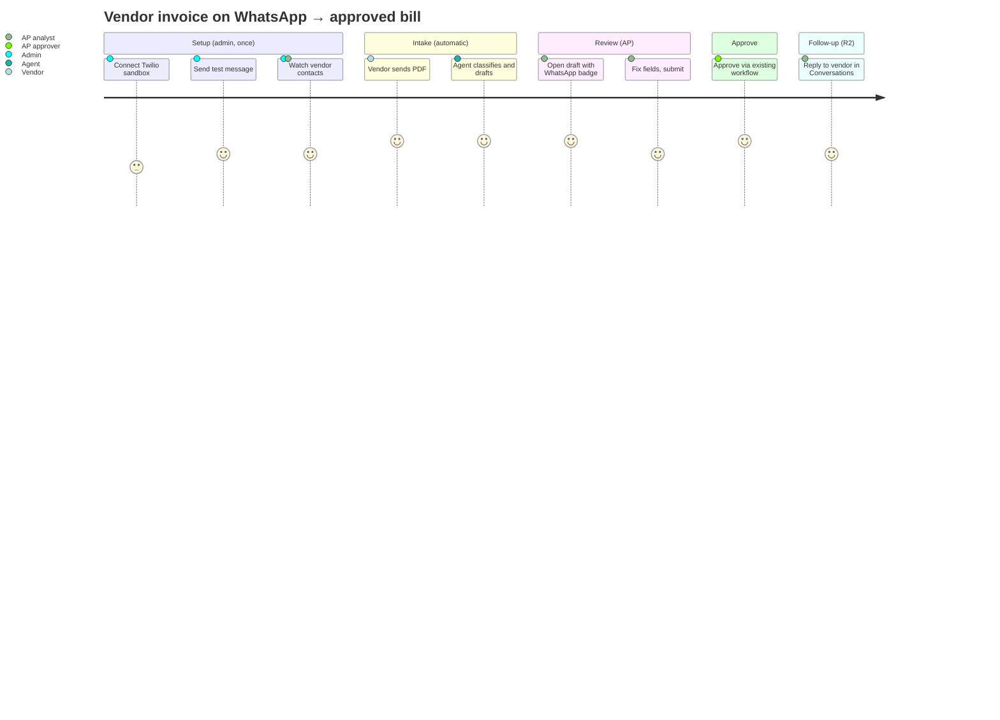
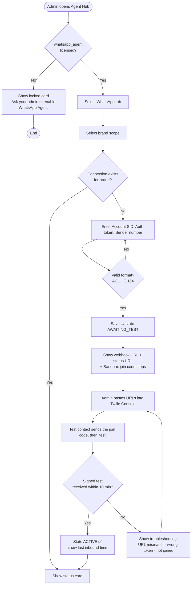
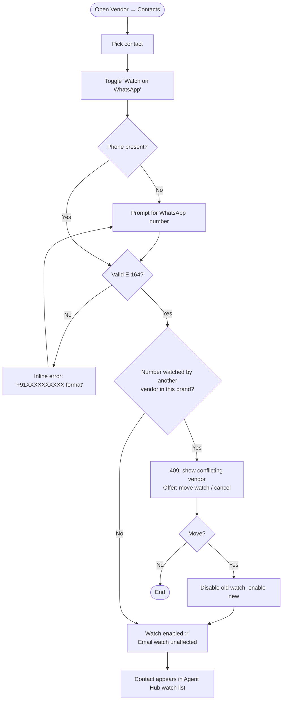
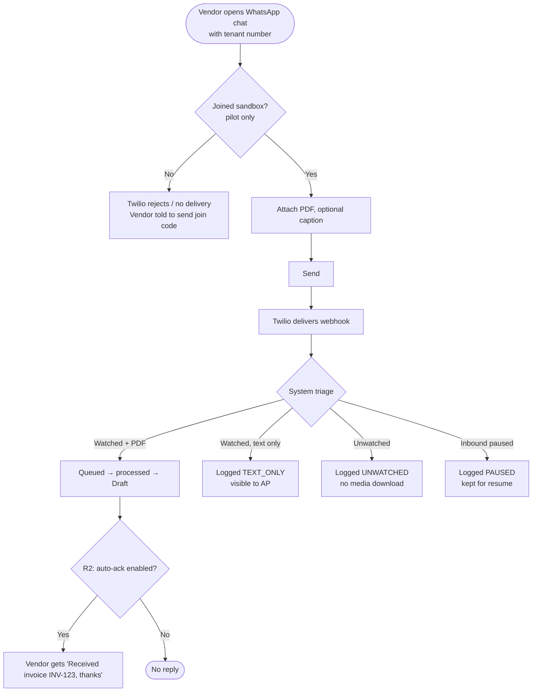
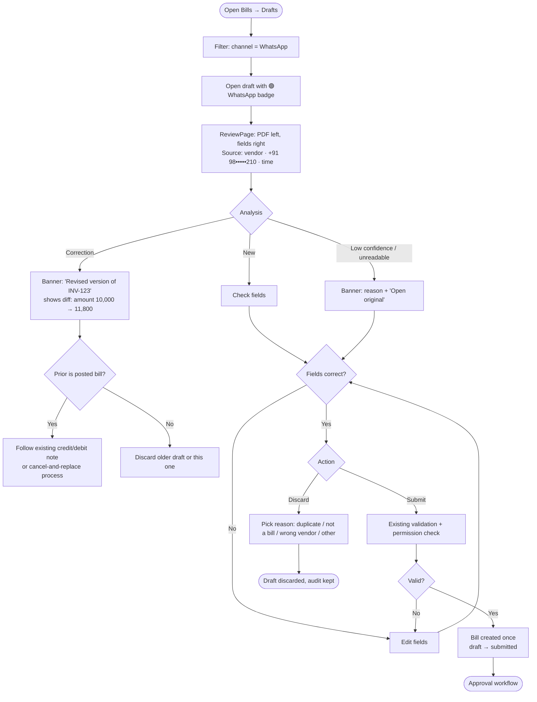
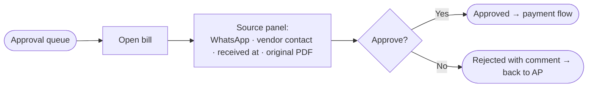
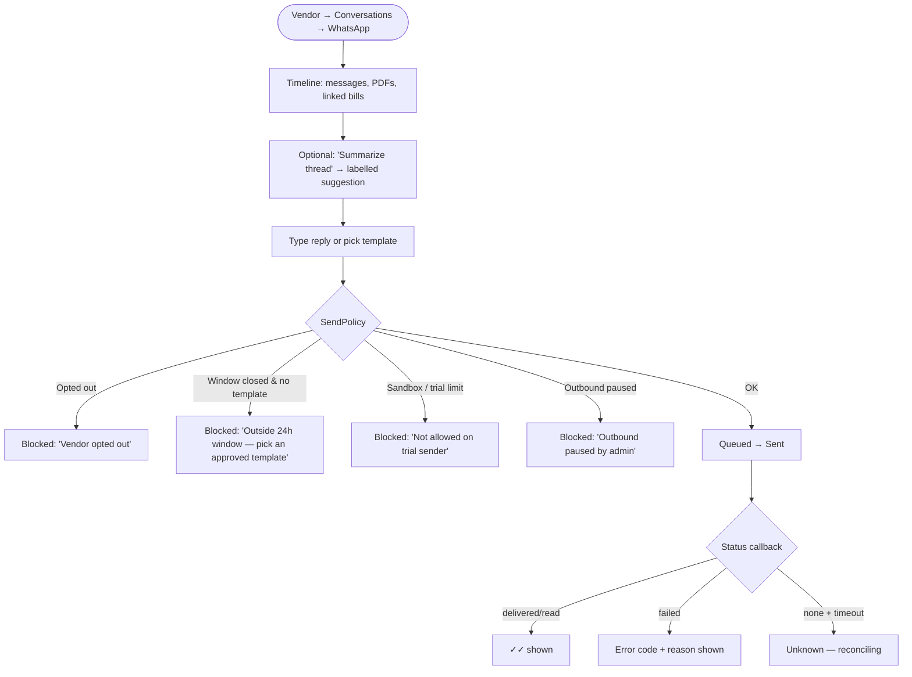
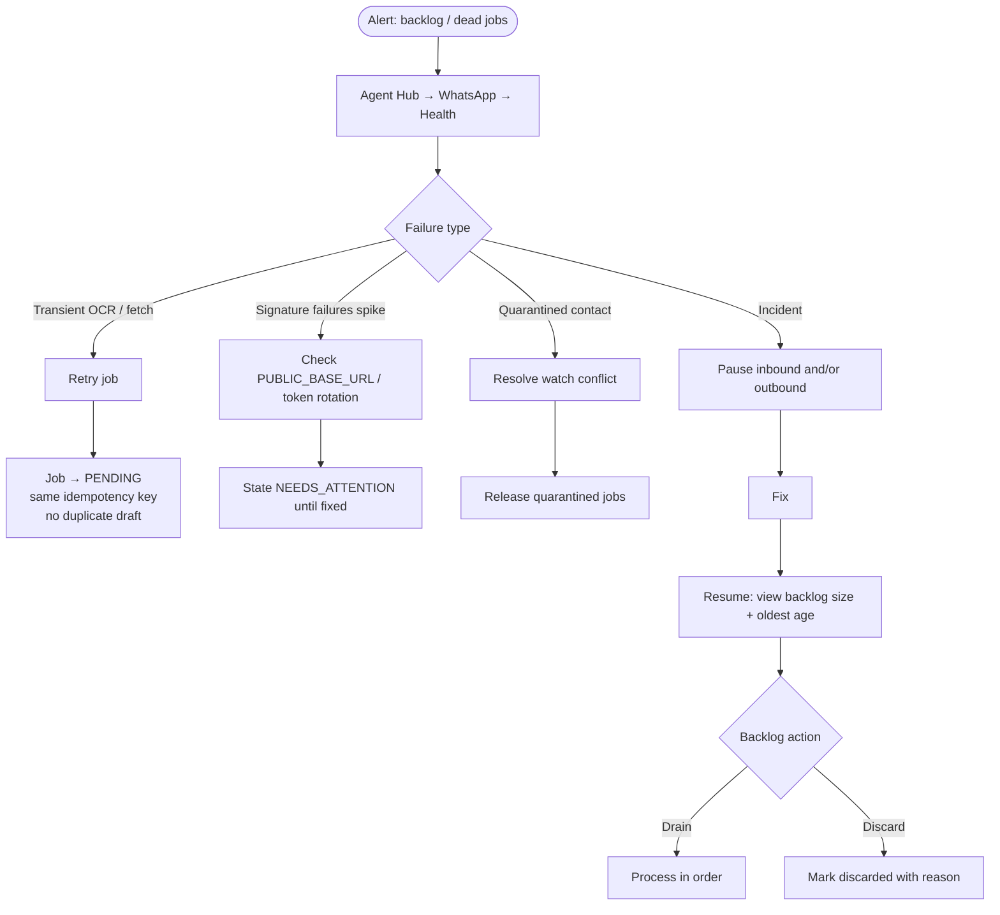
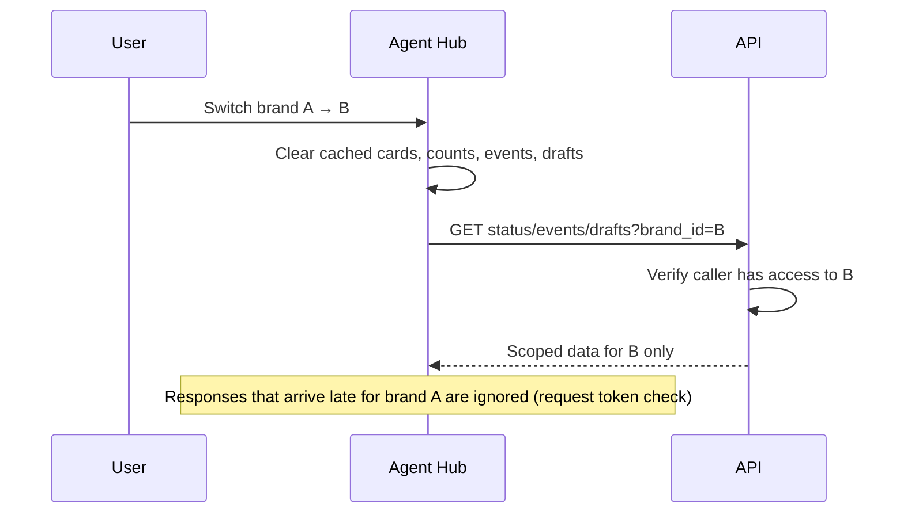

# WhatsApp Agent: user flows

**Status:** Proposed · Screens referenced: Agent Hub ([AgentHubPage.tsx](../../frontend/src/pages/AgentHubPage.tsx)), Bills → Drafts ([BillsPage.tsx](../../frontend/src/pages/BillsPage.tsx)), ReviewPage, Vendor → Contacts, Vendor Conversations.

## 0. Journey overview

## 1. Admin: connect WhatsApp

## 2. Admin / AP: watch a vendor contact

## 3. Vendor: send an invoice

## 4. AP analyst: review and submit a WhatsApp draft

## 5. AP approver: approve with provenance

## 6. AP analyst: follow up with a vendor (R2)

## 7. Operator: recover from failures

## 8. Brand switching (UI rule)

