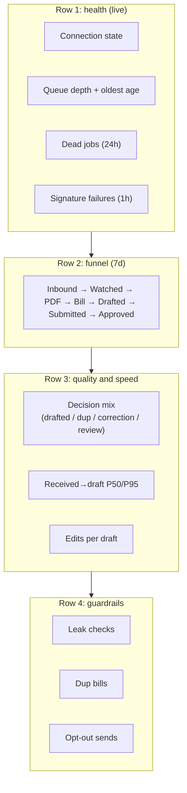

# WhatsApp Agent: success metrics

**Status:** Proposed · Targets are for the R1 Sandbox pilot unless a column says otherwise. Baselines come from the Email Agent where available.

## 1. Metric tree

```mermaid
flowchart TD
    NS["⭐ North star<br/>% of WhatsApp vendor invoices that become<br/>a correct submitted bill with no manual re-upload"]
    NS --> A["Adoption"]
    NS --> Q["Quality"]
    NS --> S["Speed"]
    NS --> R["Reliability"]
    NS --> G["Guardrails (must not regress)"]

    A --> A1["Watched contacts"]
    A --> A2["Active vendors / week"]
    A --> A3["Share of bills via WhatsApp"]

    Q --> Q1["Actionable invoice yield"]
    Q --> Q2["Classifier precision / recall"]
    Q --> Q3["Field accuracy (edits per draft)"]
    Q --> Q4["Duplicate suppression rate"]

    S --> S1["Webhook ack P95"]
    S --> S2["Received → draft P95"]
    S --> S3["Draft → submitted median"]

    R --> R1["Job success rate"]
    R --> R2["Dead-letter rate"]
    R --> R3["Oldest queued age"]

    G --> G1["Cross-tenant leaks = 0"]
    G --> G2["Duplicate bills = 0"]
    G --> G3["Unauthorized sends = 0"]
    G --> G4["Email agent regressions = 0"]
```



## 2. KPIs

### 2.1 North star

| Metric | Formula | Pilot target | Production target |
|---|---|---|---|
| **Straight-through intake rate** | submitted bills with `source_channel='whatsapp'` ÷ valid invoice PDFs received from watched contacts | ≥ 80% | ≥ 90% |

"Valid invoice PDF" is the ground truth from the labelled pilot set (synthetic) or the analyst's discard reason (production).

### 2.2 Adoption

| Metric | Formula | Target (pilot) |
|---|---|---|
| Connected brands | count of `whatsapp_connections.state='ACTIVE'` | ≥ 1 internal, 2 test tenants for isolation |
| Watched contacts | count of `watch_enabled` | ≥ 10 |
| Weekly active vendors | distinct `watch_id` with an inbound message in 7 days | ≥ 5 |
| WhatsApp share of agent drafts | WA drafts ÷ all agent drafts | Tracked only (no target in pilot) |

### 2.3 Quality

| Metric | Formula | Target |
|---|---|---|
| Actionable invoice yield | DRAFTED ÷ (PDF jobs from watched contacts) | ≥ 85% |
| Classifier precision (bill) | true bills ÷ predicted bills | ≥ 95% |
| Classifier recall (bill) | predicted bills ÷ true bills | ≥ 90% |
| OCR field accuracy | correct fields ÷ key fields (vendor, number, date, subtotal, tax, total, GSTIN) | ≥ 92% |
| Edits per draft | avg fields changed between draft payload and submitted bill | ≤ 1.0 |
| Duplicate suppression | DUPLICATE decisions ÷ actual duplicates in test set | 100% exact, ≥ 95% re-scanned |
| False duplicate rate | genuine new invoices marked DUPLICATE ÷ all DUPLICATE | ≤ 1% |
| Correction detection | CORRECTION ÷ seeded revisions | ≥ 95% |
| Discard rate | discarded ÷ drafts (by reason) | ≤ 10% (excluding duplicates) |

### 2.4 Speed

| Metric | Formula | Target |
|---|---|---|
| Webhook acknowledgement | P95 of ingress handler time | < 2 s (goal < 300 ms) |
| Received → draft | P95 of `draft.created_at − message.received_at` | < 2 min |
| Draft → submitted | median time a draft waits for a person | < 4 working hours |
| Total cycle | median of received → approved | Baseline ×0.5 vs manual WhatsApp handling |
| AP minutes saved | (manual minutes per invoice − review minutes) × drafts | Report weekly |

### 2.5 Reliability

| Metric | Formula | Target |
|---|---|---|
| Job success rate | DONE ÷ (DONE + DEAD) | ≥ 99% |
| Dead-letter rate | DEAD ÷ jobs | ≤ 1% |
| Retry rate | jobs with attempts > 1 ÷ jobs | ≤ 10% |
| Oldest queued job age | `now() − min(created_at)` WHERE PENDING/RETRY_WAIT | < 5 min (alert at 10) |
| Signature failure rate | 403 ÷ webhook calls | ~0. Alert at > 5 in 10 min |
| Unmatched sender rate | UNWATCHED ÷ inbound | Tracked. Spikes = onboarding gap |
| Outbound delivery (R2) | delivered ÷ sent | ≥ 97% |
| Outbound unknown (R2) | UNKNOWN still unresolved after 30 min | 0 |

### 2.6 Guardrails (zero tolerance)

| Guardrail | How measured | Target |
|---|---|---|
| Cross-tenant/brand exposure | Isolation suite + audit-log query for scope mismatches | **0** |
| Duplicate bills from one source | `count(bills) group by draft_id > 1` | **0** |
| Drafts per source item > 1 | `count(drafts) group by idempotency_key > 1` | **0** |
| Agent-initiated payment or bank change | audit of payment / bank-detail writes with actor = agent | **0** |
| Sends to opted-out contacts | outbox join consent | **0** |
| Email Agent regression | email golden tests + email yield week over week | No drop > 2 pts |

### 2.7 Cost

| Metric | Formula | Target |
|---|---|---|
| Twilio units used | from Console / usage API | Within 100 trial units for the pilot |
| LLM cost per document | classifier tokens × price | ≤ ₹1 |
| OCR cost per document | OCR engine cost | Same as email |

## 3. Instrumentation

| Event | Emitted at | Fields |
|---|---|---|
| `wa.inbound.received` | ingress commit | tenant, brand, connection, outcome, num_media, ack_ms |
| `wa.job.claimed` | worker | job, attempt, queue_age_ms |
| `wa.job.finished` | worker | job, state, decision, failure_code, duration_ms, ocr_ms, classify_ms |
| `wa.draft.submitted` | submit API | draft, bill, edits_count, wait_ms |
| `wa.draft.discarded` | discard API | draft, reason |
| `wa.outbound.status` | status callback | op, status, error_code |

All events go to the existing logging pipeline with the redaction rules from [LLD §9](03-lld.md#9-logging-and-redaction). Counts used in the dashboard come from SQL over the tables, so they can be checked against the events.

### Sample queries

```sql
-- Received → draft P95 (last 7 days)
SELECT percentile_cont(0.95) WITHIN GROUP (ORDER BY extract(epoch FROM d.created_at - m.received_at))
FROM whatsapp_media_jobs j
JOIN whatsapp_messages m ON m.id = j.message_id
JOIN agent_draft_bills d ON d.id = j.draft_id
WHERE m.tenant_id = :t AND m.received_at > now() - interval '7 days';

-- Guardrail: more than one draft per source item
SELECT idempotency_key, count(*) FROM agent_draft_bills
WHERE source_channel = 'whatsapp' GROUP BY 1 HAVING count(*) > 1;

-- Outcome mix
SELECT outcome, count(*) FROM whatsapp_messages
WHERE tenant_id = :t AND brand_id = :b AND received_at > now() - interval '7 days'
GROUP BY 1 ORDER BY 2 DESC;
```

## 4. Dashboard layout



## 5. Alerts

| Alert | Condition | Severity | Action |
|---|---|---|---|
| Queue stuck | oldest queued > 10 min | High | Check worker process, OCR health |
| Dead spike | > 5 DEAD in 15 min | High | Inspect `failure_code`, pause if systemic |
| Signature failures | > 5 in 10 min | High | Token rotation or URL mismatch → NEEDS_ATTENTION |
| No test events | no inbound for 24 h on an ACTIVE pilot connection | Medium | Sandbox enrollment likely expired |
| Guardrail breach | any zero-tolerance query > 0 | Critical | Pause inbound + outbound, incident |
| Trial units low | < 15 remaining | Medium | Pause outbound, plan demo usage |

## 6. Pilot exit scorecard

The pilot exits to production planning when **all** of these hold over a 2-week window:

| # | Gate | Threshold |
|---|---|---|
| 1 | All acceptance cases (PRD §7) | Pass |
| 2 | Guardrails | All zero |
| 3 | Straight-through intake | ≥ 80% |
| 4 | Received → draft P95 | < 2 min |
| 5 | Job success | ≥ 99% |
| 6 | Two-tenant isolation suite | Pass, signed off by security reviewer |
| 7 | Email agent regression | None |
| 8 | Stakeholder sign-off | Product, AP lead, security, explicit approval for real vendor data |
