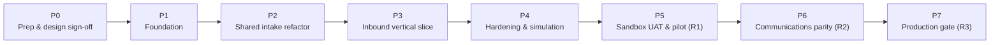
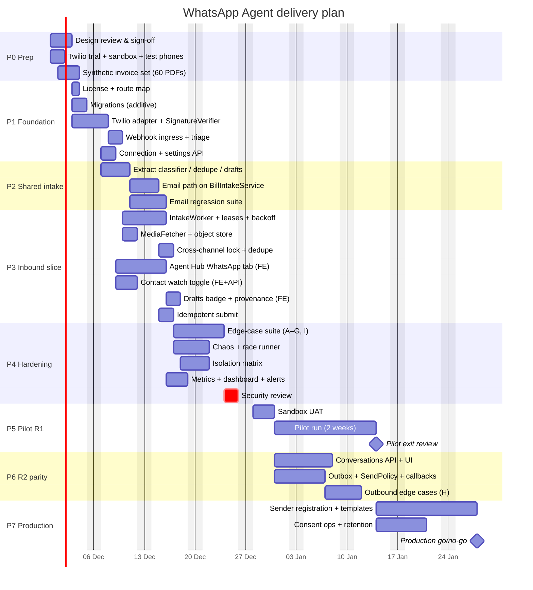
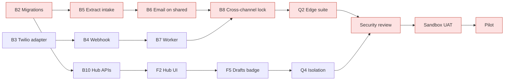
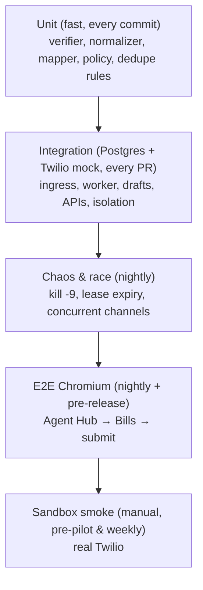
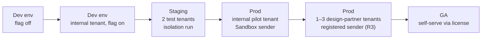

# WhatsApp Agent: end-to-end plan

**Status:** Proposed · **Planning start:** Mon 30 Nov 2026 · Dates are targets and assume 2 backend, 1 frontend and 0.5 QA engineers.

## 1. Phases at a glance

| Phase | Goal | Exit criteria |
|---|---|---|
| **P0** Prep | Docs approved, Twilio trial created, fixtures ready | PRD/HLD/LLD signed off. Sandbox number + 2 test phones joined |
| **P1** Foundation | License, schema, adapter, verified webhook | Signed fixture → row saved. Forged → 403. Replay → 1 row |
| **P2** Shared intake | `BillIntakeService` extracted. Email uses it | Email golden tests identical before/after. No API changes |
| **P3** Inbound slice | Worker → draft → Drafts badge → submit | PRD A1–A4 pass in integration |
| **P4** Hardening | Edge-case suite, chaos, isolation | All I1–I3, I5 cases green. Chaos ×3 |
| **P5** Pilot R1 | Real Sandbox, synthetic invoices, internal users | Pilot scorecard ([metrics §6](06-success-metrics.md#6-pilot-exit-scorecard)) |
| **P6** R2 parity | Conversations, outbound, callbacks | PRD A8 + H-series pass |
| **P7** Production | Registered sender, templates, consent ops | Production checklist §8 complete |

## 2. Timeline

## 3. Work breakdown

### Backend

| ID | Task | Est | Depends | Files |
|---|---|---|---|---|
| B1 | Add `whatsapp_agent` ServiceDef (default off) + route map entries | 0.5d | — | `security/services.py`, `security/licensing.py` |
| B2 | Migrations: 5 new tables + additive `agent_draft_bills` columns + indexes | 1.5d | — | `migrations.py` |
| B3 | `TwilioClient`, `SignatureVerifier`, `MediaFetcher`, `StatusMapper` | 3d | — | `integrations/twilio_whatsapp.py` |
| B4 | `InboundWebhookHandler` + router (no session auth, signature auth) | 2d | B2, B3 | `routers/whatsapp_webhook.py` |
| B5 | Extract `DocumentClassifier`, `DuplicateEngine`, `DraftRepo`, `BillIntakeService` | 4d | B2 | `domain/*`, `routers/agent.py` |
| B6 | Email path calls `BillIntakeService` (behaviour unchanged) | 2d | B5 | `routers/agent.py` |
| B7 | `IntakeWorker` (claim/lease/heartbeat/backoff/fencing) + startup hook | 4d | B2, B3 | `agents/whatsapp/worker.py`, `main.py` |
| B8 | Advisory lock + cross-channel candidate query | 2d | B5 | `domain/dedupe.py` |
| B9 | Idempotent submit (`submit_key`) | 2d | B2 | `routers/agent.py` |
| B10 | Agent Hub APIs: status, events, connection, settings, refresh, retry | 3d | B2 | `routers/whatsapp_agent.py` |
| B11 | Watch API with conflict detection | 1.5d | B2 | `routers/whatsapp_agent.py` |
| B12 | Orphan object sweeper | 1d | B7 | `agents/whatsapp/maintenance.py` |
| B13 (R2) | Conversations API, summary, save attachment, manual draft | 4d | B10 | `routers/whatsapp_conversations.py` |
| B14 (R2) | Outbox, SendPolicy, status callback, unknown-state reconciler | 5d | B3 | `agents/whatsapp/outbox.py` |

### Frontend

| ID | Task | Est | Depends | Files |
|---|---|---|---|---|
| F1 | API client additions | 1d | B10 | `api/agent.ts` |
| F2 | Agent Hub channel tabs + WhatsApp connection card + setup wizard | 3d | F1 | `pages/AgentHubPage.tsx` |
| F3 | Activity feed with filters + brand-switch clearing | 2d | F1 | `pages/AgentHubPage.tsx` |
| F4 | Watch toggle on vendor contacts + conflict dialog | 2d | B11 | vendor contact components |
| F5 | Drafts WhatsApp badge, channel filter, source panel, correction diff banner | 2d | B5 | `pages/BillsPage.tsx`, ReviewPage |
| F6 | Health panel: queue, dead jobs, retry, pause/resume with backlog choice | 2d | B10 | `pages/AgentHubPage.tsx` |
| F7 (R2) | Vendor Conversations WhatsApp timeline + reply composer with policy reasons | 4d | B13, B14 | vendor conversation pages |

### QA, ops and other

| ID | Task | Est |
|---|---|---|
| Q1 | Signed fixture generator + Twilio mock | 1.5d |
| Q2 | Edge-case suite ([05](05-edge-case-simulation.md)) | 5d |
| Q3 | Chaos + race runner | 3d |
| Q4 | Isolation matrix (2 tenants × 2 brands) | 2d |
| Q5 | Playwright/Chromium e2e: connect → watch → draft → submit | 2d |
| O1 | `PUBLIC_BASE_URL`, secrets, worker process config per environment | 1d |
| O2 | Dashboard + alerts ([06](06-success-metrics.md)) | 3d |
| O3 | Runbook: rotate token, rejoin sandbox, drain backlog, rollback | 1d |
| D1 | Update `agents/COMMUNICATION_AGENT.md`, `agent-hub/PRD_AGENT_HUB.md`, `full_database_schema.md` | 0.5d |

## 4. Dependency graph (critical path)

The critical path is the **shared-intake refactor**. Start B5 on day 1 of P1, in parallel with the adapter work.

## 5. Test strategy

| Layer | Coverage goal | Gate |
|---|---|---|
| Unit | ≥ 90% lines in `integrations/twilio_whatsapp.py`, `domain/dedupe.py`, `agents/whatsapp/*` | PR |
| Integration | Every PRD acceptance case + every API endpoint × auth | PR |
| Email regression | Golden set of ≥ 30 email scenarios produces identical decisions | PR touching `domain/` or `agent.py` |
| Chaos | F1, F3, F6, E3, G2, H3 | Nightly. Pre-pilot ×3 green |
| E2E | Happy path + correction + brand switch | Pre-release |
| Sandbox | Join, send, draft, (R2) reply | Pre-pilot + weekly during pilot |

### Pilot test data

60 synthetic PDFs: 30 clean invoices, 8 re-sends (exact), 5 re-scans, 6 corrections, 4 non-bills, 3 contracts, 2 encrypted, 2 corrupt. Plus 10 text-only messages and 5 image messages. Each file has a label so quality metrics can be computed automatically.

## 6. Rollout

| Step | Switch | Who decides |
|---|---|---|
| Schema | Deploy additive migrations first, readers tolerate NULL | Backend lead |
| Code | Deploy with `WA_WORKER_ENABLED=false` | Backend lead |
| Enable | Turn on `whatsapp_agent` for the pilot tenant only | Product + platform |
| Worker | `WA_WORKER_ENABLED=true` on one instance | Platform |
| Expand | Per tenant, after scorecard review | Product, AP lead, security |

## 7. Rollback

| Level | Action | Effect | Data |
|---|---|---|---|
| L1 | Pause inbound (settings) | Webhooks still recorded as PAUSED. No processing | Kept |
| L2 | Pause outbound | No sends. Outbox kept | Kept |
| L3 | `WA_WORKER_ENABLED=false` | Queue builds up. Webhooks still acked | Kept |
| L4 | Revoke `whatsapp_agent` license | API 403. Webhooks return 404 for that key | Kept |
| L5 | Revert code | Additive schema remains. Email path reverts to previous build | Kept. Drafts stay reviewable |

Email Agent rollback: if B6 causes a regression, the feature flag `INTAKE_SHARED_EMAIL=false` sends email back to the old in-file path until fixed. Keep that path for one release after P2.

## 8. Production readiness checklist (R3)

- [ ] Registered WhatsApp Business sender, display name approved
- [ ] Message templates approved (invoice received, missing info, payment status)
- [ ] Opt-in capture flow and STOP handling verified
- [ ] Separate production connection. Sandbox history isolated
- [ ] Retention and deletion jobs for messages, PDFs, backups
- [ ] Spending limits and usage alerts on the Twilio account
- [ ] Worker runs as its own process with autoscaling limits
- [ ] Runbook reviewed. On-call knows L1–L5
- [ ] Security review closed (signature, SSRF, isolation, PII logging)
- [ ] Pilot scorecard met

## 9. Roles (RACI)

| Activity | Product | Backend | Frontend | QA | Platform | Security | AP lead |
|---|---|---|---|---|---|---|---|
| PRD & scope | **A/R** | C | C | C | I | C | C |
| HLD/LLD | C | **A/R** | C | C | C | C | I |
| Build | I | **A/R** | **R** | C | C | I | I |
| Edge-case suite | I | C | I | **A/R** | I | C | I |
| Isolation sign-off | I | R | I | R | I | **A** | I |
| Pilot run | **A** | R | R | R | R | I | **R** |
| Go/no-go | **A** | C | C | C | C | C | C |

## 10. Risks and mitigations

| Risk | Likelihood | Impact | Mitigation |
|---|---|---|---|
| Shared-intake refactor breaks email | Med | High | Golden tests, `INTAKE_SHARED_EMAIL` flag, refactor in its own PR |
| Trial units run out before demo | Med | Med | Track usage. Outbound off by default in R1. Use mocks for load |
| Sandbox enrollment expires mid-pilot | High | Low | Weekly rejoin, "no events" alert |
| OCR latency breaks the 2-min SLO | Med | Med | Concurrency 2→4, measure OCR P95 separately |
| Vendors send photos, not PDFs | High | Med | Clear UNSUPPORTED_MEDIA reason + auto-reply template (R2). Image support in v2 |
| Production sender approval delays | Med | High | Start registration as soon as the pilot shows positive results, not after it ends |

## 11. Communication

| When | What | To |
|---|---|---|
| End of each phase | Demo + exit criteria status | Product, eng, AP lead |
| Weekly during pilot | Scorecard snapshot from the dashboard | All stakeholders |
| On guardrail breach | Incident note within 1 h | Security, product, platform |
